# FreyaTTS Tabanlı Türkçe Otomotiv Sesli Asistanı

## M00–M11 Ayrıntılı Mimari, Geliştirme, Akış Şemaları ve Kabul Durumu Dokümantasyonu

> **Belge türü:** Kaynak metne dayalı teknik gelişim ve devir dokümanı  
> **Kapsam:** Mimari kararlar, M00–M11 iş paketleri, A00–A01/A01-YT varlıkları, akış şemaları, bileşenlerin sorumlulukları, sentetik doğrulamalar, kalan riskler ve M11 fiziksel kabul planı  
> **Dayanak:** `FreyaTTS Otomotiv Asistanı - Mimari Öncelikli_.txt` (928 satır)  
> **Kaynak kapsamı:** Kullanıcının sağladığı geliştirme ve kabul anlatısı. Kaynak kod, ZIP dosyaları, test logları, WAV'ler, PBX kayıtları ve gerçek cihaz çıktıları bu dokümantasyon çalışmasında bağımsız olarak çalıştırılmadı.  
> **Son raporlanan durum:** M10 **DRY-RUN PASS**; M11 v1 kabul altyapısı hazırlanmış; **PHYSICAL ACCEPTANCE: HOLD**.

---

## İçindekiler

- [1. Bu belgenin nasıl okunacağı ve kanıt düzeyi](#bolum-01)
- [2. Ürün amacı, mimari gerekçe ve değişmez geliştirme sırası](#bolum-02)
- [3. M00 — Mimari hazırlık, ilk mock çekirdek ve devralınan varlıklar](#bolum-03)
- [4. M01 — System Core & Event Contracts](#bolum-04)
- [5. M02 — Conversation State Machine & Barge-in Reducer](#bolum-05)
- [6. M03 — Automotive Dialogue Policy & Booking State Machine](#bolum-06)
- [7. M04 — Turkish Automotive Normalizer, Lexicon & NLU Contracts](#bolum-07)
- [8. M05 — Prosody / Clause Planner & TTS Input Contract](#bolum-08)
- [9. M06 — Audio Queue, Transport Adapters & Codec Contracts](#bolum-09)
- [10. M07 — Adapter Lifecycle, Fault Isolation & Synthetic Streaming](#bolum-10)
- [11. M08 — Local Operator Console & Pronunciation Review UI](#bolum-11)
- [12. M09 — Synthetic End-to-End Integration](#bolum-12)
- [13. M10 — Real Adapter Readiness & Resilience Contracts (Dry Run)](#bolum-13)
- [14. M11 — Physical Acceptance & Real Voice Validation](#bolum-14)
- [15. M01–M11 arası bağımlılık ve kontrol zincirleri](#bolum-15)
- [16. Regresyon, kabul ve bütünlük tarihçesi](#bolum-16)
- [17. Teknik güvenlik kuralları ve invariants](#bolum-17)
- [18. Kalan riskler — kaynak durumuna göre önceliklendirme](#bolum-18)
- [19. Teknik devir için kabul kontrol listeleri](#bolum-19)
- [20. Dosyalar, raporlar ve nerede ne bulunduğu](#bolum-20)
- [21. Kavram sözlüğü](#bolum-21)
- [22. Nihai teknik değerlendirme ve devir özeti](#bolum-22)
- [Ek A. Mermaid şemaların listesi ve kaynak ilişkisi](#ek-a)
- [Ek B. Belgenin kaynak/sürüm sınırlamaları](#ek-b)

---

<a id="bolum-01"></a>
# 1. Bu belgenin nasıl okunacağı ve kanıt düzeyi

Bu dosya bir ürün reklamı değil, geliştirmenin hangi gerekçeyle ve hangi sırada yapıldığını anlatan teknik kayıttır. Her MXX bölümünde şu sorulara cevap verilir:

1. Önceki aşamadan hangi problem devralındı?
2. Hangi bileşenler ve veri sözleşmeleri eklendi?
3. Olaylar/sinyaller hangi sırada işleniyor ve akış şemasındaki her dal ne anlama geliyor?
4. Neler **sentetik**, **metinsel**, **yerel API** veya **gerçek fiziksel** olarak sınandı?
5. Test raporunda ne doğrulanmış sayılıyor ve ne doğrulanmış sayılmıyor?
6. Hangi açık konu bir sonraki modüle taşındı?

## 1.1 Durum terimleri

| Terim | Bu belgede kesin anlamı |
|---|---|
| **Tasarım kararı / plan** | Uygulanması hedeflenen yaklaşım. Tek başına tamamlanmış yazılım anlamına gelmez. |
| **Uygulandı (kaynağa göre)** | TXT içinde kodlanmış veya sisteme eklenmiş olduğu bildirilen bileşen. Bu belgenin hazırlığında kaynak kod ayrı test edilmedi. |
| **MOCK / SYNTHETIC PASS** | Sahte servisler, sanal saat, metinsel çıktılar veya medya metaverileri üzerinden senaryo davranışının geçtiği bildirildi. |
| **DRY-RUN PASS** | Gerçek servis bağlantısı açılmadan yapılandırma, sözleşme ve dayanıklılık denetiminin geçtiği bildirildi. |
| **HOLD** | İlgili fiziksel kanıt veya kabul koşulu henüz tamamlanmadı. Bu, geçmiş sentetik testlerin başarısız olduğu anlamına gelmez. |
| **Fiziksel kabul** | Gerçek Windows ortamı, gerçek model, gerçek ses, gerçek codec ve telefon sistemiyle kanıt üretilmesi. |
| **Production-ready** | Üretim hizmeti için gerekli performans, güvenlik, dayanıklılık ve gerçek entegrasyon kapılarının geçmesi. TXT'de bu durum **ilan edilmemiştir**. |

**Önemli kaynak sınırı:** Orijinal TXT bazı aşamalarda yalnızca belge adlarını veya `Windows PowerShell'de:` ifadesini içeriyor; çalıştırılacak komutların tamamı yazılı değil. Bu dosya eksik komutları tahmin ederek gerçek komut gibi sunmaz. Benzer şekilde source'ta belirtilmeyen kesin p95 eşiği, MOS hedefi, eşzamanlı çağrı kapasitesi ve KVKK uyum sonucu uydurulmaz.

## 1.2 Kaynak anlatısının zaman içindeki değişimi

Kaynak, tek seferde yazılmış değişmez bir teknik şartnameden çok, **birbirini izleyen MXX aşama raporlarını** içerir. Bu nedenle ilk aşamalarda "henüz yok" denilen bir özellik sonraki aşamalarda eklenmiş olabilir:

- M01–M09 boyunca olay kalıcılığı açıktı; **M10'da SQLite kalıcı journal/outbox eklendi**. Bununla birlikte *bekleyen M02 efektleri* ve *M03 rezervasyon durumunun kalıcılığı* M10 sonunda da eksikti.
- M09'daki **10 bloke sentetik yanıt**, **M10'daki sunum katmanıyla aynı 20 senaryo içinde 0'a** düşürüldü. Bu sonuç ses kalitesine ilişkin değildir.
- İlk genel yol haritasında **M11 için 640 WAV** hedefi anılırken sonraki M11 anlatımında **320 A/B ses çifti ve değerlendirme kapısı** geçer. Kaynak bu iki rakamın kapsam eşdeğerliğini açıkça kanıtlamaz; 640 sayısı *ilk plan*, 320 A/B ise *son kabul anlatısındaki koşul* olarak ayrı tutulur.
- M11'de **435 önceki regresyon testinin geçtiği** bildirilir. Gerçek WAV/telefon/WER/CER başarı sonucu **bildirilmez**.

---

<a id="bolum-02"></a>
# 2. Ürün amacı, mimari gerekçe ve değişmez geliştirme sırası

## 2.1 Çözülmek istenen problem

FreyaTTS tabanlı sistem, Türkçe otomotiv müşteri görüşmelerinde bir kullanıcının sözlü talebini alıp uygun kurallarla yorumlayacak; araç, fiyat, ekspertiz, randevu ve CRM bağlamında işlem yapacak; gerekiyorsa insana aktaracak; doğrulanan yanıtı Türkçeye uygun biçimde hazırlayacak ve telefon medyasına dönüştürecek **sesli asistan** olarak tasarlanmıştır.

İşlevlerden bazıları:

- Araç ve tahmini değer bilgisini doğrulanmış kaynaktan sorgulamak.
- Fiyatın teklif veya kesin satış bedeli olup olmadığını doğru ifade etmek.
- Müsaitlik ve açık müşteri onayı üzerinden ekspertiz randevusu oluşturmak.
- Belirsiz veya yetkisiz işlemleri tamamlanmış gibi bildirmemek.
- Türkçe para, tarih, saat ve otomotiv model adlarını TTS için hazırlamak.
- Müşteri söz kestiğinde önceki üretimi ve sıradaki ses parçalarını güvenle iptal etmek.
- Oturum, hata, adaptör ve telaffuz incelemesini çevrimdışı operatör panelinden izlemek.

## 2.2 Mimari karar: modüler monolit + port/adaptör

İlk sürümde her modülü bağımsız bir mikroservise dönüştürmek yerine tek çalıştırılabilir bütün içinde **ayrık sorumluluklar** tasarlandı. Port/adaptör yaklaşımı, iş kurallarının gerçek FreyaTTS, STT, CRM veya Asterisk uygulamasına doğrudan bağımlı olmasını sınırlamayı hedefler.

**Neden?** İş mantığı ile dış servislerin ömür döngüleri farklıdır. Sentetik adaptörün gerçek modelle değiştirilmesi halinde oturum kimliği, durum geçişleri veya rezervasyon güvenlik kuralları baştan yazılmamalıdır. Bu mimari karar **değiştirilebilirlik hedefi** sağlar; gerçek servislerin bütün koşullarda sorunsuz bağlanacağını tek başına garanti etmez.

### 2.2.1 İlk taslakta düzeltilmesi kararlaştırılan yapı

| Önceki taslak sorunu | Karar | Teknik neden |
|---|---|---|
| `docs/` üç yerde | Tek dokümantasyon ağacı | Sürüm ve referans karmaşasını önleme |
| `tools/` birden çok yerde | Tek geliştirici araç alanı | Test/kurulum betiklerini ortaklaştırma |
| `src/audio` ve `src/telephony/audio` görevleri iç içe | Ses işleme ve telefon protokolünü ayırma | PCM işlemesi ile PBX taşıma semantiğini farklı sınırda tutma |
| `requirements.txt` + `pyproject.toml` ikili otorite | `pyproject.toml` esas bağımlılık kaynağı | Bağımlılık kaynağını tekilleştirme |
| Baştan Kubernetes/Terraform/bulut | Önce Windows yerel geliştirme | Erken aşamada operasyon karmaşıklığını düşürme |
| Model dosyalarını Git'e koyma | Sürümü sabitlenmiş harici model önbelleği | Büyük varlıkların izlenebilir ve bağımsız yönetimi |
| Erken gerçek ses denemesi | M11 fiziksel kabulüne erteleme | Mimari ve iş mantığını akustik etkiden ayrı sınama |

Başlangıçtaki `src`, `tests`, `data`, `config`, `infra`, `voiceops`, `telephony`, `telemetry` ayrımları korunması istenen üst alanlardır. TXT, bütün son klasör ağacını tam olarak listelemediği için burada **birebir gerçek repo ağacı iddiasında** bulunulmuyor.

## 2.3 Genel sistem mimarisi — özgün akışın Mermaid karşılığı

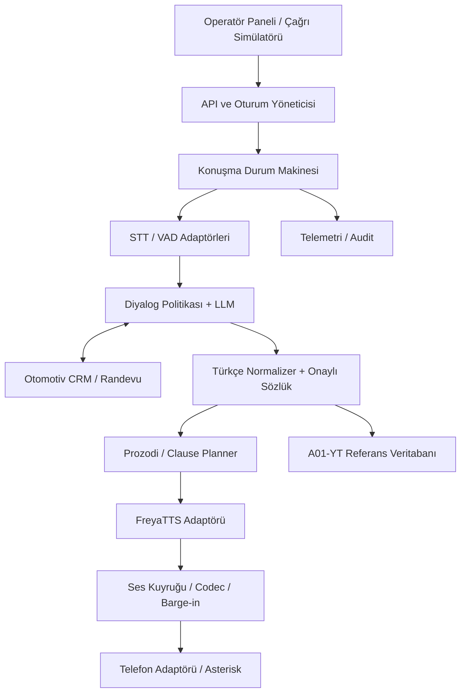

### 2.3.1 Her düğümün görevi

1. **A — Operatör paneli/çağrı simülatörü:** İnsan operatörün sahte görüşme başlatmasına, olayları görmesine ve daha sonraki aşamada kabul izlerini incelemesine olanak sağlar. M08'de gerçek yerel HTTP API ile mock çekirdeğe bağlanmıştır.
2. **B — API ve oturum yöneticisi:** Kullanıcı/oturum bağlamını, mesaj sırasını ve kimlikleri koruyacak giriş noktasıdır. M01'de SessionManager ve EventBus bunun çekirdeğini oluşturur.
3. **C — Konuşma durum makinesi:** Ne zaman dinleneceği, düşüneceği, konuşacağı, kesilmeyi bekleyeceği, temsilciye aktaracağı veya görüşmeyi kapatacağı kararlarının tekil mantık noktasıdır (M02).
4. **D — STT/VAD adaptörleri:** VAD konuşma başladı bilgisini; STT konuşma metnini sağlar. M07'de sahte servislerle, M11'de gerçek STT/VAD kabul araçlarıyla ele alınır.
5. **E — Diyalog politikası ve LLM:** Kullanıcının talebine uygun iş akışı belirlenir; randevu kesinleştirme gibi kritik kararlar kurallı M03 politikası tarafından sınırlandırılır.
6. **F — CRM/randevu:** Araç, fiyat, müşteri talebi, müsaitlik ve kesinleşme referansı dış sistemden doğrulanmalıdır. M03'te FakeCRM ve FakeBookingService kullanılmıştır.
7. **G — Türkçe normalizer/onaylı sözlük:** Sayısal bilgiyi seslendirmeye uygun metne çevirir; kanıtlanmamış marka okunuşlarını üretime almaz (M04). M10'da buna iş yanıtı sunum katmanı eklenmiştir.
8. **H — Clause planner:** TTS girdisini anlamlı parçalara böler, sayıları ve özel ifadeleri bölünmekten korur (M05).
9. **I — FreyaTTS adaptörü:** Hedef ses sentezleyicisinin dış bağımlılık sınırıdır. M07'de sentetik adaptör; M11'de gerçek Freya/Leyla test aracı anlatılır.
10. **J — Ses kuyruğu/codec/barge-in:** Medya metaverisini sıralar, kapasiteyi sınırlar, kesilmede iptal/flush uygular (M06).
11. **K — Telefon/Asterisk:** Telefon görüşmesinin gerçek medya taşıma tarafı. M06'da komut kodlayıcı ve fake transport; gerçek PBX kabulü M11'de beklemededir.
12. **L — Telemetri/audit:** Durum geçişleri, tekrarlar, yanlış ACK, hata ve iptallerin incelenebilir kayıtlarını tutmak için kullanılır.
13. **M — A01-YT:** Gerçek kanıt ve insan onayıyla ilişkilendirilmesi hedeflenen telaffuz referansları; kaynak veritabanı salt okunur tutulur.

### 2.3.2 Okların anlamı ve önemli istisna

Bu ilk şema **bileşenler arası mantıksal ilişkiyi** gösterir; bir çağrı paketinin birebir gerçek çalışma sırasını, bütün geri dönüşleri veya hata yollarını gösteren tam bir sekans diyagramı değildir. Örneğin `C → D` oku, STT/VAD adaptörlerinin durum makinesinin denetim alanında olduğunu gösterir; pratikte konuşma algılama olayı da durum makinesine **geri gelir**. `E ↔ F` iki yönlü işlem/sonuç değişimini temsil eder. `G → M` sözlük kontrolünde referans sorgulama bağlantısıdır; **A01-YT verilerinin otomatik onaylandığı** anlamına gelmez.

## 2.4 Değişmeyen geliştirme stratejisi

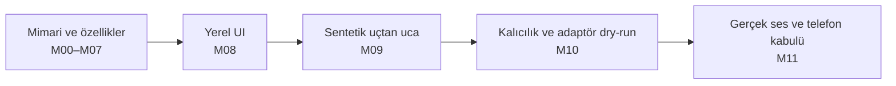

- **Erken aşamada yapılacaklar:** Birim testleri, JSON ve olay sözleşmeleri, deterministik olay üretimi, sahte STT/TTS/LLM/telefon, kuyruk ve iptal testleri.
- **Son aşamaya bırakılanlar:** Gerçek WAV üretimi, yetkili YouTube kliplerinin analizi, dinleme değerlendirmesi, MOS/WER/CER/RTF ölçümleri, GPU, gerçek telefon görüşmeleri ve PBX playout doğrulaması.
- **Temel ilke:** Mimari testin başarılı olması, sesin doğal duyulduğu veya canlı telefon görüşmesinin güvenli çalıştığı kanıtı değildir.

## 2.5 Yol haritasının bütün aşamaları

| İş paketi | Ana çıktı | Rapordaki kabul aşaması |
|---|---|---|
| M00 / başlangıç | Mimari envanter, temel tasarım kararı, önceki A00–A01 varlıklarının korunması | Başlangıç planı; bağımsız M00 tamamlandı kaydı yok |
| M01 | Oturum, olay sözleşmeleri, kimlikler, iptal | Çekirdek/sözleşme PASS |
| M02 | Deterministik konuşma durum makinesi, barge-in | MOCK CORE PASS |
| M03 | Otomotiv iş kuralları ve randevu politikası | Sentetik iş mantığı PASS |
| M04 | Türkçe normalizasyon, NLU ve sözlük | Metinsel PASS; gerçek telaffuz HOLD |
| M05 | Prozodi parçalayıcısı ve TTS input sözleşmesi | MOCK CORE PASS |
| M06 | Medya tamponu ve codec sözleşmeleri | Sentetik medya/metadata PASS |
| M07 | Adaptör yaşam döngüsü, fault isolation | Sahte streaming ve regresyon PASS |
| M08 | Yerel operatör paneli | MOCK UI & CONTROL PLANE PASS |
| M09 | 20 sentetik uçtan uca otomotiv senaryosu | Sentetik iş akışı PASS |
| M10 | SQLite outbox, kurtarma, metin sunumu, offline readiness | DRY-RUN PASS |
| M11 | Gerçek Freya/STT/codec/Asterisk/Windows kabul araçları | Altyapı hazır; PHYSICAL ACCEPTANCE HOLD |

---

<a id="bolum-03"></a>
# 3. M00 — Mimari hazırlık, ilk mock çekirdek ve devralınan varlıklar

## 3.1 M00 olarak ele alınan kapsam

Kaynakta M00, **M00–M02** yol haritasının parçası olarak geçer; fakat daha sonra "M00 tamamlandı" başlıklı bağımsız bir test veya devir raporu verilmez. Bu nedenle M00'ı **başlangıç mimarisi ve envanter kararı** olarak kaydetmek en doğru yorumdur.

Başlangıç kararları: modüler monolit, yerel Windows önceliği, port/adaptör sınırları, tekil bağımlılık kaynağı, harici model önbelleği ve canlı akustik testleri sonraya ayırmaktır. Önceki **A00–A01 ve A01-YT çalışmalarının silinmemesi**, veri kaynağı ve test kümesi olarak taşınması kararlaştırılmıştır.

## 3.2 İlk mock çekirdeğin kanıtı

Başlangıç metninde **7/7 otomatik test başarılı** olduğu, bu testlerin yalnızca örnek Python/mock çekirdeğini kapsadığı belirtilir. Kontrol edilen davranışlar:

1. Konuşma durumlarının sıralı değişimi.
2. Söz kesilmesinden sonra eski nesil ses parçalarının reddedilmesi.
3. Tamponun temizlenmesine ilişkin mock davranışı.
4. Doğrulanmamış randevunun kesinleşmiş gibi söylenmemesi.
5. Önceki **320 test vakasının** değiştirilmeden pakete taşınması.

**Henüz olmayanlar (o tarihte):** tam API, operatör paneli, gerçek Freya/STT adaptörleri, gerçek telefon entegrasyonu. Sonraki MXX paketleri bunların bir kısmını sırayla tamamlar.

## 3.3 M00 → M01 geçiş gerekçesi

İlk mock prototipin asıl değeri "bütün asistan çalışıyor" demek değil, geriye dönük uyumluluk korunarak büyütülebilecek **çekirdek soyutlamaları** ortaya çıkarmasıdır. M01 görevi bu soyutlamaların tekil otorite olarak sabitlenmesidir.

---

<a id="bolum-04"></a>
# 4. M01 — System Core & Event Contracts

## 4.1 Problem ve amaç

Diyalog, medya, TTS ve telefon gibi parçalar geliştirilmeye başlamadan önce şu soruların tek bir yanıtı olmalıdır: **Bu görüşme kime ait? Bu kaçıncı konuşma turu? Bu yanıt hâlâ güncel mi? Hangi olay daha önce işlendi?** M01 bu belirsizliği kimlik, oturum, olay sırası ve iptal sözleşmeleriyle çözmeyi hedefledi.

## 4.2 Uygulanan bileşenler

| Bileşen | Sorumluluk | Neden önemlidir? |
|---|---|---|
| `SessionManager` | Birden fazla oturumun durumunu ve olay çıkışını yönetir. | Farklı müşterilerin olaylarını ayırır. |
| `EventBus` | Sıralı dağıtım, kapasite ve tekrar kontrolü sağlar. | Olay yarışları ve kuyruk taşması karşısında denetlenebilir davranış verir. |
| `SessionId` | Görüşme düzeyinde kimlik. | Başka çağrıya ait kayıtların karışmasını sınırlamayı sağlar. |
| `TurnId` | Konuşma turu düzeyinde kimlik. | Eski tur yanıtıyla yeni turu ayırır. |
| `GenerationId` | Yanıt üretim nesli kimliği. | Kesilme sonrası gecikmiş TTS/LLM sonucunu reddeder. |
| `CancellationController` | İptal edilen üretimleri geçersiz kılar. | Barge-in güvenliğinin temelidir. |
| `AudioFormat`, `AudioFrame` | 8/16/48 kHz çerçeve biçim ve uzunluk kontrolü. | Ses verisi için daha sonraki adaptör sözleşmelerine temel verir. |
| `EventEnvelope` | UUID, UTC zaman, olay sıra numarası ve JSON serileştirme. | Olay kayıtlarının izlenmesi ve tekrar ayıklanması için temel alanları sağlar. |

### 4.2.1 Kimliklerin birlikte okunması

İş akışı için üç düzey vardır: `SessionId` görüşme sınırı; `TurnId` aynı görüşmedeki talep/cevap çevrimi; `GenerationId` bu çevrim için hâlen geçerli yanıt üretimidir. Bir `GenerationId` iptal edildiğinde geçmişe ait çıktı, metin hazırlama veya medya kuyruğu aşamasına geçse bile güncel yanıt sayılmamalıdır. Bu temel kural M02, M05, M06 ve M07'de tekrar kullanılır.

## 4.3 M01 sentetik konuşma akışı

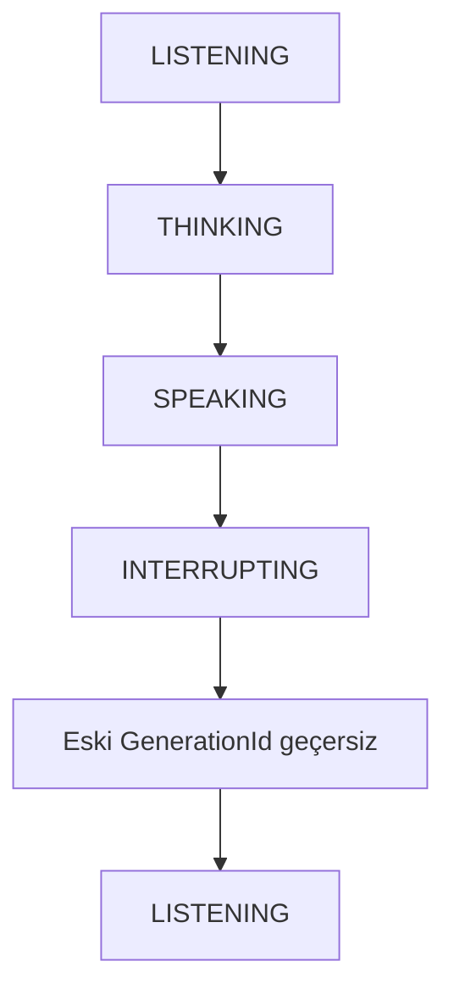

**Adım açıklamaları:**

1. `LISTENING`: Kullanıcının konuşması veya konuşma metni beklenir.
2. `THINKING`: Kullanıcının girdisi işlenerek yanıt hazırlanır.
3. `SPEAKING`: İlgili üretim neslinin yanıtı konuşma aşamasına alınır.
4. `INTERRUPTING`: Yeni konuşma tespit edildiği için mevcut yanıt artık kesilme protokolündedir.
5. `GenerationId` iptali: Önceki kuyruk işlerinin sonradan yanlışlıkla çalınması önlenir.
6. `LISTENING`: Sentetik modelde yeni girdiye açık duruma dönülür; gerçek PBX boşalması bu aşamada kanıtlanmış değildir.

## 4.4 Özellikle sınanan hata/yük durumları

- **Eşzamanlı 20 tur başlatma:** Aynı oturumda yalnızca birinin kabul edildiği bildirilir. Bu test, tek bir görüşmede üst üste rekabet eden komutların kontrolünü sınar; 20 gerçek müşteri çağrısı kapasite testi değildir.
- **Dolu EventBus kuyruğu:** Gönderilemeyen olayın kaybolmaması davranışı test edilir. Bu **RAM içi** güvenliktir; M01'de kalıcı outbox değildir.
- **Tekrar ve geç kalan çıktılar:** Eski üretim kimliklerinin güncel olayı değiştirmemesi hedeflenir.

## 4.5 Kabul, ortam ve açıklar

M01 için **çekirdek ve sözleşme testleri PASS** raporlanır. Kalıcı olay kuyruğu, çökme kurtarması ve gerçek medya denetimi henüz yoktur. M02'ye devredilen ana ihtiyaç, bu çekirdeği VAD/STT/LLM/telefon olaylarına tepki veren **deterministik konuşma reducer'ı** ile birleştirmektir.

Kaynakta belgelerin sistem çekirdeği/API sözleşmeleri, M01 kabul–M02 devir kriterleri, M02 ajan görevi ve doğrulama raporunu içerdiği belirtilir.

---

<a id="bolum-05"></a>
# 5. M02 — Conversation State Machine & Barge-in Reducer

## 5.1 Problem ve amaç

M01'de olaylar ve kimlikler vardı; ancak "hangi olay hangi durumda geçerlidir ve neyi tetikler?" sorusu M02'nin konusudur. Sistem, VAD konuşma başlangıcı, STT kesin transkripti, LLM yanıtı, playout bitti olayı, medya boşaltma ACK'i, timeout, hangup ve temsilciye aktarım durumlarını **deterministik** olarak işler.

## 5.2 Uygulanan parçalar

- `ConversationSignal`: Dışarıdan gelen konuşma sinyallerinin sürümlenebilir biçimi.
- `ConversationReducer`: Geçerli durum + gelen olay → yeni durum ve etki çıkarımı.
- `Effect`: LLM/TTS/medya/telefon bileşenlerine verilmesi gereken komut temsilidir.
- `Barge-in`: Kullanıcı asistanı konuşurken bölünce yanıtı iptal etme yolu.
- `Flush ACK Barrier`: Doğru tampon temizleme onayı gelmeden normal dinlemeye dönmemek.
- `Deferred Transcript`: ACK beklerken gelen müşteri son transkriptini kaybetmeden saklamak.
- `Watchdog`: Beklenen ACK gelmediğinde timeout ve kontrollü başarısızlık.
- `Audit`: Eski nesil, mükerrer olay, yanlış sıra ve hataların izlenebilir kaydı.

## 5.3 Özgün durum makinesi — bütün yollarıyla

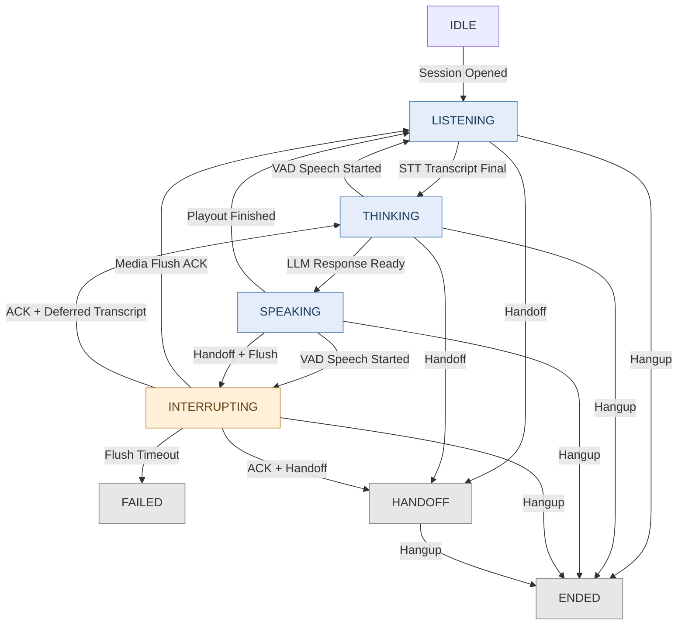

### 5.3.1 Durumların tek tek anlamı

| Durum | Sistem mantığı | Çıkış yolları |
|---|---|---|
| `IDLE` | Görüşme açılmadan önceki durum. | `Session Opened → LISTENING` |
| `LISTENING` | Kullanıcı girdi olayı bekleniyor. | Kesin STT → `THINKING`; handoff; hangup |
| `THINKING` | Geçerli kullanıcı turu için yanıt hazırlanıyor. | Yanıt hazır → `SPEAKING`; yeni VAD → `LISTENING`; handoff; hangup |
| `SPEAKING` | Asistanın yanıtı oynatılıyor/oynatma durumu izleniyor. | Playout bitişi; barge-in; handoff için flush; hangup |
| `INTERRUPTING` | Eski yanıt iptal edilmiş; medya tamponunun temizlenme sonucu bekleniyor. | Doğru ACK sonrası `LISTENING`/`THINKING`/`HANDOFF`; timeout → `FAILED`; hangup |
| `FAILED` | Flush veya güvenlik koşulu başarısızlık durumuna düşmüş. | Kaynak şemada terminal olarak işaretli. |
| `HANDOFF` | İnsan temsilciye aktarım mantığına geçilmiş. | Kaynak şemada hangup → `ENDED`. |
| `ENDED` | Görüşme sonlandırılmış. | Terminal. |

### 5.3.2 Okların tamamının koşullu açıklaması

1. `IDLE → LISTENING`: Oturum açılma sinyali geçerli olduğunda dinleme başlar.
2. `LISTENING → THINKING`: STT *final* transkript verdiğinde işleme başlanır; kaynak, partial transkriptin aynı kapı olduğuna dair iddia içermez.
3. `THINKING → SPEAKING`: Uygun ve güncel LLM/iş yanıtı hazır olduğunda konuşma aşamasına geçilir.
4. `SPEAKING → LISTENING`: Medya oynatımının bittiği olayı alındığında yeni müşteri turu dinlenebilir.
5. `THINKING → LISTENING`: Yanıt hazırlanırken yeni VAD konuşması başlarsa eski turdan çıkılır; güncel konuşma yeniden değerlendirilir.
6. `SPEAKING → INTERRUPTING`: Asistan konuşurken VAD konuşma başladığını bildirir; barge-in tetiklenir.
7. `INTERRUPTING → LISTENING`: Geçerli medya flush ACK'i gelmiş ve ertelenmiş final transkript yoksa normal dinlemeye dönülür.
8. `INTERRUPTING → THINKING`: Geçerli ACK ile birlikte bekletilmiş final kullanıcı transkripti varsa yeni tur doğrudan işlenir.
9. `INTERRUPTING → FAILED`: Flush bekleme süresi dolarsa başarılı boşaltma varsayılmaz; güvenli başarısızlık seçilir.
10. `LISTENING → HANDOFF`: Dinleme aşamasında aktarım istenirse aktarım durumuna geçilebilir.
11. `THINKING → HANDOFF`: Yanıt hesaplanırken aktarım kararı alınabilir.
12. `SPEAKING → INTERRUPTING`: Konuşma devam ederken temsilci aktarımı istenirse önce ses flush edilir.
13. `INTERRUPTING → HANDOFF`: Flush ACK + bekleyen handoff birlikte tamamlanınca temsilciye aktarım durumu açılır.
14. `LISTENING/THINKING/SPEAKING/INTERRUPTING/HANDOFF → ENDED`: Görüşme bu durumların herhangi birinde kapanabilir; o anda bekleyen etkilere uygun iptal gereklidir.

## 5.4 Barge-in'in kritik senaryosu — zaman sıralaması

```mermaid
sequenceDiagram
    participant U as Müşteri / VAD
    participant C as M02 Reducer
    participant T as TTS üretimi
    participant P as Medya/PBX adaptörü
    U->>C: VAD Speech Started (SPEAKING sırasında)
    C->>T: Eski GenerationId iptal
    C->>P: FLUSH_MEDIA isteği
    Note over C,P: INTERRUPTING; doğru ACK beklenir
    U->>C: STT Transcript Final
    Note over C: Deferred Transcript saklanır
    P-->>C: Eşleşen Media Flush ACK
    C->>C: Yeni turu atomik başlat
    C-->>U: THINKING / yeni yanıt hazırlığı
```

**Neden ACK bariyeri şart?** Yerel `cancel` komutunun verilmesi, karşı uçtaki oynatma tamponunun temizlendiği anlamına gelmez. Hemen `LISTENING` durumuna geçilirse eski ses yeni kullanıcı sözünü örtebilir. Bariyer bunu sentetik kontrol düzeyinde önler; **gerçek Asterisk boşalma semantiğini** M11 kanıtlamalıdır.

**Neden deferred transcript?** Kullanıcının sözü, sistem flush beklerken final hâle gelebilir. Atılırsa müşterinin talebi kaybolur; ACK'ten önce işlenirse eski medya ile yeni konuşma yarışı oluşabilir. Bu nedenle geçerli transkript referansı saklanır ve onay sonrası atomik yeni tur açılır.

## 5.5 Test, çalışma ortamı ve devir

- Yanlış veya yinelenen ACK, geciken ses parçaları, tekrar olaylar ve zaman aşımı mock olaylarla sınandı.
- `FLUSH_MEDIA` bu aşamada gerçek PBX eylemi değil, emir/sözleşmedir.
- Linux/Python 3.13 üzerinde doğrulama bildirildi; **Windows/Python 3.11** ayrıca doğrulanmadı.
- TXT'de açıkça görünen çalıştırma parçaları: `py -3.11 -m venv .venv` ve Windows PowerShell için `.\scripts\check_m02.ps1`. Kaynak dışında kurulum adımları üretilmemiştir.
- M02 kararı: **MOCK CORE PASS**. Kalıcı olay kuyruğu, restart kurtarma, gerçek ACK ve üretim dayanıklılığı sonraki aşamalara devredilir.

---

<a id="bolum-06"></a>
# 6. M03 — Automotive Dialogue Policy & Booking State Machine

## 6.1 Problem ve amaç

M02 "ne zaman konuşulur?" sorusunu çözmüştür; M03 "ne söylenmesine ve hangi işlemin yapılmasına izin verilir?" sorusunu çözer. Otomotiv CRM, araç sorgulama, fiyat doğrulama, müşteri yetkisi, ekspertiz müsaitliği, açık onay, rezervasyonun kesinleşmesi ve insan temsilci aktarımı bu katmanın sorumluluğuna yerleştirilmiştir.

## 6.2 Uygulanan bileşenler

| Bileşen | Görev |
|---|---|
| `DialoguePolicy` | Otomotiv sektörünün deterministik karar kuralları |
| `BookingStateMachine` | Randevu/rezervasyon durum geçişleri |
| `DialogueCoordinator` | M02 konuşma olaylarını M03 iş katmanına bağlama |
| `CRMPort` | Araç/fiyat/müşteri bilgileri için soyut dış servis sınırı |
| `InspectionBookingPort` | Müsaitlik, kesinleştirme ve rezervasyon durum sorgusu sınırı |
| `ReferenceStore` | Oturuma ait transkript ve yanıt referansları |
| `FakeCRM`, `FakeBookingService` | Gerçek CRM yerine deterministik sentetik servisler |

## 6.3 Özgün ekspertiz randevu akışı

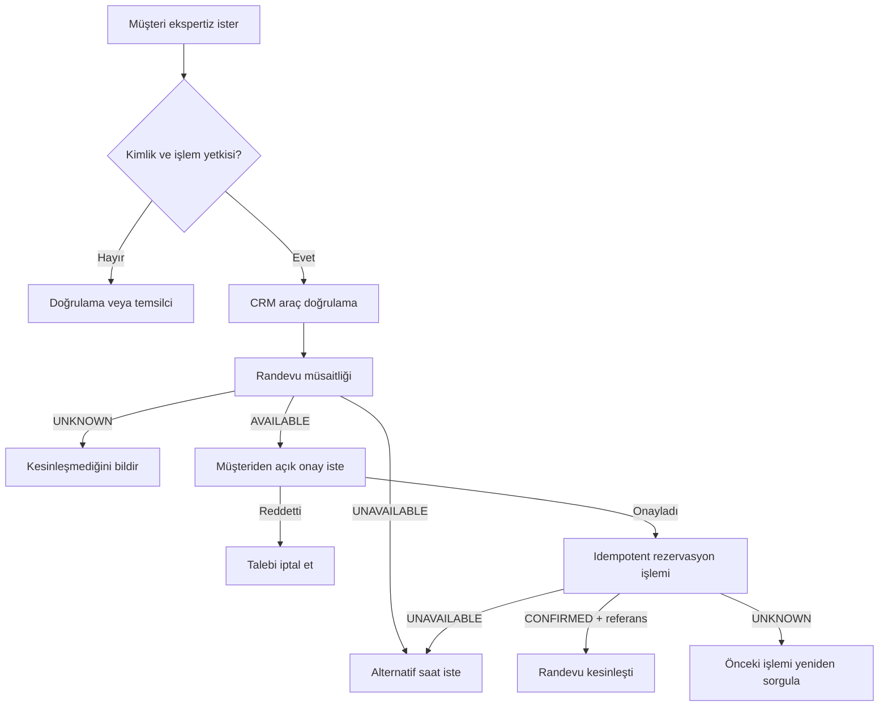

### 6.3.1 Düğüm ve karar dallarının ayrıntılı yorumu

1. **Talep alınır:** Kullanıcı ekspertiz için randevu ister; bu ifade tek başına rezervasyon değildir.
2. **Kimlik/yetki kontrol edilir:** İşleme yetkili değilse doğrulama veya insan temsilci yolu seçilir. TXT canlı kimlik doğrulama sağlayıcısını tanımlamaz.
3. **CRM araç doğrulama:** Talebin hangi güvenilir araç kaydına ait olduğu anlaşılmalıdır.
4. **Müsaitlik sorgusu:** Rezervasyon portunun cevabı kesin, olumsuz veya belirsiz olabilir.
5. **`UNAVAILABLE`:** Belirtilen zaman uygun değildir; alternatif istenir.
6. **`UNKNOWN`:** Sonuç güvenilir biçimde bilinmiyordur; "randevunuz oluştu" denmez.
7. **`AVAILABLE`:** Uygun zaman bulunmuştur; buna rağmen sistem **açık onay** olmadan kesinleştirmez.
8. **Müşteri reddederse:** İşlem iptal edilir; rezervasyon kesinleşmez.
9. **Müşteri onaylarsa:** Aynı onayın yanlışlıkla iki rezervasyon üretmemesi için idempotent işlem yaklaşımı kullanılır.
10. **`CONFIRMED + referans`:** Ancak dış hizmet geçerli referansla kesinleşmeyi bildirince olumlu randevu cümlesi hazırlanır.
11. **Rezervasyon `UNKNOWN`:** Aynı işlemi körlemesine tekrar etmek yerine önceki işlemin durumu sorgulanır.
12. **Rezervasyon `UNAVAILABLE`:** Müsaitlik değiştiyse alternatif arayışına geri dönülür.

**İki bağımsız koşul:** `Müşteri onayı = evet` ve `Rezervasyon servisi = CONFIRMED + geçerli referans` farklı olgulardır; sistem yalnızca ikincisiyle "kesinleşti" diyebilir.

## 6.4 M02 ile güvenlik bağlantısı

1. M03 bir iş yanıtı veya temsilciye aktarım kararı üretir.
2. M02'nin *güncel* `TurnId` ve `GenerationId` değerleri kontrol edilir.
3. Eski yanıt geçersizse atılır; geçerliyse `response_ref` üzerinden `LLM_RESPONSE_READY` oluşturulur.
4. Temsilci kararı `HANDOFF_REQUESTED` sinyaliyle iletilir.
5. Yanıt bu aşamada doğrudan FreyaTTS'e verilmez; sonraki Türkçe normalizasyon/prozodi kapılarını geçmelidir.

## 6.5 Üç turluk sentetik otomotiv görüşmesi

| Tur | Müşteri isteği | Sahte sistem davranışı | Güvenlik özelliği |
|---|---|---|---|
| 1 | Araç değerini sorar | Doğrulanmış tahmini değer **1.250.000 TL** denir | Bunun kesin satış teklifi olmadığı belirtilir |
| 2 | **3 Kasım 2026, 14.30** için ekspertiz ister | Müsaitlik bilgisi verilir ve açık onay istenir | Henüz kayıt yapılmaz |
| 3 | Randevuyu onaylar | FakeBookingService onay referansı üretir; yalnızca bir rezervasyon kaydı oluşur | Mükerrer işlem önlenir |

Bu değerler **gerçek piyasa fiyatı veya gerçek randevu uygunluğu değil, test örneğidir**.

## 6.6 Regresyon, sınırlar, devir

- M03 eklendiğinde önceki **52 testin geçtiği** ve 320 golden metnin SHA-256 bütünlüğünün korunduğu bildirildi.
- Önceden tanımlanmış bileşenlerin değiştirilmeden kullanıldığı belirtilir.
- Linux/Python 3.13 ortamı kullanılmıştır; Windows/Python 3.11 ve canlı CRM testi yapılmamıştır.
- **Açıklar (M03 anındaki):** gerçek serviste idempotency, canlı müşteri kimlik doğrulaması, KVKK, kalıcı kuyruk ve dağıtık işlem güvenliği.
- **Sonraki paket:** M04 Türkçe normalizasyon, otomotiv sözlüğü ve NLU.
- Kaynakta adı verilen belgeler: `docs/15_M03_SOZLESME_VE_IS_KURALLARI.md`, `docs/16_M03_KABUL_VE_M04_DEVIR.md`, `docs/17_M04_AI_AGENT_GOREVI.md`, `docs/18_M03_DOGRULAMA_RAPORU.md`.

---

<a id="bolum-07"></a>
# 7. M04 — Turkish Automotive Normalizer, Lexicon & NLU Contracts

## 7.1 Problem ve amaç

Bir CRM cevabının doğru olması, TTS'in doğru okuyabileceği anlamına gelmez. `1.250.000 TL`, `03.11.2026`, `14:30'da`, `145.000 km`, yabancı marka/model adları veya ekli Türkçe ifadeler hem **anlam** hem **sesletim** bakımından denetlenmelidir. M04 iki farklı işi bir araya getirir: gelen müşteri metninden niyet/alan çıkarımı (NLU) ve giden konuşma metninin kurallı hazırlanması (normalizer).

## 7.2 Bileşenler

| Bileşen | İşlev |
|---|---|
| `TurkishAutomotiveNormalizer` | Para, kuruş, tarih, saat, motor, kilometre, model yılı dönüşümleri |
| `AutomotiveLexicon` | İnsan onaylı, kaynak kanıtına bağlı marka/model telaffuz kayıtları |
| `A01YTReadOnlyAdapter` | Eski A01-YT referans veritabanını değiştirmeden okuma |
| `DeterministicNLU` | Araç, fiyat, ekspertiz, CRM, temsilci niyetlerini sınıflandırma/alan çıkarımı |
| `ParseContext` | Araç kimliği, lokasyon, saat dilimi ve bekleyen onay bağlamı |
| `NLUReferenceBridge` | M03 iş mantığına ham metin yerine güvenli referans iletimi |

## 7.3 Normalizasyon örnekleri (kaynakta verilen dönüşümler)

| Kaynak ifade | Konuşma için hazırlanmış ifade |
|---|---|
| `1.250.000 TL` | bir milyon iki yüz elli bin Türk lirası |
| `1.250,50 TL` | bin iki yüz elli Türk lirası ve elli kuruş |
| `03.11.2026` | üç kasım iki bin yirmi altı |
| `14:30'da` | on dört otuzda |
| `145.000 km` | yüz kırk beş bin kilometre |
| `1.5 TSI` | bir nokta beş TSI |

**Sınır:** Bu satırlar metin dönüşümüdür. TTS'in bunları istenen vurgu, fonetik, duraklama ve doğallıkla söylediği ölçülmemiştir.

## 7.4 NLU karar akışının açıklayıcı diyagramı

Aşağıdaki şema, kaynağın açıklamalarından **belge yazarı tarafından türetilmiş özet bir anlatım şemasıdır**; TXT içinde bu başlık için özgün bir `flowchart` yoktur.

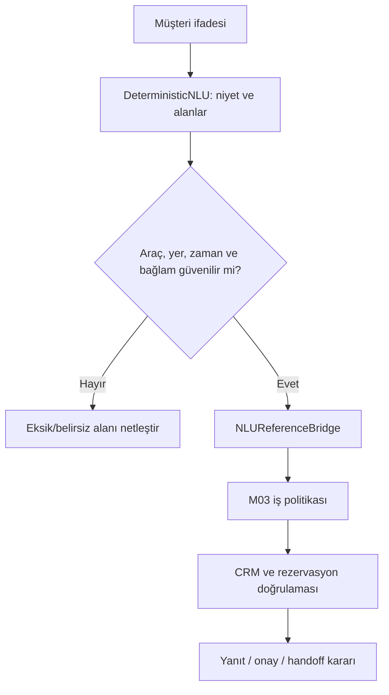

Örnekteki "Qashqai için yarın saat 14.30'da ekspertiz istiyorum" ifadesinin yalnızca randevu niyeti olarak sınıflanması yeterli değildir: güvenilir **araç kayıt kimliği**, servis yeri, geçerli yerel tarih ve saat dilimi gerekli olabilir. "Yarın" bağlamsız bir mutlak tarih değildir. İki farklı saat tespit edilirse sistem keyfî seçim yapmak yerine netleştirme istemelidir. **NLU rezervasyonu kendisi yapmaz**; M03 politika ve servis doğrulaması otoritesini korur.

## 7.5 A01-YT telaffuz güvenlik kapısı

Qashqai, Peugeot, Citroën, Škoda gibi adlar için **tahmini** sesletim biçimleri doğrudan üretim sözlüğüne yazılmadı. Yalnızca kaynak kanıtına dayanan ve insanın onayladığı kayıtlar etkinleştirilebilecektir. Kaynaktaki üç A01-YT referansı korunmuştur; gerçek ses anotasyonları olmadığı için bu aşamada **onaylı telaffuz kuralı = 0**.

Bu bilinçli koruma, marka adının yanlış okunma riskini ortadan kaldırmaz: yanlış okunuşu otomatik "düzeltmek" yerine, kanıtsız düzeltmenin sisteme sokulmasını engeller.

## 7.6 320 golden cümlenin analiz sonucu

| Ölçülen metinsel gösterge | Adet |
|---|---:|
| Metni dönüşen cümle | 163 |
| İnsan incelemesi gerektiren | 29 |
| İnceleme kümesinde karakter uyumsuzluğu | 16 |
| Etkin onaylı marka/model okunuşu | 0 |

**16 uyumsuzluk, 29 inceleme vakasının alt kümesidir**; birbirine eklenerek 45 ayrı vaka diye yorumlanmamalıdır.

## 7.7 Test ve devir

M04 temiz paket doğrulamasında **193/193 test**, **12 geçerli JSON sözleşmesi** ve bütünlük manifesti sonucu bildirilmiştir. Windows ortamında fiziksel deneme bulunmaz. Kabul **mimari/metin PASS**, gerçek telaffuz **HOLD** olarak ayrılmıştır. M05'e devredilen görev, metni güvenli clause parçalarına bölmek ve TTS girdi sözleşmesine bağlamaktır.

---

<a id="bolum-08"></a>
# 8. M05 — Prosody / Clause Planner & TTS Input Contract

## 8.1 Problem ve amaç

M04 metinleri normalleştirmiştir; ancak uzun bir yanıtın nerede bölüneceği ve hangi öğelerin asla yarılmaması gerektiği çözülmelidir. Yanlış clause bölmesi `1.250.000 TL` gibi bir niceliği, marka adını veya Türkçe ek bağını ayırabilir. M05'in işi **anlam birimlerini koruyan ve iptal edilebilir konuşma planı** üretmektir.

## 8.2 Uygulanan bileşenler

| Bileşen | Görev |
|---|---|
| `ProsodyClausePlanner` | Metni konuşma parçalarına ayırır. |
| `PhraseBoundary` | Bölünmemesi gereken ifade sınırlarını korur. |
| `ClausePlan` | Parça sırası ve sınırlarını tutar. |
| `TTSInput` | TTS adaptörüne verilecek tipli girdi sözleşmesidir. |
| `MockTTS` | Gerçek ses oluşturmadan metin iş sırasını simüle eder. |
| `ProsodyCoordinator` | M02, M03 ve M04 verilerinin clause üretimine bağlanmasını sağlar. |
| `CancellationController` bağlantısı | Eski `GenerationId` ile işlenmiş parçaların reddini sağlar. |

## 8.3 Cümle → normalize metin → clause örneği

**Girdi:**

> Aracınızın tahmini değeri 1.250.000 TL, ekspertiz saati 14:30.

**M04 + M05 ardından:**

- **CLAUSE 01:** "Aracınızın tahmini değeri bir milyon iki yüz elli bin Türk lirası," — **yumuşak duraklama için hedef 110 ms**.
- **CLAUSE 02:** "ekspertiz saati on dört otuz." — son parça.

110 ms, gerçek WAV dosyasında ölçülmüş bir sessizlik değil, **planlanan kontrol değeridir**. M05 bu noktada ses üretmemiştir.

## 8.4 Özgün M05 güvenlik/üretim flowchart'ı

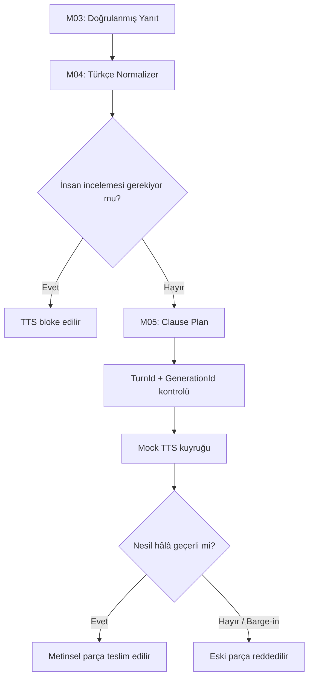

### 8.4.1 Her adımın ayrıntısı

1. **M03 doğrulanmış yanıt:** Yanıtın randevu/fiyat açısından güvenilir olması beklenir; bu, telaffuz açısından henüz yeterli değildir.
2. **M04 normalizasyonu:** Sayılar, tarih ve zaman ifadeleri düzenlenir; onaysız marka okunuşları için güvenlik işaretleri korunur.
3. **İnsan inceleme kararı:** Metin güvenle konuşmaya hazırlanamıyorsa `TTS bloke edilir`; "bir şekilde seslendir" yaklaşımı uygulanmaz.
4. **Clause planı:** Korunan ifade aralıklarına saygı duyularak anlam parçaları oluşturulur.
5. **Tur ve üretim nesli doğrulaması:** Parçanın hâlâ mevcut yanıtla ilişkili olması gerekir.
6. **Mock TTS kuyruğu:** Gerçek WAV yerine metinsel kuyruk işlemi yapılır.
7. **Nesil kontrolü:** Tamamlanma anında kimlik tekrar kontrol edilir; bu önemlidir çünkü istek kabul edilirken geçerli olan üretim, daha sonra iptal edilmiş olabilir.
8. **Geçerliyse teslim:** Bu teslim gerçek telefonda oynatma değil, mock akışında parça teslimidir.
9. **Geçersizse reddetme:** Yeni turu eski cümleyle kirletme engellenir.

## 8.5 Test senaryosu ve idempotency

İki parça kuyruğa alındı. İlki mock olarak teslim edildi; arada söz kesme olayı oluştu; ikinci parça artık eski `GenerationId` taşıdığı için reddedildi. Buna ek olarak aynı TTS isteğinin tekrar gelmesi ve **aynı kimlikle farklı metin** gönderilmesi senaryolarına yönelik idempotency kontrolü eklendi.

## 8.6 320 cümlelik regresyonun ayrıntıları

| Gösterge | Sonuç | Nasıl yorumlanmalı? |
|---|---:|---|
| Doğrudan planlanabilir cümle | 291 | 320 cümlenin 29'u inceleme kapısında kaldı. |
| İnceleme gerektiren | 29 | Güvenli üretim için insan kararı gerekli. |
| Toplam clause | 356 | Planlama sonucu metin parçası sayısı; WAV sayısı değildir. |
| Korunan aralık | 202 | Bölünmesi engellenen özel ifade aralıkları. |
| Uygun mock TTS girdisi | 325 | Kaynak bu sayıyı böyle verir; 320 cümle sayısıyla aynı birimde olduğu varsayılmaz. |
| Onaylı telaffuz kuralı | 0 | A01-YT ses kanıtları henüz yok. |

**Sayı uyumu hakkında:** `325 uygun mock TTS girdisi`, `320 kaynak cümle` ve `356 toplam clause` farklı düzeylerde sayılmış olabilir. TXT bunların payda/üretim yöntemi ayrıntısını vermediğinden bunlardan yeni bir başarı oranı hesaplamıyoruz.

## 8.7 Kabul ve sonraki ihtiyaç

Tüm birikimli testlerde **237/237 PASS**, paket bütünlüğünde PASS raporlandı. Gerçek Freya/GPU/YouTube/PBX bağlantısı yoktu. M05 sonucu **MOCK CORE PASS; production/gerçek ses HOLD**. Sonraki adım, bu parçalara medya kuyruk ve codec sözleşmeleri kazandıracak M06'dır.

<a id="bolum-09"></a>
# 9. M06 — Audio Queue, Transport Adapters & Codec Contracts

## 9.1 Problem ve amaç

M05, sözlü yanıtı clause dizisi olarak üretti; fakat gerçek telefon altyapısı parça sırası, codec uyumu, örnekleme frekansı, ağ/medya kuyruk kapasitesi ve flush semantiği ister. M06 bu sözleşmeleri **ses baytı üretmeden** tanımlar ve sınar. Ses işleme ile telefon taşınması farklı portlarda tutulur.

## 9.2 Uygulanan bileşenler

| Bileşen | İşlev | Güvenlik/sınır notu |
|---|---|---|
| `MediaFormat` | Codec, örnekleme hızı, RTP saat alanları | Codec adı ile RTP zaman tabanı karıştırılmaz. |
| `AudioChunkMetadata` | `SessionId`, `TurnId`, `GenerationId`, sıra numarası, süre | Gecikmiş/başka oturumdan gelen parçalar ayıklanabilir. |
| `MediaBuffer` | Oturum bazlı, kapasite sınırlı medya kuyruğu | Sınırsız bellek büyümesini engelleme hedefi. |
| `AudioBufferPort` | Değiştirilebilir tampon arayüzü | Gerçek backend ileride takılabilir. |
| `TransportPort` | Telefon/medya gönderim sınırı | İş mantığı PBX'e gömülmez. |
| `FakeTransport` | Gerçek medya göndermeden taşıma simülasyonu | Canlı bağlantı kanıtı değildir. |
| `MediaCoordinator` | M02 olaylarını tampon/flush eylemleriyle bağlar | Barge-in ve tamponun birlikte denetlenmesi. |
| `FlushRequest` / `FlushAck` | İstek/yanıt kimliği eşleştirme | Her gelen ACK kabul edilmez. |
| `AsteriskCommandEncoder` | Asterisk JSON kontrol komutu üretimi | Gerçek Asterisk protokol denemesi henüz yok. |

## 9.3 Codec/örnekleme sözleşmesi tablosu

| Biçim | Çözümlenmiş ses örnekleme frekansı | 20 ms için örnek sayısı | M06 kanıt düzeyi |
|---|---:|---:|---|
| PCM S16LE | 8.000 Hz | 160 | Metadata PASS |
| PCM S16LE | 16.000 Hz | 320 | Metadata PASS |
| PCM S16LE | 48.000 Hz | 960 | Metadata PASS |
| G.711 A-law | 8.000 Hz | 160 | Metadata PASS |
| G.711 µ-law | 8.000 Hz | 160 | Metadata PASS |
| G.722 | 16.000 Hz | 320 | RTP saat ayrımı PASS |

**20 ms örnek hesabı** (açıklama, test sonucu değil): `örnek sayısı = örnekleme hızı × 0,020 saniye`; örneğin `16.000 × 0,020 = 320`. G.722 için TXT, **çözümlenmiş ses hızını 16 kHz**, **RTP saat frekansını ise 8 kHz** olarak ayrı tuttuğunu özellikle vurgular. Tablodaki PASS, **gerçek codec encode/decode başarısı** anlamına gelmez.

## 9.4 Özgün medya/backpressure/barge-in flowchart'ı

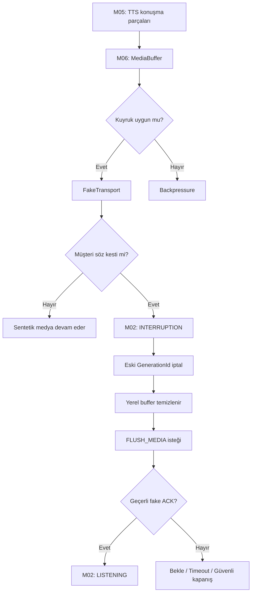

### 9.4.1 Her okun ve kararın açıklaması

1. `M05 → MediaBuffer`: Konuşma planından gelen parçanın medya tarafındaki sıra ve kimlik metaverisi oluşturulur.
2. `MediaBuffer → Kuyruk uygun mu?`: Oturumun kapasitesi ve kabul koşulları denetlenir.
3. `Evet → FakeTransport`: Kuyruğa uygun parça sahte telefon taşıyıcısına iletilir.
4. `Hayır → Backpressure`: Üretim hızının tüketim hızını aşması engellenmeye çalışılır; sürekli yeni veri kabul edilmez. Kaynak, backpressure için kesin üretim politikası veya tampon boyutu belirtmez.
5. `FakeTransport → Müşteri söz kesti mi?`: Gönderim sürerken yeni kullanıcı konuşması oluşup oluşmadığı değerlendirilir.
6. `Hayır → Sentetik medya devam`: Yalnızca simüle edilen playout akışı sürdürülür.
7. `Evet → M02 INTERRUPTION`: Konuşma durum makinesine kesilme semantiği iletilir; bu yalnızca yerel buffer işi değildir.
8. `Eski GenerationId iptal`: Önceki konuşma nesline ait tüm gecikmiş parçaların güncelliği kaybolur.
9. `Yerel buffer temizlenir`: Uygulamanın kendi kuyruğundaki eski parçalar atılır.
10. `FLUSH_MEDIA isteği`: Telefon adaptörüne karşı uç medya tamponunu boşaltması için kontrol komutu hazırlanır.
11. `Geçerli fake ACK?`: Gelen yanıtın doğru flush isteğine ait olması ve sahte adaptörde gerçekten üretilmiş olması aranır.
12. `Evet → LISTENING`: M02 bariyeri kaldırır ve yeni kullanıcı sesini işlemeye dönebilir.
13. `Hayır → Bekle/timeout/güvenli kapanış`: Yanlış veya gecikmiş onay, başarılı gibi yorumlanmaz.

**Kritik ayrım:** `Yerel MediaBuffer boş` ile `PBX'te çalınmayı bekleyen ses yok` **eşdeğer değildir**. M06'nın en önemli fiziksel kabul devri bu farkın M11'de ölçülmesidir.

## 9.5 Sınanan dayanıklılık vakaları

- Yanlış flush kimliği.
- Sahte adaptörce üretilmemiş ACK.
- Aynı ACK'in tekrar gelmesi.
- `MEDIA_XOFF` ile akış kontrolü.
- Kuyruk kapasitesi ve backpressure.
- Geç gelen medya `chunk`'ı.
- Timeout sırasında işlem güvenliği.
- Hangup ve flush arasında yarış.

Burada doğrulanan, **olay/metadata işleme ve durum değişimi** davranışıdır. Gerçek G.711 kodlama, RTP ağ kaybı, jitter veya PBX ses boşalması ölçümü yapılmamıştır.

## 9.6 Regresyon, geriye uyumluluk ve açık konular

M01–M05'ten gelen **44 Python modülünün aynı bırakıldığı**, 320 golden dosyanın SHA-256 özetinin korunduğu, JSON Schema, sentetik flush demosu, temiz ZIP açılışı ve manifest denetiminin geçtiği belirtilir. Bütün testler Linux/Python 3.13 ortamındadır; Windows/Python 3.11 yoktur.

M06 anında eksik kalanlar: kalıcı outbox, restart kurtarma, gerçek ağ teslimatı, gerçek codec dönüşümleri, hedef Asterisk sürümünde doğrulanmış flush garantisi. Bunların bir bölümü M10'da yazılım düzeyinde ele alınmış; **PBX ve codec fiziksel kabulü M11'e kalmıştır**.

---

<a id="bolum-10"></a>
# 10. M07 — Adapter Lifecycle, Fault Isolation & Synthetic Streaming

## 10.1 Problem ve amaç

M01–M06'nın portları oluşturulmuş olsa da STT, TTS, LLM ve telefon adaptörleri için çalışma ömrü, bağlantı hatası, retry, deadline, timeout, arızalı servisin izolasyonu ve iptal kuralları ortaklaştırılmamıştı. M07, **gerçek hizmete bağlanmadan** dört adaptörün sistem davranışını tekil gözetim altında düzenler.

## 10.2 Modüller

| Bileşen | Rolü |
|---|---|
| `SyntheticAdapter` | Dört adaptör türünün sentetik ortak uygulaması |
| `AdapterSupervisor` | Başlatma/durdurma, etki yönlendirmesi ve adaptör durumlarını gözetim |
| `MockClock` | Zamanı testlerin tekrar üretilebileceği sanal değer olarak ilerletme |
| `Deadline` | Monoton nanosaniye temelli işlem süresi sınırı |
| `RetryPolicy` | Kontrollü üstel yeniden deneme |
| `CircuitBreaker` | Sürekli hata veren adaptöre istek vermeyi geçici durdurma |
| `HealthSnapshot` | Adaptör durum/hata/kuyruk/devre görünümü |
| `SyntheticStreamBridge` | M05 clause'larını M06 sentetik medya metaverisine bağlama |

`RetryPolicy` ile **idempotent olmayan dış işlemler** birbirine karıştırılmamalıdır. Bağlantı geçici olarak kopsa bile "rezervasyon oluştur" veya "telefon işlemini başlat" gibi mükerrer yan etki yaratabilecek komutlar belirsiz sonuçtan sonra otomatik tekrar edilmemelidir; TXT bu güvenlik ayrımını özellikle bildirir.

## 10.3 Özgün adaptör yaşam döngüsü

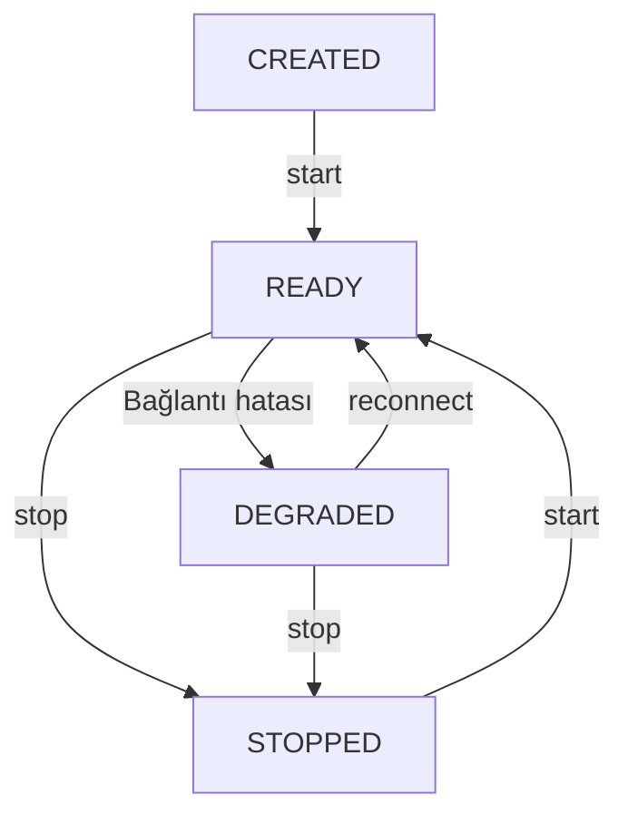

### 10.3.1 Durum ve ok açıklaması

1. **`CREATED`:** Adaptör örneği oluşturulmuştur; kullanıma hazır ilan edilmemiştir.
2. **`CREATED → READY / start`:** Sentetik adaptör başlatma koşullarını yerine getirmiştir.
3. **`READY`:** Gözetim açısından hizmet vermeye hazır durumdur; M07'de bunun gerçek Freya/PBX sağlık kontrolüne karşılığı yoktur.
4. **`READY → DEGRADED`:** Bağlantı veya işlem hatası adaptörün sağlığını bozmuştur.
5. **`DEGRADED`:** Arıza izlenebilir; tüm sistemin otomatik durması gerekmez.
6. **`DEGRADED → READY / reconnect`:** Bağlantı tekrar kurulunca adaptör sağlıklı duruma geçebilir.
7. **`READY → STOPPED` ve `DEGRADED → STOPPED`:** Kapatma hem sağlıklı hem bozulmuş durumda mümkündür.
8. **`STOPPED → READY / start`:** Durmuş sentetik adaptör yeniden başlatılabilir.

Kaynak şeması `CircuitBreaker`'ın bütün alt durumlarını ayrı düğüm olarak çizmez; bu nedenle buraya kaynakta olmayan **OPEN/HALF_OPEN** durum akışı eklenmez.

## 10.4 Fault isolation — neyi sağlar?

Bir TTS adaptörü bağlantısını kaybettiğinde STT/LLM adaptörlerinin zorla durdurulmaması, hatanın etki alanını daraltır. Bu örnek **sentetik altyapıda** gösterilmiştir; gerçek hizmetlerin kaynak tükenmesi, GPU belleği, işlem çakılması veya PBX kopması altında aynı izolasyonun çalıştığı henüz ölçülmemiştir.

İstekler `SessionId`, `TurnId`, `GenerationId`, komut sıra numarası ve deadline denetimiyle korunur. İptal olmuş eski TTS işinin sonucu geç ulaşsa bile M01 kimlik kapısına takılır; yeni medyaya karışması engellenir.

## 10.5 Uçtan uca sentetik streaming deneyi

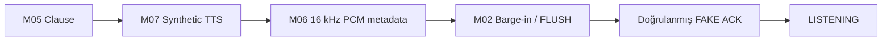

**Altı olayın tam sırası:**

1. M05'in ilk metin parçası sahte TTS kuyruğuna girdi.
2. M07 sanal saat üzerinden tamamlanma sonucu oluşturdu.
3. M06, **16 kHz PCM / 20 ms** sentetik medya metaverisini kabul etti.
4. İkinci TTS işi sırasında söz kesme tetiklendi ve eski iş `CANCELLED` oldu.
5. M02, `FLUSH_MEDIA` komutundan sonra `INTERRUPTING` durumunda bekledi.
6. Ancak açıkça üretilen ve doğrulanan **sahte ACK** gelince `LISTENING` durumuna geçildi.

**Ölçülen gerçek ses baytı: 0. Gerçek PBX ACK'i: yok.** Bu ifade, şemanın bir ses kalitesi demosu değil, sözleşme/olay koordinasyonu deneyi olduğunun ana kanıtıdır.

## 10.6 Gerileme testleri ve devir

Kaynakta M01–M06'daki **52 Python kaynak dosyasının byte düzeyinde korunduğu**, JSON sözleşmesi sayısının **25'e** çıktığı (beşi M07), temiz ZIP açılışı ve **332/332 test PASS** sonucu bildirildi. M07 sonunda **production readiness HOLD**: gerçek ağ ve model bağlantıları, kalıcı kuyruk ve restart kurtarma, gerçek PBX flush henüz yoktu.

**Sonraki adım M08:** simülasyonların yalnızca komut satırında değil, çevrimdışı ve izlenebilir operatör arayüzünde yönetilmesi.

---

<a id="bolum-11"></a>
# 11. M08 — Local Operator Console & Pronunciation Review UI

## 11.1 Problem ve amaç

Arka uç bileşenlerinin birer testle doğrulanması operatöre gerçek zamanlı kontrol görünürlüğü vermez. M08; aktif oturum, geçiş durumu, adaptör sağlığı, retry/hata izi, medya kuyruğu, flush bekleme ve A01-YT telaffuz incelemelerini **tek yerel kullanıcı arayüzünde** birleştirir. Tasarım çevrimdışı çalışmayı ve dış CDN gerektirmemeyi hedefler.

## 11.2 Dört ana ekran

| Ekran | Görülen/işletilen işlev |
|---|---|
| **Genel bakış** | Dört sahte adaptörün sağlık görünümü, aktif oturum, sanal zaman ve olay geçmişi |
| **Oturumlar** | VAD/STT/LLM konuşma turu simülasyonu, barge-in, **FAKE ACK** tetikleme ve izleme |
| **Telaffuz inceleme** | A01-YT üç kaynak, 320 golden metin, inceleme ve onay kayıtları |
| **Olay günlüğü** | Durum geçişleri, retry, hatalar ve denetim izi |

Bu başlıklar M08'in ilk sürümündeki dört alanı gösterir. Sonraki M09 ve M10, sırasıyla **Senaryolar** ve **Hazırlık** sekmelerini eklemiştir; "M08 hep dört sekme içerir" gibi güncel olmayan bir yorum yapılmamalıdır.

## 11.3 Özgün M08 kullanıcı arayüzü–çekirdek entegrasyon diyagramı

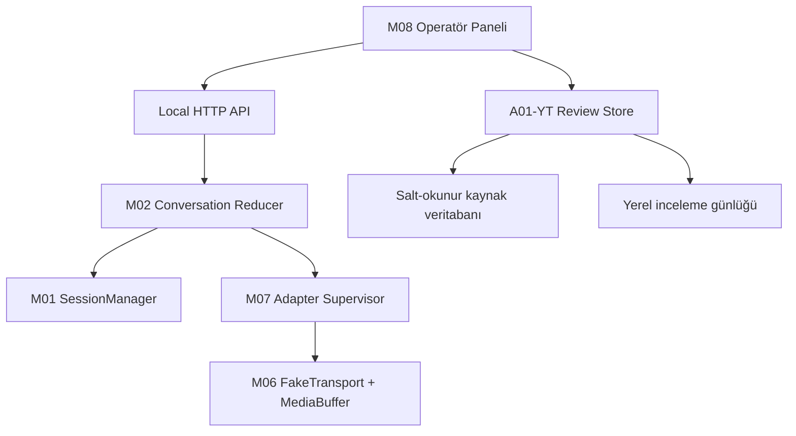

### 11.3.1 Düğümler, oklar ve güven sınırları

1. `UI → Local HTTP API`: Operatör ekranı doğrudan iç nesne alanlarını değiştirmek yerine API isteği gönderir.
2. `API → M02`: Gelen simülasyon talebi iş kuralları/durum reducer'ı üzerinden geçer; UI kendi paralel durum makinesini oluşturmaz.
3. `M02 → M01`: Aktif oturum, tur ve kimlik otoritesi M01'de kalır.
4. `M02 → M07`: Konuşmanın yaratacağı dış etki, adaptör gözetimine yönlendirilir.
5. `M07 → M06`: Sentetik medya transport ve buffer mantığına girer; gerçek PBX bağlantısı kurulmaz.
6. `UI → Review Store`: Telaffuz kayıtlarının inceleme alanına erişilir.
7. `Review Store → Salt-okunur kaynak DB`: Orijinal A01-YT kaydı korunur; üzerinde doğrudan düzeltme yapılmaz.
8. `Review Store → Yerel inceleme günlüğü`: Kullanıcı kararları ayrı yerel veritabanında izlenebilir olur.

**Neden ayrı inceleme veritabanı?** Orijinal telaffuz delilinin değişmeden saklanması, inceleme kararının ise sonradan takip edilmesi istenir. Bu hem veri bütünlüğü hem denetim izi açısından bilinçli bir tasarım seçimidir.

## 11.4 Kullanıcı arayüzünde sentetik görüşme yolu

`LISTENING → THINKING → SPEAKING → INTERRUPTING → FAKE ACK → LISTENING`

Bu akış M01–M07 sınıflarına gerçekten bağlanan mock olaylarla test edildiği bildirilen operatör eylemidir. Arayüz `FAKE ACK` ifadesini açık gösterir; böylece operatör bir sahte sinyali gerçek telefon santralinden gelmiş gibi yorumlamaz.

## 11.5 Telaffuz incelemesi — göstergelerin ayrımı

| Gösterge | Adet | Kabul açısından anlamı |
|---|---:|---|
| Golden cümle | 320 | Önceki karşılaştırma veri kümesi |
| Metni dönüşen | 163 | Normalizer metin dönüşümü |
| İnceleme gerektiren | 29 | Güvenli otomatik telaffuz kararının verilemediği metinler |
| Karakter uyumsuzluğu | 16 | Yukarıdaki 29 vakanın alt kümesi |
| Gerçek ses anotasyonu | 0 | M08 anında ses referansı henüz eklenmemiş |
| Onaylı telaffuz | 0 | İnsan onaylı aktif marka/model okunuşu yok |
| Korunan A01-YT kaynakları | 3 | Referans kayıt sayısı, ses klibi veya onay sayısı değil |

Onay önkoşulları: kaynak, transkript, klip bütünlüğü ve WAV doğrulaması. Gerçek klip bulunmadığı için onay kuyruğunun boş olması **beklenen güvenli durumdur**.

## 11.6 Çalışma, güvenlik ve kabul

- Panelin kayıtta belirtilen yerel adresi: **`http://127.0.0.1:8765`**.
- Yerel sunucu, Python standart kütüphanesi ve çevrimdışı çalışma vurgulanır; bulut/CDN zorunluluğu belirtilmez.
- Chromium'da **sentetik JSON ile ekran görüntüleme** ve yerel HTTP API testi bildirilir.
- Önceki **332 test** + M08'deki **30 yeni test** = **362/362 PASS**.
- Önceki 60 Python modülü ve 320 golden cümle için bütünlük korunmuştur.
- **Windows 11 / Python 3.11 / Microsoft Edge fiziksel kabulü yoktur.**
- Sonuç: **MOCK UI & CONTROL PLANE PASS**, üretim hazır olma **HOLD**.

## 11.7 M08 → M09 devri

Arayüz ve modüller tek tek çalışıyor görünse de bunların **aynı otomotiv görüşmesi boyunca** birbiriyle tutarlı yürüdüğü, çoklu oturumlar ve hata koşullarıyla birlikte sınanmalıdır. M09 bu sistemsel entegrasyon ihtiyacından doğmuştur.

---

<a id="bolum-12"></a>
# 12. M09 — Synthetic End-to-End Integration

## 12.1 Problem ve amaç

M01–M08 modülleri bağımsız ve sınırlı birleşik testlerden geçmişti. M09'un görevi; **tek bir çalıştırılabilir senaryo altyapısında** niyet çözümleme → iş politikası → konuşma metni → clause → sahte TTS → medya → kesme/flush → UI gözlemi zincirinin tamamını sınamaktır.

## 12.2 Özgün M09 uçtan uca flowchart'ı

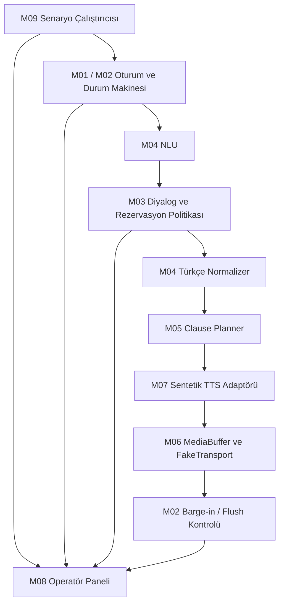

### 12.2.1 Tüm yolun adım adım açıklaması

1. **M09 senaryo çalıştırıcısı** test tanımını ve beklenen davranışları seçer. Testte gerçek müşteri konuşması yerine sentetik olay/veri vardır.
2. **M01/M02 oturum ve durum makinesi**, geçerli kullanıcı turunu oluşturur; oturum izolasyonu ve olay sırası sağlanır.
3. **M04 NLU**, metin girdisinden araç, fiyat, randevu veya temsilci niyetini ve gerekli alanları çıkarır.
4. **M03 diyalog politikası**, CRM/rezervasyon iş kurallarını çalıştırır; sahte servis sonucuna göre onay, ret, açıklama veya handoff verir.
5. **M04 normalizer**, doğrulanmış iş yanıtını konuşma için biçimlendirir. Aynı modülün giriş NLU ve çıkış normalizasyonunda iki farklı rol aldığına dikkat edilmelidir.
6. **M05 clause planner**, metni bölünmeyecek aralıkları koruyarak TTS girişlerine dönüştürür.
7. **M07 sentetik TTS**, gerçek WAV üretmeden sahte üretim/tamamlama olayları verir.
8. **M06 buffer/transport**, medya metaverisini sıraya alır, kapasite ve flush mantığını denetler.
9. **M02 barge-in/flush**, müşteri kesmesi, ACK ve timeout senaryolarını kontrol eder; çevrim yeniden M02 üzerinden yönetilir.
10. **M09 → M08 paneli:** Senaryo başlatma ve çalıştırma durumu görünür olur.
11. **M01/M02 → M08 paneli:** Konuşma ve oturum durumu görüntülenir.
12. **M03 → M08 paneli:** İş politikası sonucu ve ilgili durum izlenir.
13. **M02 flush kontrolü → M08 paneli:** Kesilme ve ACK bekleme olayları denetlenebilir hâle gelir.

Bu akışta bileşenler test amacıyla ayrı ayrı yeniden yazılmamış, önceki modüllerin sınıf/sözleşmeleri yeniden kullanılmıştır. Bu ayrım entegrasyonun değerini artırır; ancak gerçek adaptör kullanılmadığından gerçek zamanlı kaliteyi kanıtlamaz.

## 12.3 Sentetik 20 senaryonun kategorileri

TXT tek tek 20 senaryonun benzersiz adlarını ve her birinin giriş/çıkış logunu vermez; **senaryo kategorilerini** verir. Bu yüzden aşağıdaki satırlar test alanlarıdır, yirmi ayrı test ismi uydurulmamıştır.

| Alan | Kaynakta listelenen test davranışları |
|---|---|
| Ekspertiz | Müsaitlik, onay, ret, bilinmeyen sonuç |
| Rezervasyon güvenliği | Mükerrer onay, belirsiz işlemin sorgulanması |
| Fiyat ve CRM | Doğrulanmış fiyat, süresi dolmuş fiyat, CRM takip kaydı, yetkisiz erişim |
| Diyalog | İnsan temsilciye aktarım, belirsiz saat |
| Barge-in | Geçerli ACK, yanlış ACK, flush timeout |
| Medya | XOFF/XON, geç gelen üretim, hangup sırasında iptal |
| Adaptör dayanıklılığı | Retry, bağlantı kopması ve yeniden başlatma |
| Eşzamanlılık | Birden fazla oturumun birbirinden ayrılması |

**Sonuç:** 20/20 senaryo **sentetik kontrol ve iş mantığı düzeyinde PASS**.

## 12.4 M08 paneline eklenen M09 Senaryolar ekranı

Operatör, senaryo seçimi ve çalıştırma sonucunda PASS/FAIL, kontrol maddeleri, ilgili oturum durumu ve güvenli olay izini görebilir. API için **senaryo adının doğrulanması**, localhost erişim sınırı ve **CSRF koruması** bildirildi. Arayüz Chromium'da statik/sentetik veriyle incelendi; gerçek Windows/Edge kabulü yoktur.

## 12.5 Entegrasyonda bulunan ve düzeltilen iki sorun

### 12.5.1 Monoton saat ile sanal saatin uyuşmaması

M03 olay üretimi, M02/M07'nin sanal saatiyle uyumsuz bir zaman otoritesi kullanıyordu. Böyle bir durumda timeout ve deadline davranışları testten teste tutarsızlaşabilir. Kaynak, M03'e geriye dönük uyumlu **saat enjeksiyonu** eklendiğini belirtir. Bu, modüllerin aynı test zaman referansıyla işlemesini sağlar.

### 12.5.2 Ekli Türkçe temsilci ifadeleri

M04 NLU, `temsilciye` gibi ek almış sözcükleri her durumda yakalayamıyordu. Eşleşme genişletildi ve regresyon kapsamına eklendi. Bu iyileştirme, kullanıcı ifadesindeki morfolojik biçimi göz ardı etmenin insan aktarımı isteğini kaçırabileceğini gösterir.

## 12.6 Açık bulgu: 10 konuşmaya hazırlanma blokesi

M09'da **10 sentetik yanıt**, M05 inceleme kapısında takıldı. Nedenler arasında bazı fiyat ifadeleri, ISO tarih/saat gösterimleri ve onaysız marka okunuşları sayıldı.

**Bu bulgunun kritik anlamı:** `İş kuralı doğru işlendi` demek, `müşteriye okunabilir ses çıktı` demek değildir. Yanıtın konuşmaya uygun metne dönüştürülmesi **ayrı bir kalite kapısıdır**. M10'un `PolicySpeechPresenter` bileşeni bu sorun için planlanmış ve uygulanmıştır.

## 12.7 Test, regrese etme ve devir

- **411 otomatik test** ve **20 senaryo**, ZIP temiz klasöre çıkarılarak yeniden çalıştırıldı.
- 320 golden verinin SHA-256 değeri korundu.
- Linux/Python 3.13 ile doğrulandı; Windows/Python 3.11 yoktu.
- **Gerçek Freya, mikrofon, YouTube sesi, GPU veya telefon bağlantısı kullanılmadı.**
- M09 sonucu: **sentetik uçtan uca PASS; gerçek ses ve production readiness HOLD**.
- M10'a taşınanlar: metin sunumu blokeleri, RAM içi kuyruk kalıcılığı, çökme kurtarması ve canlı adaptör bağlantısı öncesi güvenlik denetimi.

---

<a id="bolum-13"></a>
# 13. M10 — Real Adapter Readiness & Resilience Contracts (Dry Run)

## 13.1 Problem ve amaç

M10, M09 sonunda belirgin kalan iki işletim riski ile iki bağlantı hazırlığı ihtiyacını hedef almıştır:

1. İş politikası doğru olsa bile bazı yanıtlar TTS inceleme kapısından geçemiyordu.
2. RAM içi olay yönetimi çökme sonrası kayıtların güvenilir kurtarılmasına yetmiyordu.
3. Yarım kalan oturumların hangi güvenli durumda açılacağı tanımlanmalıydı.
4. Gerçek Freya/STT/LLM/PBX adaptörleri için **bağlantı açmadan önce** yapılandırma gereksinimleri kontrol edilmeliydi.

M10, gerçek servislere bağlanarak "artık çalışıyor" iddiası oluşturmak için değil, **M11 için koşullu hazırlık** üretmek için tasarlanmıştır.

## 13.2 Uygulanan bileşenler

| Bileşen | Görev | Yeni olan |
|---|---|---|
| `DurableJournal` | SQLite tabanlı kalıcı oturum ve olay kayıtları | RAM dışı kayıt otoritesi |
| `DurableSessionManager` | Atomik durum değişimi, olay sırası, yeniden başlatma sonrası güvenli kurtarma | İşlemsel state/outbox |
| `PolicySpeechPresenter` | M03 yanıtından M04/M05'e uygun konuşma metni çıkarma | Operatör metni ile konuşma metnini ayırma |
| `OfflineReadiness` | Dört adaptörün yapılandırma ve bağlantı öncesi koşullarını denetleme | Gerçek bağlantı açılmadan readiness analizi |
| `M10 DryRun` | 20 senaryoyu kalıcı oturum otoritesiyle yürütme | M09 senaryolarını dayanıklılık katmanına taşıma |
| `M10 Hazırlık ekranı` | Operatöre adaptör kontrol bulgularını gösterme | UI tarafında görünür kabul kontrolü |

## 13.3 PolicySpeechPresenter neden eklendi?

Kritik ürün bilgisi, insan operatör ekranında kimlik ve referans olarak görünür kalabilir; ancak TTS'e **rastgele teknik kimliklerin** aynen okunması gerekmeyebilir. Kaynaktaki örnek:

**Operatörün gördüğü metin:**

> Ekspertiz randevunuz oluşturuldu. Onay referansı: id123XYZ.

**Konuşmaya hazırlanmış metin:**

> Ekspertiz randevunuz oluşturuldu. Referans bilgisi operatör ekranında görüntüleniyor.

Burada iş sistemindeki referansın **silindiği** iddia edilmez; seslendirme sunumundan ayrıldığı anlatılır. Ayrıca metin üretimi ve rezervasyon kesinleşmesi farklı denetimlerdir: burada örnek, **zaten doğrulanmış** bir onay yanıtının nasıl seslendirileceğini gösterir.

### 13.3.1 M09 → M10 karşılaştırması

| Aynı 20 sentetik senaryoda | M09 | M10 |
|---|---:|---:|
| Konuşma hazırlama kapısında bloke edilen yanıt | 10 | 0 |

**Doğru yorum:** Metinsel uygunluk artmıştır. **Yanlış yorum:** Türkçe telaffuz artık kanıtlıdır. Onaylı A01-YT marka okunuşu sayısı hâlâ **0** idi.

## 13.4 Özgün SQLite/outbox/restart recovery flowchart'ı

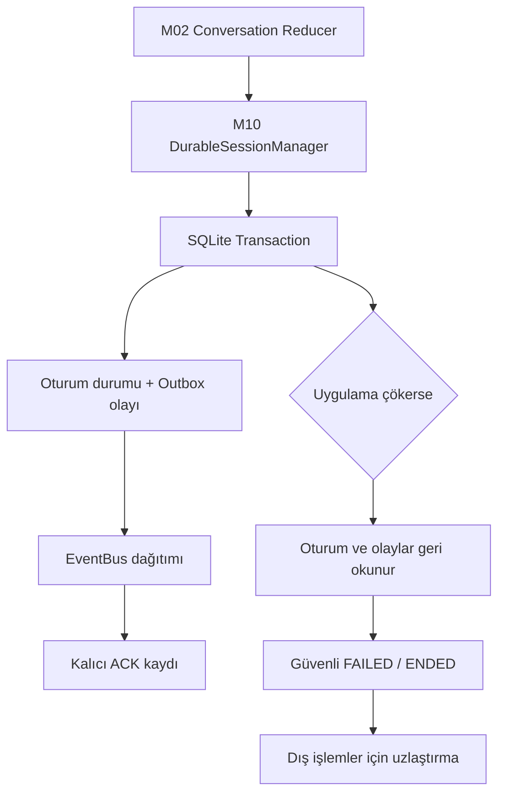

### 13.4.1 Normal işleyişin her adımı

1. **M02 reducer** geçerli bir olay sonucunda oturum değişikliği ve gönderilmesi gereken etkinin mantığını üretir.
2. **DurableSessionManager** bu değişikliği RAM'de bağımsızca kesinleştirmek yerine kalıcı kayda bağlar.
3. **SQLite transaction** açılır. Kaynakta amaç, oturum durum değişimi ve çıkış olayının **aynı işlem** içinde atomik yazılmasıdır.
4. **Oturum durumu + outbox olayı** birlikte tutulur. Böylece "durum değişti ama gönderim olayı hiç kayıt altına alınmadı" türü tutarsızlıkların bir bölümü önlenir.
5. **EventBus dağıtımı** kalıcı outbox'tan yayınlanacak olayları ilgili tüketiciye iletir.
6. **Kalıcı ACK kaydı**, gönderim sonrası işlenen onayın kaydedilmesini temsil eder.
7. **Transaction başarısız olursa**, kaynakta RAM'deki oturum durumunun değiştirilmeden korunduğu bildirilir; yarım commit'i uygulama doğru durum diye göstermez.

### 13.4.2 Çökme sonrası her adım

8. **Uygulama çökerse**, journal'daki oturum/olaylar yeniden okunur.
9. **Yarım görüşmeler otomatik sürdürülmez.** Sistem güvenli terminal durum olan `FAILED` veya `ENDED` yönüne gider.
10. **Dış işlem uzlaştırma** gerekebilir: örneğin CRM/randevu servisine istek gönderilmiş ama cevap kaydedilememişse sistem "kesinlikle yapılmadı" diye varsaymaz; dış sistemden doğrulama gereksinimi taşınır.

### 13.4.3 Outbox'ın vermediği garanti

- **Exactly-once dağıtım garanti edilmez.** Crash ve retry yüzünden aynı olayın tekrar yayımlanması mümkün olabilir.
- Bu nedenle **olay kimliğiyle tüketici tekrar ayıklaması** gereklidir.
- M10 sonunda **M02'nin bekleyen efektleri** ve **M03'ün rezervasyon durumunun kalıcılığı** henüz tam değildir.
- Bu açık, yalnızca "SQLite eklendi" cümlesiyle kapatılmış sayılmaz. Dış sistemler arası atomiklik/uzlaştırma ayrı risk olmaya devam eder.

## 13.5 M10 adaptör hazırlık denetimi

| Adaptör | Çevrimdışı kontrol kapsamı | M10'da canlı bağlantı | Aktivasyona hazır mı? |
|---|---|---|---|
| FreyaTTS | Model dizini, sağlayıcı, timeout | Hayır | `ready_for_activation = false` |
| STT/Whisper | Yerel model konumu, yapılandırma | Hayır | `false` |
| LLM | Endpoint, izinli uygulayıcı, secret-env | Hayır | `false` |
| Asterisk | Transport, codec, örnekleme hızı, güvenlik | Hayır | `false` |

Bu tabloda dosya/yapılandırma kontrolleri **servisin gerçekten yanıt verdiği sağlık sorgusu** değildir. M10'da hiçbir adaptörün canlı health probe'u yapılmadığından `ready_for_activation` değeri her biri için **false** kalır.

### 13.5.1 UI ve çalışma ortamı

M08 paneline **M10 Hazırlık** sekmesi eklenmiş ve çevrimdışı denetim bulguları orada gösterilmiştir. Panel için kaydedilen yerel adres `http://127.0.0.1:8765`'tir. Testler **Linux/Python 3.13** üzerinde yapılmıştır; Windows/Python 3.11 ve Edge fiziksel kabulü yapılmamıştır.

## 13.6 M10 kabul ve korunan regresyonlar

- **M01–M09'dan 411 regresyon testi korunmuştur.**
- M10 sonunda **435 toplam otomatik test başarılı** olarak raporlanır.
- Eski 320 cümlelik golden test kümesi değiştirilmemiştir.
- 20 otomotiv senaryosu dry-run ile tekrarlanmıştır.
- **M10 DRY-RUN PASS** kararı verilmiştir.
- **Production readiness HOLD** kalmıştır; gerçek Freya, STT, GPU, mikrofon, YouTube klibi ve Asterisk bağlantısı yapılmamıştır.

M10 teslim belgelerinin kaynakta verilen adları: kurulum/geliştirme rehberi, kalıcı outbox ve restart recovery mimarisi, metin hazırlama/adaptör sözleşmeleri, güvenlik/açık riskler, kabul raporu ve 20 senaryolu karşılaştırma CSV'si. TXT bu belgelerin tam içeriklerini taşımaz; burada içerikleri bağımsız doğrulanmış gösterilmez.

## 13.7 M10 → M11 geçiş kararı

M10'dan sonra aynı işi yeni bir mock modüle dönüştürmek yerine **hedef donanımda gerçek fiziksel kanıt** üretilmelidir. Bir sonraki aşama M11, mimari tasarımın bir sonraki soyutlama paketi değil, **gerçek kabul kapısıdır**.

---

<a id="bolum-14"></a>
# 14. M11 — Physical Acceptance & Real Voice Validation

## 14.1 Güncel durumun kesin ifadesi

Kaynağın son kayıtlarında **M11 v1 fiziksel kabul altyapısının hazırlandığı**, **435 önceki otomatik testin geçtiği** ve **320 golden metin kümesinin korunduğu** bildirilmiştir. Ancak gerçek ses, STT, GPU, Asterisk ve Windows/Edge kabul deneyleri **henüz yapılmadığı** için:

> **M11 PHYSICAL ACCEPTANCE: HOLD**

HOLD'un nedeni, rapora göre M01–M10 sentetik testlerin başarısız olması değildir; gerçek Windows 11, RTX 4070, Freya modeli, STT ses kayıtları ve canlı Asterisk ortamına bu aşamada erişilememesidir.

## 14.2 Kabul alanları ve talep edilen gerçek kanıtlar

| Fiziksel kabul alanı | Beklenen kanıt | TXT'deki gerçekleşme durumu |
|---|---|---|
| FreyaTTS / Leyla | Gerçek WAV, model SHA-256, sabit seed, RTF, insan dinleme puanları | Çalıştırıcı hazırlanmış; fiziksel ölçüm yok |
| Türkçe STT/VAD | Etiketli kayıtlar, WER/CER, gerçek söz kesme ölçümü | Ölçüm altyapısı hazırlanmış; gerçek skor yok |
| Codec | PCM/G.711 dönüşümü, frame bütünlüğü, gerçek playout | FFmpeg yolu hazırlanmış; fiziksel sonuç yok |
| Asterisk | Canlı medya olay izi, PBX kaydı, kuyruk boşalma gözlemi, kapanış | Test koşulları hazırlanmış; canlı PBX kanıtı yok |
| A01-YT telaffuz | Yetkili klip, SHA-256, zaman kodu, transkript, insan onayı | Üç kaynak kaydı var; onaylı klip/okunuş kabulü yok |
| Windows / Edge | Hedef sistemde çalıştırma ve kullanıcı kabul kayıtları | Fiziksel kabul yok |

**Bağımsız kapı ilkesi:** Bir alanın yazılım aracının hazır olması, o alanın PASS olması değildir. Her alan, kendi gerçek kanıtı olmadan HOLD kalır.

## 14.3 Freya/Leyla gerçek TTS kabul çalıştırıcısı

Kaynak şu test aracı özelliklerini bildirir:

1. Yerel Freya modelinin **açık onayla yüklenmesi**.
2. Model kimliği ve dosya bütünlüğünün kaydedilmesi.
3. **Sabit `seed=9`, `steps=32`** ile tekrarlanabilir çalışma ayarları.
4. **48 kHz WAV** oluşturma amacı.
5. Oluşan dosyaların SHA-256 özetini kaydetme.
6. **RTF** (real-time factor) ölçme ve performans kayıtlarını tutma.
7. `voice-review` kapısında **320 A/B çifti ve insan dinleme kararları** olmadan PASS vermeme.

**RTF'nin anlamı** (teknik terim açıklaması): Üretilen sesin hesaplama süresinin, sesin oynatma süresine oranı. Bu belgede *ölçülmüş RTF değeri yoktur*; eşiği de verilmemiştir. `seed` ve `steps`, kaynakta belirtilmiş **araç ayarlarıdır**, bu aşamada ses dosyası üretildiği kanıtı değildir.

### 14.3.1 İlk fiziksel adım — 12 cümlelik smoke test

Kaynağın son önerisi, FreyaTTS-small ve sabit Leyla profiliyle önce **12 cümlelik gerçek smoke test** yapılmasıdır. Bunun hedefi tüm 320 metin için büyük ölçekli A/B çalışmasına geçmeden önce model yükleme, dosya üretimi, biçim, hash ve temel dinlenebilirlik zincirinin hedef Windows/GPU ortamında çalıştığını göstermek olacaktır.

**Belgede 12 cümlenin birebir metin listesi yoktur.** Mevcut 320 golden cümlenin seçilme yöntemi ya da hangi on ikinin kullanılacağı kaynakta belirtilmediği için burada verilmez.

### 14.3.2 Sonraki aşama — 320 A/B değerlendirmesi

Bu aşamada 320 golden metin için A/B ses çifti ve dinleyici kararlarının eksiksiz olması kabul şartı olarak belirtilmiştir. Bunun ilk yol haritasındaki **640 WAV** ile olası nicelik ilişkisi makul görünse de kaynak, "640 dosya = 320 çift" eşitliğini tam teknik kabul tanımı olarak açıklamaz. Bu yüzden uygulamada kayıt matrisi, dosya adları ve karşılaştırma protokolü M11 rehberindeki asıl kriterlere göre netleştirilmelidir.

## 14.4 STT / VAD kabul altyapısı

- Yerel **Faster-Whisper** yolu üzerinden etiketli ses örnekleri için WER/CER hesabı hazırlanmıştır.
- Gerçek **VAD kesilme süresi** ve telefon oynatma gecikmesi ayrıca ölçülmelidir.
- TXT'de **ölçülmüş WER, CER veya VAD gecikmesi değeri** yoktur.

**Ölçütlerin anlamı:**

- **WER (Word Error Rate):** Konuşma tanımadaki kelime hatalarının referans kelime sayısına göre oranı.
- **CER (Character Error Rate):** Karakter düzeyinde eşdeğer hata oranı.
- **VAD gecikmesi:** Gerçek kullanıcı konuşmasının başlamasıyla algılama/tepki zincirinin belirlenen noktası arasındaki süre; TXT bu ölçümün kesin başlangıç/bitiş timestamp tanımını vermediği için belirli bir sonuç uydurulmaz.

## 14.5 Codec kabulü

FFmpeg üzerinden PCM/G.711 dönüşümü ve frame kontrolü için yerel test yolu hazırlanmıştır. M06'daki metadata testleriyle fark şöyledir:

- **M06:** "Bu codec için örnekleme hızı/saat/çerçeve metaverisi mantıklı mı?"
- **M11:** "Gerçek ses baytları gerçekten encode/decode edilebiliyor mu, frame bütünlüğü korunuyor mu ve karşı uçta düzgün oynatılıyor mu?"

Gerçek playout ve gecikme ölçülmeden bu kapı tamamlanmış sayılmaz.

## 14.6 Asterisk / PBX kabul koşulları

Kaynak, aynı görüşmeyi en az üç farklı kanıt türüyle desteklemek gerektiğini belirtir:

1. **Canlı olay izi:** PBX'in medya kontrol ve akış sinyallerinin zaman damgalı kaydı.
2. **Ham PBX kaydı:** Gerçek telefon ortamında medyanın kaydı.
3. **Bağımsız dinleme/gözlem:** Kullanıcı söz kestiğinde gerçekte ne duyulduğuna ilişkin doğrulama.

Ek koşullar:

- **En az 30 gerçek barge-in ölçümü**.
- Kaynakta sözü edilen **önerilen p95 hedefinin** doğrulanması. **P95 için sayısal eşik TXT'de yazmıyor**; bu dosya kendiliğinden milisaniye hedefi belirlemez.
- Asterisk'in belgelerde anılan **`FLUSH_MEDIA` ve `QUEUE_DRAINED`** olay davranışlarının hedef kurulumda kontrol edilmesi.
- Görüşme kapanışı ve playout güvenliği.

### 14.6.1 Fiziksel barge-in için açıklayıcı kanıt akışı

Aşağıdaki diyagram M11 kabul tablosundan türetilmiş **açıklayıcı** akıştır; TXT'de bu görselin aynısı bulunmaz.

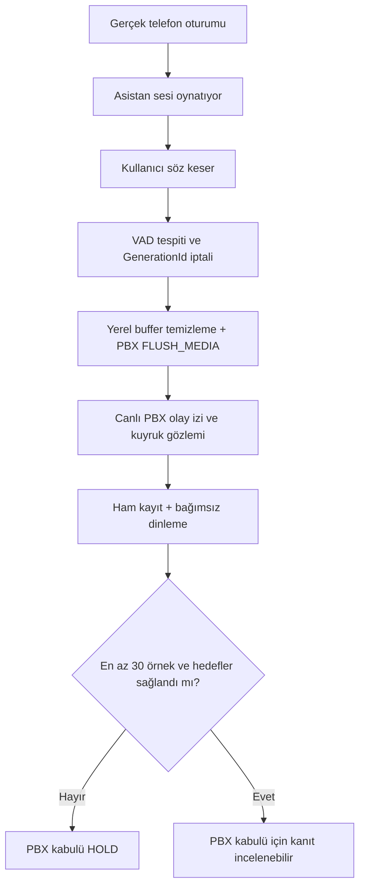

**Akışın önemi:** Yanlış ACK'in reddi daha önce test edilmiştir; ancak gerçek telefonda **eski sesin ne kadar süre duyulmaya devam ettiği** ancak canlı kayıt ve dinleme gözlemiyle değerlendirilebilir. `QUEUE_DRAINED` sinyalinin anlamı da kurulu Asterisk sürümünde ve gerçek medyada ayrıca doğrulanmalıdır. Yukarıdaki `evet` oku bütün M11'i otomatik PASS yapmaz; yalnızca PBX kabul dosyasının incelenmesini mümkün kılar.

## 14.7 A01-YT gerçek telaffuz kabulü

Kaynakta üç referans için mevcut izin beyanlarının korunacağı ve gerçek kaynak kanıtının gerekeceği belirtilir. En az **50 hedef** için şunlar bulunmadan veritabanı kabulü geçmez:

- Gerçek, kullanım yetkisine uygun ses klibi.
- Klip bütünlüğünü gösteren SHA-256.
- Kaynaktaki zaman kodu.
- Transkript.
- İnsan tarafından verilmiş telaffuz onayı.

Bu eşik **50 farklı marka olduğu** anlamına gelmeyebilir; kaynak yalnızca "50 hedef" der. Aynı şekilde önceki **3 kaynak**, *3 onaylı klip* sayısı değildir.

## 14.8 Windows 11 / RTX 4070 / Edge fiziksel kabulü

M11'in hedef ortamı gerçek Windows bilgisayarıdır; kaynak özel olarak **Windows 11**, **RTX 4070**, yerel Freya model kurulumunu ve Edge arayüz denemesini anar. Önce yazılım regresyonları, ardından model bağımlılıklarının yerel kurulumu ve gerçek WAV denemeleri hedeflenir.

**Komutlar hakkında not:** Orijinal TXT'de "Windows bilgisayarında ilk çalıştırma", "PowerShell'de" ve "model smoke testi" başlıkları vardır; ancak söz konusu **tam komut blokları görünmüyor**. Bu nedenle burada doğrulanmış gerçek CLI bayrakları uydurulmaz. Uygulama için M11'in adı geçen **Windows 11 adım adım uygulama rehberi** veya gerçek proje ZIP'indeki betikler incelenmelidir.

## 14.9 M11 çıktıları ve belgeleri

Kaynağa göre hazırlanan/öngörülen teslimler:

1. Windows 11 adım adım uygulama rehberi.
2. Fiziksel kabul planı.
3. M11 gerçek durum ve kabul matrisi.
4. Çevrimdışı HTML kabul raporu.
5. Freya/Leyla gerçek ses üretim ve `voice-review` araçları.
6. Faster-Whisper WER/CER ve FFmpeg codec test yolları.
7. Asterisk gerçek olay/medya/dinleme kanıtlarının alınmasına ilişkin kabul yaklaşımı.

Bunların hazırlanmış **araç ve doküman** olması ile gerçek testin **tamamlanması** farklıdır. Kaynak net biçimde gerçek fiziksel kanıt **bulunmadığını** söyler.

## 14.10 M11 kabul kapılarının takip tablosu

| Kapı | Kanıt bekleniyor mu? | TXT son durumu | Sonraki somut işlem |
|---|---|---|---|
| Windows 11 kurulum | Evet | HOLD | Hedef PC'de bağımlılık/435 regresyon kontrolü |
| GPU + gerçek Freya yükleme | Evet | HOLD | Model/cihaz bilgisi ve SHA-256 kaydı |
| Leyla ile 12 cümlelik smoke | Evet | HOLD | 48 kHz WAV ve RTF/dinleme kaydı |
| 320 A/B karşılaştırması | Evet | HOLD | Eksiksiz ses çiftleri ve insan kararları |
| Türkçe STT/VAD | Evet | HOLD | Etiketli gerçek ses ve WER/CER/tepki süreleri |
| Gerçek codec + playout | Evet | HOLD | PCM/G.711 dosya ve frame kanıtı |
| Asterisk barge-in | Evet | HOLD | En az 30 gerçek ölçüm, olay/ham ses/dinleme |
| A01-YT | Evet | HOLD | En az 50 hedefin klip/hash/zaman/transkript/onayı |
| Edge kullanıcı kabulü | Evet | HOLD | Yerel arayüzü gerçek hedef tarayıcıda sınama |
| Genel production-ready | Evet | HOLD | Bütün kritik kapıları değerlendirme ve açık riskleri kapatma |

## 14.11 M11 için önerilen çalışma sırası (kaynakla uyumlu plan)

1. **Hedef PC'nin yazılım tabanı:** Windows sürümü, Python, bağımlılıklar ve mevcut regresyonların çalıştırılması. Bu adım fiziksel ses üretmeden yapılabilir.
2. **Modelin yerel kurulumu ve kanıtı:** FreyaTTS-small ile sabit Leyla profilinin doğru model kimliği ve hash üzerinden yüklenmesi.
3. **İlk gerçek WAV kapısı:** 12 cümlelik smoke testi, çıktı biçimi, örnekleme, RTF ve dinleme kayıtları.
4. **Genişletilmiş TTS değerlendirmesi:** 320 A/B çifti ve insan kararları; eksik çift varsa PASS verilmemesi.
5. **STT/VAD ölçümleri:** Etiketli gerçek konuşma, WER/CER ve kesilme/latency verileri.
6. **Codec/playout kabulü:** Gerçek PCM/G.711 dönüşüm ve oynatma bütünlüğü.
7. **Asterisk fiziksel çağrı deneyleri:** Canlı olay izi + ham kayıt + dinleme ile en az 30 barge-in.
8. **Telaffuz kaynakları:** Üç referansın yetkili kliplerini kanıtlandırma, en az 50 hedefi insan onayıyla değerlendirme.
9. **Edge/operatör ve nihai karar:** Fiziksel ekran deneyimi ve kapıların kanıt bazlı birleştirilmesi.

Bu sıra **uygulanması önerilen bir yürütme planıdır**, tamamlanmış işlerin listesi değildir. Son kaynak raporunun en net ilk görevi: **Leyla profilinde 12 cümlelik gerçek smoke test; sonra 320 A/B**.

---

<a id="bolum-15"></a>
# 15. M01–M11 arası bağımlılık ve kontrol zincirleri

## 15.1 Kimlik ve iptal zinciri

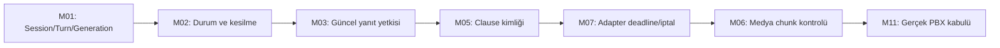

Sistem güvenliğinin tek bir `if cancel:` kontrolünden oluşmadığını gösterir. **Oturum kimliği** M01'de ortaya çıkar; **kesilme kararı** M02'de alınır; **iş yanıtının güncelliği** M03'te denetlenir; **konuşma parçası** M05'te kimliklenir; **geciken adaptör sonucu** M07'de filtrelenir; **medya chunk'ı** M06'da kuyruğa alınırken tekrar sınanır; en sonunda **gerçek PBX'te duyulan sonuç** M11'de kanıtlanmalıdır.

## 15.2 Randevu doğruluk zinciri

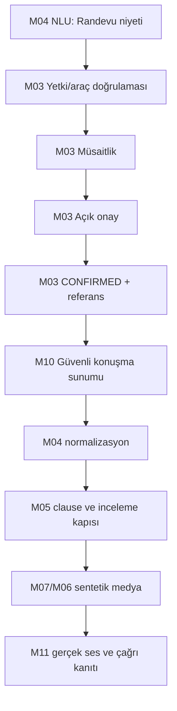

Bu zincir iki farklı doğruluk koşulu taşıyor: **işlemsel doğruluk** (`CONFIRMED` olmadan kesin konuşmama) ve **iletişimsel doğruluk** (onay kodunun, tarihin, paranın ve marka adlarının kullanıcıya güvenilir biçimde iletilmesi). M10'da ikinci zincirin metinsel tarafı iyileştirilmiştir; M11'de gerçek duyulabilirlik hâlâ beklemektedir.

## 15.3 Üç veri düzeyi: metin, sentetik medya ve gerçek ses

| Düzey | Örnek temsil | Hangi modüller? | Neyi kanıtlamaz? |
|---|---|---|---|
| **Metinsel iş yanıtı** | "Randevu oluşturuldu" / fiyat / tarih | M03–M05, M10 | Gerçek rezervasyonun canlı CRM'de oluştuğunu veya sesin doğru duyulduğunu |
| **Sentetik medya metaverisi** | 16 kHz, 20 ms, chunk sıra/kimlik | M06–M09 | Gerçek waveform, codec dönüşüm, telefon playout |
| **Gerçek akustik/telefon kanıtı** | WAV, PBX ham ses, ölçüm, dinleme | M11 hedefi | Diğer tüm güvenlik ve üretim risklerinin otomatik kapandığını |

---

<a id="bolum-16"></a>
# 16. Regresyon, kabul ve bütünlük tarihçesi

## 16.1 Kaynakta açıkça verilen test sayıları

| Rapor/aşama | Bildirilen toplam otomatik test sonucu | Ek doğrulama veya not |
|---|---:|---|
| Başlangıç mock çekirdek | **7/7** | İptal ve durum akışı örneği |
| M01 | Sayı ayrıca belirtilmiyor | Çekirdek/sözleşme PASS; 20 tur yarış örneği |
| M02/M03 çevresi | **52 önceki test** | M03, önceki 52'nin korunduğunu bildirir |
| M04 | **193/193** | 12 JSON sözleşmesi, paket bütünlüğü |
| M05 | **237/237** | 320 metinli clause raporu, ZIP bütünlüğü |
| M06 | Toplam sayı verilmemiş | Regresyon, yeni testler, JSON, sentetik flush, manifest PASS |
| M07 | **332/332** | 25 JSON sözleşmesi, temiz ZIP testi |
| M08 | **362/362** | M07'ye +30 yeni test |
| M09 | **411** | Ayrıca **20/20 sentetik senaryo** |
| M10 | **435** | M09'un 411 testi korunmuş; dry-run PASS |
| M11 v1 | **Önceki 435 test geçti** | Gerçek fiziksel kabul hâlâ HOLD |

**Önemli istatistik sınırı:** Bunlar kaynağın ardışık raporlarında belirtilen **birikimli** test sayılarıdır. Toplanarak "7+193+237+... adet bağımsız test" hesabı yapılmaz. M11'de yeni gerçek ses/telefon kabul sayıları veya ölçüm sonuçları bildirilmiyor.

## 16.2 Golden veri kümesi — 320 cümle

320 cümlelik karşılaştırma veri kümesi başlangıçtan itibaren korunmuş ve birçok aşamada **SHA-256 bütünlüğü değişmedi** diye raporlanmıştır. Bu yaklaşım, modüller geliştirilirken değerlendirme örneklerinin sessizce değiştirilmemesini amaçlar.

Bu golden veri kümesi hakkında TXT'nin **söylemediği** şeyler: 320 cümlenin tam metin listesi, kategorik dağılımının tamamı, WAV karşılıkları, gerçek insan dinleme sonuçları ve cümle başına bireysel MOS/WER/CER skorları. Bu belgede eksik veriler doldurulmamıştır.

## 16.3 Ortam doğrulamasının sınırı

M02–M10 boyunca **Linux/Python 3.13** üzerinden yapılan testler anlatılır. M08 UI ekranlarında Chromium kullanımı belirtilir. Ancak ürün hedefi **Windows-first** olduğundan Windows/Python 3.11/Edge çalıştırması ayrı fiziksel kabul kapısıdır ve kaynakta hâlâ eksiktir.

## 16.4 Kod ve paket bütünlüğü bulguları

- M06: önceki 44 Python modülünün değişmediği.
- M07: önceki 52 Python kaynağının byte düzeyinde değişmediği.
- M08: önceki 60 Python modülünün değişmediği.
- Birçok aşamada ZIP temiz klasöre çıkarılarak yeniden test edilmiş ve manifest doğrulanmıştır.

Bu raporlar **kaynakta kayıtlı bulgulardır**; ilgili ZIP/test dosyalarının kendisi burada mevcut olmadığından bağımsız tekrar sonucu olarak sunulmaz.

---

<a id="bolum-17"></a>
# 17. Teknik güvenlik kuralları ve invariants

Aşağıdaki kurallar, kaynak boyunca tekrar eden iş ve durum güvenliği kararlarının sistematik derlemesidir.

| Kural | Nerede ortaya çıktı? | Test edilen yön | Fiziksel/işletim açığı |
|---|---|---|---|
| Eski `GenerationId`'den gelen çıktı yeni görüşmeye karışmaz | M01, M02, M05–M07 | Mock iptal, gecikmiş yanıt | Gerçek medya buffer/PBX temizliği M11 |
| Yanlış flush ACK dinlemeyi açamaz | M02, M06 | Kimlik/tekrar/sahte ACK testleri | Gerçek Asterisk ACK semantiği M11 |
| Doğrulanmamış randevu kesinleşti denmez | M03 | FakeBookingService ve onay yolu | Gerçek CRM/rezervasyon işlem güvenliği |
| Müşteri onayı tek başına `CONFIRMED` değildir | M03 | Üç turluk sentetik görüşme | Canlı serviste status/idempotency |
| Doğrulanmamış/süresi geçmiş fiyat üretilmez | M03 | Sahte fiyat senaryoları | Canlı fiyat verisi ve yetki |
| Kanıtsız telaffuz kuralı aktive edilmez | M04, M05, M08 | İnceleme kapısı | Yetkili klip ve insan onayı M11 |
| Hatalı TTS girdisi zorla okunmaz | M05 | 29 inceleme vakası | Gerçek sesletim ölçümü |
| Lokal tampon = PBX tamponu değildir | M06 | Mock flush/ACK | Gerçek kuyruk ve playout M11 |
| Belirsiz yan etkili işlem körlemesine retry edilmez | M03, M07 | Mock idempotency mantığı | Canlı dağıtık işlem uzlaştırması |
| Olay durumu + outbox atomik yazılır | M10 | SQLite dry-run | Exactly-once yok; tüketici dedup gerekir |
| Restart'ta yarım çağrı otomatik sürdürülmez | M10 | Güvenli FAILED/ENDED | Bekleyen efekt/booking state kalıcılığı eksik |
| Kanıtı olmayan M11 kapısı PASS alamaz | M11 | Kabul araçlarının kapı yaklaşımı | Gerçek ölçüm sonuçlarının toplanması |

---

<a id="bolum-18"></a>
# 18. Kalan riskler — kaynak durumuna göre önceliklendirme

> Aşağıdaki önceliklendirme **belge yazarının değerlendirmesidir**; TXT'de tüm risklere ortak bir sayısal puan verilmemiştir. Riskin varlığı ve kanıt boşluğu TXT'den alınmıştır.

| Risk | Önerilen öncelik | Gerekçe | Doğrulama/azaltma yolu |
|---|---|---|---|
| Gerçek Asterisk flush ve barge-in kanıtsız | Kritik | Müşteri sözünün eski asistan sesiyle örtülmesi ve hatalı dinleme geçişi | En az 30 gerçek örnek, canlı iz + PBX ses + bağımsız dinleme |
| Gerçek Freya/Leyla ses kalitesi kanıtsız | Kritik | Türkçe telaffuz, doğallık ve performans bilinmiyor | 12 cümle smoke, 320 A/B, hash, RTF, insan kararı |
| Canlı CRM/rezervasyon durum uzlaştırması eksik | Kritik | Belirsiz sonuç mükerrer veya yanlış "kesinleşti" bildirimi üretebilir | Gerçek servis sözleşmesi, idempotency/dedup ve belirsiz işlem sorgusu |
| Bekleyen M02 efektleri ve M03 booking state kalıcılığı eksik | Yüksek | Journal olsa da tam sistem kurtarma tamamlanmış değil | Restart/çökme testlerinde iş etkisi uzlaştırması |
| Onaylı marka telaffuzu = 0 | Yüksek | Otomotiv özel adları duyulur biçimde doğrulanmış değil | A01-YT en az 50 hedef ve insan onayı |
| Windows/Edge/GPU çalışma kanıtı yok | Yüksek | Hedef ortam performansı ve uyumu belirsiz | Fiziksel Windows kabulü |
| Gerçek codec encode/decode ve playout yok | Yüksek | M06 metadata PASS gerçek ses bütünlüğünü kanıtlamaz | M11 PCM/G.711 ve playout kayıtları |
| STT/VAD WER/CER ve kesme gecikmesi ölçülmedi | Yüksek | Gerçek konuşma algılama hataları bilinmiyor | Etiketli ses ve gerçek latency kayıtları |
| Gerçek müşteri verisi için KVKK ve kimlik doğrulama açıkları | Yüksek | M03'te gerçek güvenlik/uyum tamamlanmadığı belirtiliyor | Canlıya geçmeden erişim, veri işleme ve yetki incelemesi |
| Kalıcı outbox exactly-once sanılabilir | Yüksek | Duplicate dağıtım olasılığı | Tüketicide olay ID'siyle dedup, uzlaştırma |
| Offline readiness "servis sağlıklı" diye yorumlanabilir | Orta/Yüksek | M10 hiç canlı sağlık sorgusu yapmadı | Canlı health probe ve bağlantı kabulü M11 |

## 18.1 Kaynakta olumlu görünen ancak risk kapatmayan bulgular

- **435/435 regresyon PASS** → fiziksel ses/telefon PASS değildir.
- **20/20 senaryo PASS** → canlı CRM'de 20 gerçek rezervasyon başarılıdır demek değildir.
- **10 blokajın 0'a düşmesi** → bütün yabancı marka telaffuzları doğrudur demek değildir.
- **SQLite outbox** → exactly-once mesaj teslimi ve tam rezervasyon kurtarması demek değildir.
- **M08 Chromium ekranları** → Windows/Edge ürün kabulü demek değildir.
- **Asterisk komut kodlayıcısı** → kurulu PBX'in gerçekten ses temizlediği anlamına gelmez.

---

<a id="bolum-19"></a>
# 19. Teknik devir için kabul kontrol listeleri

## 19.1 M00–M10'dan taşınan yazılım kanıtları

- [x] M01 oturum, olay sözleşmesi, kimlik ve iptal çekirdeği (TXT'de PASS)
- [x] M02 deterministik durum makinesi ve sentetik flush bariyeri (PASS)
- [x] M03 otomotiv diyalog politikası, sahte CRM/booking (PASS)
- [x] M04 normalizer, NLU ve telaffuz güvenlik kapısı (metinsel PASS)
- [x] M05 clause planı ve mock TTS girdi doğrulaması (PASS)
- [x] M06 codec metadata, queue, fake transport/ACK kontrolü (PASS)
- [x] M07 sentetik adaptör yaşam döngüsü ve hata izolasyonu (PASS)
- [x] M08 çevrimdışı operatör paneli ve inceleme kayıtları (MOCK UI PASS)
- [x] M09 20 sentetik uçtan uca senaryo (20/20 PASS)
- [x] M10 metin sunumu, SQLite journal/outbox, offline readiness (DRY-RUN PASS)
- [x] M11 v1 için yazılım kabul araçları ve rapor altyapısı (hazır olduğu bildiriliyor)

> `[x]` işaretleri **kaynak TXT'de tamamlandığı bildirilen yazılım işleri** ifade eder; bu dokümantasyon sırasında yapılan bağımsız kod doğrulamasını ifade etmez.

## 19.2 M11 gerçek fiziksel kanıt kontrol listesi

- [ ] Hedef Windows 11 ortamındaki çalışma kanıtı
- [ ] Hedef GPU ve model yükleme kanıtı
- [ ] Leyla profiliyle **12 gerçek cümle** smoke testi
- [ ] WAV biçimi, ses süresi, SHA-256 ve gerçek RTF kayıtları
- [ ] **320 A/B çiftinin** ses ve insan dinleme kararları
- [ ] Etiketli Türkçe gerçek ses ve WER/CER sonuçları
- [ ] Gerçek VAD kesilme/tepki süresi ölçümü
- [ ] PCM/G.711 gerçek dönüştürme/frame/playout kaydı
- [ ] Asterisk canlı olay izi, ham PBX ses kaydı ve bağımsız dinleme
- [ ] En az **30 gerçek barge-in ölçümü** ve belirlenmiş p95 kabul şartı
- [ ] A01-YT için **en az 50 kanıtlı telaffuz hedefi**
- [ ] Windows/Edge yerel operatör kabulü
- [ ] Canlı CRM/randevu idempotency, yetki ve belirsiz işlem uzlaştırma incelemesi
- [ ] Bekleyen M02 efektleri ve M03 rezervasyon kalıcılığı açıklarının değerlendirilmesi
- [ ] Tüm kritik kapılar sonrası gerçek üretim kabul kararı

## 19.3 Kanıt paketine yazılması önerilen alanlar

Aşağıdakiler, kaynağın kanıt türlerini izlenebilir kılmak amacıyla **önerilen bir rapor kayıt şemasıdır**; TXT'de aynen uygulandığı ileri sürülmez:

| Alan | Örnek içerik türü |
|---|---|
| `acceptance_gate` | `freya_smoke`, `stt_wer`, `pbx_barge_in` |
| `environment` | OS, Python, GPU, sürümler |
| `artifact_path` | Yerel WAV/CSV/JSON/log konumu |
| `sha256` | İlgili model veya çıktı özeti |
| `test_case_id` | Golden cümle veya çağrı senaryosu kimliği |
| `expected` / `observed` | Kabul beklentisi ve ölçülen sonuç |
| `reviewer_decision` | İnsan inceleme kaydı |
| `status` | `PASS`, `FAIL`, `HOLD` |
| `limitations` | Ölçüm yöntemi, eksik kanıt, açık risk |

Bu, sahada sadece "çalıştı" notu değil, yeniden incelenebilir kanıt üretmeyi amaçlar.

---

<a id="bolum-20"></a>
# 20. Dosyalar, raporlar ve nerede ne bulunduğu

Bu TXT bir **süreç ve teslim anlatısıdır**; MXX paketlerine ait gerçek ZIP'leri veya dokümanların tam içeriklerini bu dosyada barındırmaz. Kaynakta anılan teslim türleri aşağıda toplandı.

| İş paketi | Metinde anılan teslimler |
|---|---|
| M01 | Çekirdek/API sözleşmeleri; kabul ve M02 devri; M02 AI ajan görevi; doğrulama raporu |
| M02 | Durum makinesi/olay sözleşmeleri; M02 kabul–M03 devri; M03 ajan görevi; doğrulama raporu; `check_m02.ps1` |
| M03 | `docs/15_M03_SOZLESME_VE_IS_KURALLARI.md`, `docs/16_M03_KABUL_VE_M04_DEVIR.md`, `docs/17_M04_AI_AGENT_GOREVI.md`, `docs/18_M03_DOGRULAMA_RAPORU.md` |
| M04 | Normalizer/NLU sözleşmeleri; M04 doğrulama raporu; 320 karşılaştırma CSV; M05 ajan görevi |
| M05 | Prosody/Clause sözleşmeleri; M05 kabul–M06 devri; M06 ajan görevi; rapor; clause CSV |
| M06 | Codec/kuyruk/taşıma sözleşmeleri; M06 kabul–M07 devri; M07 ajan görevi; rapor |
| M07 | Adaptör yaşam döngüsü/izolasyon sözleşmeleri; M07 kabul–M08 devri; M08 ajan görevi; rapor |
| M08 | Yerel UI/API/telaffuz inceleme belgeleri; M08 kabul–M09 devri; M09 ajan görevi; rapor |
| M09 | Entegrasyon mimarisi; 20 senaryo CSV; M09 kabul/doğrulama; M10 ajan görevi |
| M10 | Kurulum/rehber; kalıcı outbox/restart mimarisi; speech presenter/adaptör sözleşmeleri; güvenlik/risk raporu; karşılaştırma CSV; M10 kabul ve M11 devri |
| M11 | Windows 11 rehberi; gerçek kabul planı; kabul matrisi; çevrimdışı HTML rapor; ses/STT/codec/PBX kabul araçları |

**Dosya erişimi uyarısı:** Bu belgenin oluşturulduğu görevde yukarıda sayılan paketlerin kendileri verilmedi; **yalnızca** ana TXT içeriği kullanıldı. Belge adları "pakette bulunuyor" şeklinde kaynak anlatımıdır, dosya sisteminde ayrıca taranmış oldukları anlamına gelmez.

---

<a id="bolum-21"></a>
# 21. Kavram sözlüğü

| Terim | Açıklama |
|---|---|
| **STT** | Speech-to-Text; konuşma sesinden metin çıkarma. |
| **TTS** | Text-to-Speech; metinden konuşma sesi üretme. |
| **VAD** | Voice Activity Detection; konuşma etkinliği algılama. |
| **LLM** | Large Language Model; diyalog/yanıt katmanında kullanılabilecek model türü. |
| **CRM** | Müşteri, araç ve takip verisi hizmeti. |
| **PBX / Asterisk** | Telefon santrali/medya taşıma sistemi. |
| **Barge-in** | Asistan konuşurken müşterinin söze girerek asistan konuşmasını kesmesi. |
| **Reducer** | Güncel durum ve olayı alıp yeni durum/etki türeten deterministik mantık. |
| **Effect** | Dış adaptöre uygulanacak iş/komut. |
| **Idempotency** | Aynı mantıksal isteğin tekrarında yan etkinin yanlışlıkla çoğalmamasını amaçlayan özellik. |
| **ACK** | Bir isteğe ait tamamlanma/onay mesajı; gerçek ve fake ACK aynı kanıt değeri taşımaz. |
| **FLUSH_MEDIA** | Medya oynatma kuyruğunu boşaltmaya yönelik kontrol işlemi. |
| **QUEUE_DRAINED** | PBX medya kuyruğunun boşaldığına ilişkin hedef Asterisk sürümünde doğrulanması gereken olay. |
| **XOFF/XON** | Medya akışını durdurma/sürdürme sinyalleri. |
| **Codec** | Sesin kodlanma/çözülme biçimi. |
| **RTP clock** | Medya paketlerinin zaman tabanı; çözümlenmiş örnekleme frekansından farklı olabilir. |
| **Clause** | TTS için ayrı ele alınan, anlam ve prosodi bakımından bütünlüklü metin parçası. |
| **Golden test set** | Değişmeden korunan ve regresyon karşılaştırmasında kullanılan referans veri kümesi. |
| **SHA-256** | İçerik bütünlüğü/kimlik takibi için kullanılan kriptografik özet. |
| **Outbox** | Durumla birlikte kalıcı kaydedilen, daha sonra dağıtılacak olay kaydı. |
| **Exactly-once** | Mesajın yalnızca bir kez işlenmesine ilişkin kuvvetli teslim/işleme garantisi; M10 bunu sunmuyor. |
| **Circuit breaker** | Hatalı adaptöre tekrarlanan isteklerin geçici olarak durdurulması yaklaşımı. |
| **Deadline** | Bir işlemin tamamlanması için zaman sınırı. |
| **RTF** | Gerçek zaman katsayısı; üretim süresi / üretilen ses süresi. |
| **WER/CER** | Kelime/karakter hata oranları. |
| **MOS** | İnsan dinleyici değerlendirmesi için kullanılan ortalama görüş puanı yaklaşımı; TXT'de ölçülmüş MOS yok. |
| **p95** | Ölçümlerin yüzde 95'inin altında kaldığı gecikme sınırı; kaynaktaki kesin hedef sayı belirsiz. |
| **Dry-run** | Gerçek servise bağlanmadan kuralları ve bağlantı önkoşullarını sınayan prova. |

---

<a id="bolum-22"></a>
# 22. Nihai teknik değerlendirme ve devir özeti

## 22.1 Ne yapıldı?

FreyaTTS otomotiv asistanı için **modüler çekirdek (M01), konuşma durum makinesi (M02), iş/rezervasyon politikası (M03), Türkçe NLP/TTS hazırlığı (M04–M05), medya/codec sözleşmeleri (M06), adaptör yönetimi (M07), çevrimdışı operatör paneli (M08), 20 senaryoluk sentetik entegrasyon (M09) ve dayanıklılık/hazırlık dry-run (M10)** tamamlanmış olarak raporlanmıştır. M11'in **gerçek fiziksel kabul araçları** hazırlanmıştır.

## 22.2 Ne kanıtlandı?

Kaynak anlatımına göre M10 sonunda **435 otomatik test** başarılı, M09/M10 kapsamındaki **20 sentetik senaryo** başarılı, M09'daki **10 TTS metin blokajı** M10'da aynı senaryolarda **0**, 320 golden metin veri kümesi değiştirilmeden korunmuştur.

## 22.3 Ne henüz kanıtlanmadı?

**Gerçek Freya/Leyla WAV çıkışı, gerçek dinleme kalitesi, STT WER/CER, fiziksel VAD gecikmesi, PCM/G.711 playout, canlı Asterisk flush/queue davranışı, 30 gerçek barge-in, A01-YT 50 onaylı hedefi, Windows/RTX 4070/Edge fiziksel kabulü ve gerçek üretim dayanıklılığı** kaynakta tamamlanmış değildir. Bekleyen M02 efektleri, M03 rezervasyon durumu kalıcılığı ve canlı servis güvenliği ayrıca açık konulardır.

## 22.4 Bir sonraki uygulanabilir karar

**Yeni bir M12 mimari paketi açmak yerine M11'in fiziksel HOLD kapıları gerçek ölçümlerle kapatılmalıdır.** İlk kanıt, hedef Windows bilgisayarında **FreyaTTS-small + sabit Leyla profiliyle 12 cümlelik smoke test** olmalıdır. Bunun ardından kaynağın tarif ettiği **320 A/B insan dinleme değerlendirmesi**, STT/codec/PBX ve telaffuz kabul alanlarına geçilebilir.

---

<a id="ek-a"></a>
# Ek A. Mermaid şemaların listesi ve kaynak ilişkisi

> Aşağıdaki kayıt, bu belgede hangi görsellerin TXT'deki **özgün** flowchart'lardan aktarıldığını, hangilerinin ise konuyu açıklamak amacıyla sonradan **türetildiğini** belirtir.

| Bu dokümandaki konum | Şema | Tür |
|---|---|---|
| §2.3 | Genel sistem mimarisi | **Özgün TXT flowchart'ı** |
| §2.4 | M00–M11 geliştirme sırası | **Açıklayıcı türetim** |
| §4.3 | M01 sentetik konuşma yolu | **Açıklayıcı türetim** |
| §5.3 | M02 konuşma durum makinesi | **Özgün TXT flowchart'ı** |
| §5.4 | M02 kesilme/ACK sequence | **Açıklayıcı türetim** |
| §6.3 | M03 ekspertiz rezervasyonu | **Özgün TXT flowchart'ı** |
| §7.4 | M04 NLU karar yolu | **Açıklayıcı türetim** |
| §8.4 | M05 TTS giriş/inceleme/iptal | **Özgün TXT flowchart'ı** |
| §9.4 | M06 kuyruk/flush/backpressure | **Özgün TXT flowchart'ı** |
| §10.3 | M07 adaptör yaşam döngüsü | **Özgün TXT flowchart'ı** |
| §10.5 | M07 sentetik akış özeti | **Açıklayıcı türetim** |
| §11.3 | M08 UI/API entegrasyonu | **Özgün TXT flowchart'ı** |
| §12.2 | M09 sentetik uçtan uca bütünleşme | **Özgün TXT flowchart'ı** |
| §13.4 | M10 journal/outbox/restart | **Özgün TXT flowchart'ı** |
| §14.6.1 | M11 PBX kanıt akışı | **Açıklayıcı türetim** |
| §15.1–15.2 | Modüller arası iki kontrol zinciri | **Açıklayıcı türetim** |

**Mermaid okuma notu:** GitHub gibi Mermaid destekli Markdown görüntüleyicilerde akış diyagramları görselleşir; düz metin düzenleyicisinde `mermaid` kodu görünür. Şemalar bilgi aktarımı amacıyla hazırlanmıştır; çalıştırılabilir uygulama kodu değildir.

<a id="ek-b"></a>
# Ek B. Belgenin kaynak/sürüm sınırlamaları

1. **Birincil kaynak:** `FreyaTTS Otomotiv Asistanı - Mimari Öncelikli_.txt`.
2. **Kaynak analiz yöntemi:** 928 satırlık ana metin baştan sona okunmuş, MXX raporları tek bir kronolojik teknik anlatıya dönüştürülmüştür.
3. **Bağımsız doğrulama yapılmayanlar:** ZIP kaynak kodu, test betiklerinin gerçek çalışması, SQLite şeması, JSON Schema dosyalarının içeriği, API yanıtları, Freya model dosyaları, gerçek WAV/telefon izi ve çevrimdışı raporların orijinal dosyaları.
4. **Arka plan yorumları:** Mimari akışların nedenleri, bazı türetilmiş görseller, risk önceliği ve kabul veri şeması dokümanı okunabilir kılmak için açıklayıcı olarak eklenmiştir; kaynakta kelimesi kelimesine ölçülmüş sonuç muamelesi görmez.
5. **Dış kaynak doğrulaması yapılmadı:** TXT'deki “Asterisk Documentation” ve “GitHub” ifadelerinde doğrudan URL verilmediği için bu belge harici servis sürümünün belgelere birebir uyumunu yeniden doğruladığını iddia etmez.
6. **Genel sonuç:** M00–M10 mimari/sentetik ilerleme **raporlanmış**; M11 fiziksel doğrulama **beklemede**. En temel sınır budur.

---

*Belge sonu — M00–M11 mimari ve sentetik gelişim anlatısı, özgün/türetilmiş flowchart açıklamaları ve M11 fiziksel kabul devri.*
