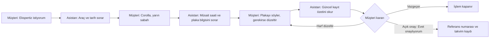
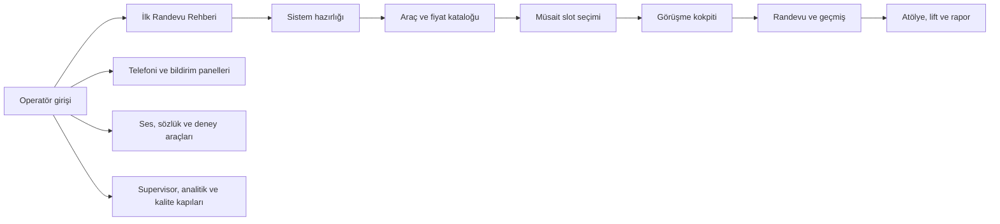
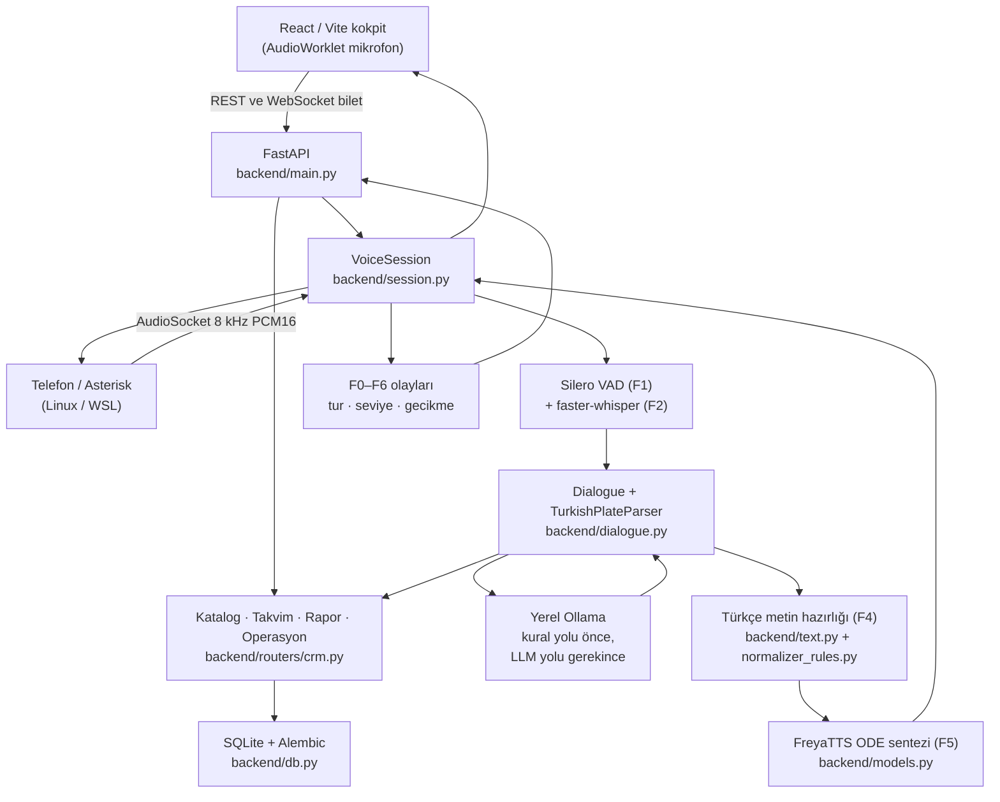
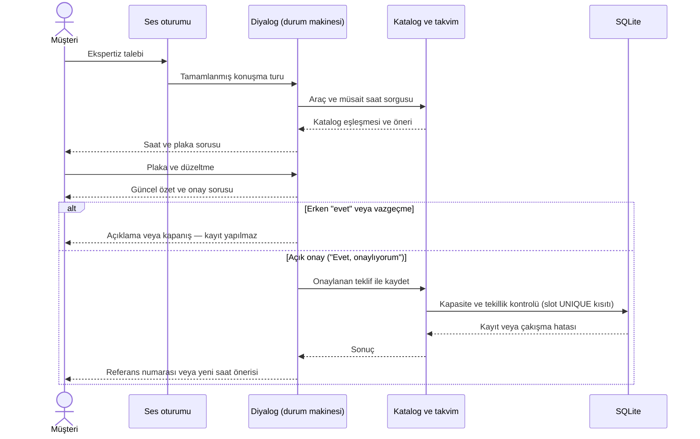
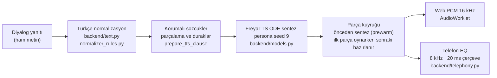
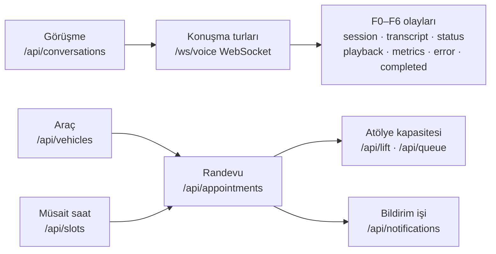
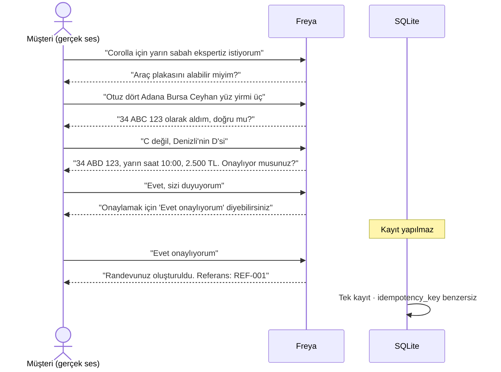

# FreyaTTS Automotive PoC · Ürün ve Teknik Mimari Raporu

> **Sürüm:** 2.0 · **Tarih:** 2026-11-20 · **Yazar:** Seydi Eryılmaz (@seydivakkas)

---

## Okuyucu rehberi

| Okur | Öncelikli bölümler |
|---|---|
| Müşteri veya demo izleyicisi | §2 müşteri deneyimi · §6 FreyaTTS · §10 demo akışı |
| Ekspertiz işletmesi | §3 kokpit ve ekranlar · §5 randevu işlemi · §8 işletim ve veri |
| Geliştirici veya değerlendirici | §4 mimari · §6–8 uygulama · §9 kanıt matrisi |

---

## 1. Yönetici özeti

**Freya**, Türkçe sesli görüşmeyi takip edilebilir bir ekspertiz işlemine dönüştüren yerel bir otomotiv asistanı prototipidir. Müşteri talebini söyler, araç ve plaka bilgilerini verir, önerilen saati seçer ve özet üzerinden onaylar. Operatör görüşmeyi panelde izler ve sonucu takvimde görür.

Projenin ayırt edici iddiası şudur: **otomotive özgü Türkçe konuşma biçimlerini iş kuralları ve doğrulanabilir kayıtlarla birleştirmek.** Bu iddia üç ayrı teknik soruya yanıt gerektirir:

1. Sözlü plakayı, model adını ve fiyatı doğru **duymak** (Silero VAD + faster-whisper)
2. Niyet ve alan bilgisini kural öncelikli, LLM destekli **yorumlamak** (Dialogue + TurkishPlateParser)
3. Müşteriye anlaşılır biçimde **geri okumak** (Türkçe normalizasyon + FreyaTTS)

Bu iddianın canlı ses kanıtı — gerçek mikrofonla kayıt — bir sonraki teslimdir.

> [!NOTE]
> Tüm ölçüm değerleri `docs/measured-latency.json` ve `docs/benchmark-results.json` kaynaklıdır. Bağımsız dağılım ölçümü yapılmamıştır; tek çalıştırma örnekleri SLA değildir.

---

## 2. Müşteri deneyimi

Müşterinin ürün yüzü **konuşmadır.** Web mikrofonu yönetim kokpitindeki Görüşme ekranından açılır. Telefon müşterisi konuşmayı santral kanalı üzerinden yürütür. Mevcut web demo operatör panelinde yürütülür.



### Temel senaryo — plaka ve hedefli düzeltme

| Söylenen | Sistem çıktısı | Kaynak |
|---|---|---|
| `"Otuz dört Adana Bursa Ceyhan yüz yirmi üç"` | `34 ABC 123` | `TurkishPlateParser.parse_spoken()` |
| `"C değil, Denizli'nin D'si"` | `34 ABD 123` | `TurkishPlateParser.correct_plate()` |
| `"Evet, sizi duyuyorum"` | Görüşme sürer, kayıt yapılmaz | Diyalog politikası — erken onay reddi |
| `"Evet, onaylıyorum"` | Takvimde tek kayıt, referans döner | `book()` + idempotency kontrolü |

> [!IMPORTANT]
> `"Evet, sizi duyuyorum"` ile `"Evet, onaylıyorum"` arasındaki ayrım diyalog politikasının görevidir. Açık onay yalnızca güncel teklif aşamasında kabul edilir; diğer tüm "evet" ifadeleri onay olarak işlenmez.

Kaynaklar: [`backend/turkish_plate.py`](../backend/turkish_plate.py) · [`tests/test_poc_spoken_plate_and_intent.py`](../tests/test_poc_spoken_plate_and_intent.py)

---

## 3. Operatör kokpiti — 20 ekran ve dört kategori

Kokpit **20 sekme** ve **4 kategori** içerir. Kategori yapısı [`frontend/src/nav.ts`](../frontend/src/nav.ts) dosyasından alınmıştır.



### 3.1 Operasyon & Atölye (`workshop`)

| Ekran | İkon | Pipeline aşaması | Kullanıcının yaptığı | Arka plan |
|---|---|---|---|---|
| **Görüşme** | 🎙️ | F0–F6 | Mikrofon oturumu, konuşma ve durum takibi, metinle deneme | `/ws/voice`, WebSocket bilet, `VoiceSession`, diyalog, F0–F6 olayları |
| **Randevular** | 📅 | — | Slot açma/kapatma, liste ve takvim görünümü, taşıma önizleme | CRM + scheduling, çakışma kontrolü, `book()` idempotency |
| **Sıra & Lift Durumu** | 🚗 | — | Kuyruk takibi, lift/istasyon durumu izleme | Lift kapasitesi, teknisyen ataması |
| **Ekspertiz Raporları** | 📄 | — | Rapor ve teslim sürecini yönetme, PDF onayı | Rapor kaydı, PDF üretimi, HMAC imzalı indirme bağlantısı |
| **Araçlar ve Fiyatlar** | 🏷️ | — | Marka/model kayıtları, ekspertiz paketi ve fiyat | CRM, katalog ve fiyat sorgusu; ücret kuruş olarak tutulur |
| **Teknisyen Dikte** | 🎙️ | — | Sesli bulgu girme | Dikte transkripsiyonu ve bulgu kaydı |
| **Araç Teşhis & OBD-II** | 🔌 | — | DTC hata kodları ve telemetri | Tanı uçları, OBD-II veri işleme. Fiziksel donanım kabulu ayrı |

### 3.2 Telefoni & Santral (`telephony`)

| Ekran | İkon | Kullanıcının yaptığı | Arka plan |
|---|---|---|---|
| **Bildirimler & WhatsApp** | 💬 | Bildirim kuyruğu ve teslim durumu | `whatsapp_webhook.py`, SMS kuyruğu, `X-Webhook-Token` doğrulama |
| **Görüşme Geçmişi** | 📜 | Görüşme ayrıntısı, transkript, olaylar | Görüşme, mesaj ve gecikme metrikleri; kademeli silme |
| **Operatör (6002)** | 🎧 | Çağrı izleme, fısıltı ve aktarım | AMI, `MockAMIClient`; gerçek arama/aktarım PoC kapsamında değil |
| **Giden Çağrılar** | 📞 | Arama hazırlama ve sonuç inceleme | Telefoni, çağrı işi; sahte AMI ile çalışır |

### 3.3 Ses & Yapay Zekâ Hattı (`audio_ai`)

| Ekran | İkon | Pipeline aşaması | Kullanıcının yaptığı | Arka plan |
|---|---|---|---|---|
| **Araç İçi DSP & Gürültü** | 🛡️ | F0 | 120 Hz HPF, spektral gürültü azaltma, AGC denemeleri | `dsp.py`, `car_denoiser.py` giriş/çıkış sinyali |
| **A/B Test & İnce Ayar** | ⚖️ | F1–F2 | Silero VAD ve Whisper ASR varyant karşılaştırması | `ab_testing.py`, z-test ve MOS konfigürasyonu |
| **Sözlük & Fonetik** | 📖 | F4 | Terim telaffuzu, normalizasyon denemesi | `config/lexicon.json`, `normalizer_rules.py` |
| **Otomotiv Ontolojisi** | 🌐 | F3–F4 | Alan şeması, terimler ve veri ilişkileri | Ontoloji modelleri, OBD-II semantik şema |
| **Ses Laboratuvarı** | 🧪 | F5–F6 | Metin normalizasyonu, FreyaTTS sentezi, WAV dinleme | `text_speech` router, FreyaTTS ODE, WSOLA |

### 3.4 Gözetim & Kalite Kapıları (`governance`)

| Ekran | İkon | Pipeline aşaması | Kullanıcının yaptığı | Arka plan |
|---|---|---|---|---|
| **Supervisor & FQICI** | 🔍 | F3 | 22 niyet üzerinde kalite incelemesi | Supervisor sözleşmeleri, politika, `supervisor.py` |
| **Analitik & KPI** | 📊 | — | p50/p95/p99 gecikme, SLA ve başarı oranları | `analytics.py`, `realtime_dashboard_metrics.py` |
| **Sistem & Donanım** | 🖥️ | — | RTX 4070 VRAM durumu, model circuit breaker | `gpu_health_circuit_breaker.py`, readiness ucu |
| **M01–M11 Kalite Kapıları** | 🎯 | — | 11 deterministik mühendislik kapısı ve test kanıtları | `milestones.py`, milestone çıktıları ve raporlar |

> [!TIP]
> İlk Randevu Rehberi (`FirstAppointmentGuide.tsx`) model hazırlığı, araç, takvim ve görüşmeyi tek bir akışta bir araya getirir. Demo sırasında giriş ve laboratuvar ekranları arka planda kalabilir.

Kaynaklar: [`frontend/src/nav.ts`](../frontend/src/nav.ts) · [`frontend/src/FirstAppointmentGuide.tsx`](../frontend/src/FirstAppointmentGuide.tsx) · [`backend/main.py`](../backend/main.py)

---

## 4. Sistem mimarisi ve dağıtım



### Bileşen sorumlulukları

| Bileşen | Dosya | Görevi |
|---|---|---|
| FastAPI | `backend/main.py` | Yaşam döngüsü, router kaydı, model yükleme |
| VoiceSession | `backend/session.py` | 16 kHz giriş, VAD, STT, kuyruk, iptal, ses oynatma |
| Dialogue | `backend/dialogue.py` | Randevu durum makinesi; LLM'in DB'ye doğrudan erişimi yok |
| TurkishPlateParser | `backend/turkish_plate.py` | Sözlü plaka çözümü ve hedefli düzeltme |
| FreyaTTS adaptörü | `backend/models.py` | `_synth_one` API; seed 9 sabit; dahili normalizasyon tekrar çalışmaz |
| Metin hazırlığı | `backend/text.py` + `normalizer_rules.py` | Türkçe sayı, tarih, fiyat, plaka normalizasyonu |
| SQLite | `backend/db.py` | WAL, yabancı anahtarlar, atomik randevu, slot tekilliği |
| AudioSocket | `backend/telephony.py` | UUID, çift yönlü 8 kHz PCM16, 20 ms çerçeve |
| Güvenlik | `backend/security_utils.py` + `.env` | HTTP Basic, WS bilet, HMAC, `PBX_ALLOWED_IPS` |

> [!NOTE]
> Windows ana makinede web paneli, FastAPI, SQLite ve yerel model süreçleri çalışır. Asterisk Linux/WSL veya ayrı santral olarak yapılandırılabilir. `HF_HUB_OFFLINE=1` ile tamamen çevrimdışı çalışılabilir.

### Router ailesi

`backend/routers/` altında on alan modülü:

| Modül | Kapsam |
|---|---|
| `core_system` | Sağlık, hazırlık (`/api/readiness`), model yükleme |
| `text_speech` | Normalizasyon (`/api/normalize`), sentez (`/api/synthesize`), sözlük, A/B |
| `operator_qa` | Operatör QA, kalite |
| `telephony` | Bildirim, giden arama, AudioSocket, aktarım, WhatsApp webhook |
| `crm` | Araç, muayene, randevu, görüşme, teknisyen dikte |
| `scheduling` | Lift, sıra, servis yeri |
| `audio_dsp` | DSP uçları |
| `compliance` | KVKK, ses arşivi |
| `observability` | GPU, SIP, metrik |
| `generic_resources` | Catch-all; en son kaydedilir |

---

## 5. Niyet, plaka ve randevu işlemi



### Diyalog politikası — anahtar kararlar

| Karar | Mekanizma | Kaynak |
|---|---|---|
| Kural mı / LLM mi? | `_rule_extract` önce çalışır; kurallar yeterliyse LLM çağrılmaz | `backend/dialogue.py` |
| Plaka çözümü | Sözlü fonetik alfabe + sayı çözücü + hedefli düzeltme | `backend/turkish_plate.py` |
| Açık onay zorunluluğu | Her kanalda ve her durumda müşteri onayı şarttır | Diyalog politikası |
| Slot tekilliği | SQLite UNIQUE kısıtı + yarış koşulu koruma | `backend/db.py` → `book()` |
| İdempotency | `idempotency_key` ile aynı istek tekrarında çift kayıt engeli | `backend/db.py` |

---

## 6. FreyaTTS — otomotive özgü ses sentezi



### Otomotive özgü özellikler ve doğrulama durumu

| Özellik | Somut mekanizma | Doğrulama durumu |
|---|---|---|
| **Türkçe sayı ve biçim çözümleme** | Tarih `14:30` → `"on dört otuzda"` · Fiyat `2.500 TL` → `"iki bin beş yüz Türk lirası"` | `backend/text.py` + `normalizer_rules.py`. Laboratuvarda ham/normalize çifti ve ses örneği al |
| **Otomotiv telaffuz sözlüğü** | `"VW"` → `"Folksvagen"` · `"TSI"` → `"te se i"` · `"e-Power"` → `"i pavır"` | `config/lexicon.json`. Benchmark çıktısında "Folksvagen" ve "i pavır" doğrulandı |
| **Plaka harf okuma** | `"34 ABD 123"` → `"otuz dört, a, be, de, yüz yirmi üç"` | `backend/text.py` LETTERS eşlemesi |
| **Cümle ve durak kontrolü** | Kısa yanıt blokları, noktalama bazlı duraklar, korumalı atomlar | `clauses`, `protected_atoms`, `prepare_tts_clause` |
| **Önbellek ve ısınma** | İlk karşılama önbelleği ~15 ms · Soğuk başlatma ~10,7 s | `docs/measured-latency.json` · `docs/benchmark-results.json` |
| **Parçalı üretim ve söz kesme** | İlk parça hazır olduğunda çalma başlar; eski tur kuyruğu iptal edilir | `backend/session.py` üretici ve kuyruk yönetimi |
| **Kanal uyarlama** | Web: 16 kHz PCM · Telefon: 8 kHz PCM16, 20 ms çerçeve, EQ | `play_wave`, `backend/telephony.py` |
| **Deney araçları** | A/B varyant, morfolojik kontrol, ODE batch ayarı | `text_speech` router ve A/B konfigürasyonu |

### Ölçülen değerler (tek çalıştırma, RTX 4070 Laptop, 2026-11-06)

| Adım | Ölçüm | Not |
|---|---|---|
| Karşılama ilk sesi | ~15 ms | Önceden önbelleğe alınmış |
| İsim turu | ~1,4 s | |
| Araç turu (kısa cümle) | ~3,2 s | |
| Seçim ve onay turu | ~3,2 s | |
| LLM gerektiren turlar | ~6 s | |
| STT | ~0,3–1,5 s | |
| TTS soğuk (Passat cümlesi, 4,8 s ses) | 1.638 ms | RTF 0,34 |
| TTS sıcak (Passat cümlesi, 4,8 s ses) | 647 ms | RTF 0,13 |
| VRAM tepe | 7.478 MiB / 8.188 MiB | Masaüstü uygulamaları dahil |

> [!WARNING]
> Bu değerler tek çalıştırma örnekleridir. Dağılım, p95 ve SLA için çok sayıda çalıştırma gereklidir. Benchmark çıktısında ASR transkripsiyonları (`"Force Wagon Puzzle"`, `"KaşGöl"`) düzeltilmemiş ham ASR çıktısıdır — bu değerler TTS kalitesini değil, benchmark koşullarındaki ASR doğruluğunu gösterir.

**Sentez kalitesini raporlamak için dört kontrol sorusu:**
1. Plakanın tamamı anlaşılır mı? (`34 ABD 123` → `"otuz dört, a, be, de, yüz yirmi üç"`)
2. Fiyat ve saat yanlış duyuluyor mu? (`2.500 TL`, `10:00`)
3. Telefonda ünsüz ayrımı korunuyor mu? (dar bant 8 kHz)
4. İlk ses ve söz kesme gecikmesi ne kadar?

Kaynaklar: [`backend/text.py`](../backend/text.py) · [`backend/normalizer_rules.py`](../backend/normalizer_rules.py) · [`backend/models.py`](../backend/models.py) · [`backend/routers/text_speech.py`](../backend/routers/text_speech.py) · [`backend/session.py`](../backend/session.py)

---

## 7. REST API, olaylar ve veri modeli



### Temel uç noktalar

| Alan | Uç nokta | Açıklama |
|---|---|---|
| Sağlık | `GET /api/health` | Hızlı durum |
| Hazırlık | `GET /api/readiness` | Model yükleme, bağımlılık durumları |
| Model yükleme | `POST /api/models/load` | Çalışırken model yükle |
| Normalizasyon | `POST /api/normalize` | Ham metin → konuşulabilir metin |
| Sentez | `POST /api/synthesize` | Metin → WAV |
| Ses oturumu bilet | `POST /api/session-ticket` | Tek kullanımlık, 30 s geçerli |
| Ses oturumu | `WS /ws/voice?ticket=...` | PCM16 çift yönlü; ilk JSON konfigürasyon |
| OpenAPI | `GET /docs` | Tam API belgesi |

### WebSocket medya sözleşmesi

**İlk JSON (istemci → sunucu):**
```json
{"sample_rate": 48000, "encoding": "pcm_s16le", "channels": 1}
```
Desteklenen hızlar: 8000 / 16000 / 24000 / 44100 / 48000 Hz.

**Sunucu olay tipleri:** `session` · `transcript` · `status` · `playback` · `metrics` · `error` · `completed`

`playback` mesajı `pause` / `resume` / `flush` komutlarını taşır; istemci oynatma kuyruğunu bu komutlarla yönetir.

**AudioSocket:** `0x10` tip, 8 kHz 16-bit mono little-endian, başlık uzunluğu big-endian, UUID 16 bayt, son kısa çerçeve sıfırla tamamlanır.

> [!NOTE]
> Gerçek tablo ve ilişki imzaları [`backend/db.py`](../backend/db.py)'de ve Alembic migration dosyalarındadır.

---

## 8. Yerel işletim, veri ve hata yönetimi

### Güvenlik modeli

| Kural | Mekanizma |
|---|---|
| REST erişimi | HTTP Basic; `ADMIN_PASSWORD` `.env`'de; boşsa 503 |
| WebSocket | Tek kullanımlık 30 s bilet (`/api/session-ticket`) |
| Webhook | `X-Webhook-Token` gövde işlenmeden önce doğrulanır |
| Gizli anahtarlar | `AMI_SECRET`, `WHATSAPP_WEBHOOK_TOKEN`, `AUDIO_ARCHIVE_MASTER_KEY`, `LINK_SIGNING_KEY` — boşsa ilgili özellik kapalı |
| AudioSocket | Şifresiz; yalnızca `PBX_ALLOWED_IPS` izin listesiyle |

### Veri yönetimi

| Konu | Politika |
|---|---|
| Tarih alanları | UTC ISO 8601; arayüz İstanbul saatini gösterir |
| Transkript | Görüşme silinince kademeli silinir |
| Ham ses | `RECORD_AUDIO` varsayılan kapalı; açıksa `recordings/*.wav`, `RETENTION_DAYS` sonunda temizlenir |
| Demo modu | `DEMO_MODE=1` → `data/demo/`; işletim verisine erişmez |
| Ücret | Kuruş olarak tutulur, TL gösterimde bölünür |

> [!CAUTION]
> Transkript ve diğer kişisel veriler için saklama süresi henüz uygulanmamıştır. KVKK maddeleri hukuki incelemede olup kesinleşmemiştir. TurnTrace'in ham metin alanı varsayılan dışa aktarma kapsamından çıkarılmalı veya maskelenmeli.

### Müşteri ekranı hata durumları

| Durum | Kullanıcıya gösterilen | Kayıt durumu |
|---|---|---|
| Mikrofon izni reddi | "Mikrofon erişimi gerekli" | — |
| Model hazır değil | "Sistem hazırlanıyor" | — |
| Plaka anlaşılmadı | Plaka sorusu tekrarlanır | — |
| Saat doldu (slot çakışması) | Yeni saat önerilir | — |
| Bağlantı kesildi | Tekrar bağlan mesajı | — |
| Başarısız kayıt | Hata mesajı; referans verilmez | — |

### Bilinen sınırlar

- Eşzamanlı görüşme kapasitesi ölçülmedi; testler tek görüşmeyle yapıldı.
- Serbest takvim tarihi pazarlığı ilk sürümde yok; yalnızca sunulan seçenek numarası.
- Kayıtsız araç için işlem yapılmaz.
- Giden arama ve aktarım `MockAMIClient` ile çalışır — gerçek çağrı yapılmaz.
- Bildirim sağlayıcısı sahte — gerçek SMS/WhatsApp gönderilmez.
- LLM akışı şemalı alan çıkarımı için; doğrulanmamış sonucu erken seslendirme yapılmaz.

---

## 9. Kanıt matrisi ve sınırlamalar

| İddia | Mevcut kanıt | Kalan kabul |
|---|---|---|
| Sözlü plaka çözümü | `TurkishPlateParser` birim testleri; 81 il kodu ve fonetik alfabe | İnsan PCM → ASR → çözüm → TTS geri okuma → gerçek kayıt |
| Hedefli harf düzeltmesi | `correct_plate()` birim testleri (`"C değil D"` → `34 ABD 123`) | Mikrofon koşusunda ASR hata zincirleri |
| Erken onay reddi | `test_poc_spoken_plate_and_intent.py` diyalog kararı | Mikrofon koşusunda erken onay zinciri |
| Tekil kayıt / idempotency | Randevu tablosu ve UNIQUE kısıtı testi | Yeniden bağlanma ve son slot yarışı |
| Çekirdek regresyon | 33 geçen test (`test_poc_spoken_plate_and_intent.py`) | Yeni commit ile aynı komutla tekrar |
| 512 konuşma | Sürümlenmiş `POC_SOHBET_512.jsonl` ve Mermaid ağaçları | Tüm yolların test koşucusuyla çalıştırılması |
| Yerel ses zinciri | Uygulama kodu; önceki sanal ses kaydı | İnsan mikrofon kabulü; güncel gecikme dağılımı |
| Asterisk ve çevre birimleri | Adaptör, panel ve yapılandırma kodu | Gerçek hat, aktarım, bildirim sağlayıcısı, fiziksel OBD |
| FreyaTTS kalitesi | Normalizasyon, sözlük, benchmark JSON | Kör dinleme, telefon anlaşılabilirliği, insan puanı |

> [!NOTE]
> `test_poc_spoken_plate_and_intent.py`'daki çekirdek test, metni doğrudan `Dialogue.answer()` metoduna veriyor. Bu test diyalog kararını ve veritabanı sonucunu doğrular. Mikrofon, ASR ve hoparlör kanıtı ayrı toplanır.

Kaynaklar: [`tests/test_poc_spoken_plate_and_intent.py`](../tests/test_poc_spoken_plate_and_intent.py) · [`docs/POC_SOHBET_512.jsonl`](POC_SOHBET_512.jsonl) · [`docs/measured-latency.json`](measured-latency.json) · [`docs/benchmark-results.json`](benchmark-results.json)

---

## 10. Sıradaki teslim ve demo akışı

### Öncelikli kabul senaryosu

**Bir sonraki teslim: gerçek mikrofonla kayıt altına alınmış tek bir uçtan uca kabul senaryosu.**

**Hazırlık:**
1. Demo veritabanında Corolla, 2.500 TL paket ve yarın 10:00 slotu sabitlenir.
2. 09:00 slotu dolu, 10:00 açık olarak girilir (`poc_db` fixture yapısı).

**Senaryo adımları:**



**Paketle:**
- Görüşme/tur kimliğiyle eşleşen maskeli F0–F6 olayları
- Canlı ses kaydı (WAV veya video)
- Koşu öncesi/sonrası randevu farkı (DB diff)
- Başarısız olursa: VAD/ASR, plaka, niyet, DB veya TTS katmanından hangisi hata verdi?

### İki dakikalık demo sırası

1. **Müşteri konuşur** → Freya "Araç plakasını alabilir miyim?" der
2. **Müşteri plakayı söyler** → Freya `34 ABC 123` adayını okur
3. **Müşteri düzeltir** ("C değil D") → Freya `34 ABD 123` ile günceller
4. **Müşteri "evet, sizi duyuyorum" der** → Freya devam eder, kayıt yapılmaz
5. **Freya özeti okur** → Müşteri "evet, onaylıyorum" der
6. **Operatör takvimde kaydı görür** → F0–F6 olay zinciri açılır

---

## 11. Rapora eklenecek ekler

| Ek | İçerik |
|---|---|
| **Ekran kataloğu** | 20 ekran için güncel ekran görüntüsü, rol, giriş, birincil görev, boş/hata durumu, ilgili API |
| **Ses sözlüğü** | Plaka harfleri, model, marka, teknik kısaltma, fiyat ve saat — ham metin · normalize · WAV · ölçüm |
| **API ve olay kataloğu** | REST ve WebSocket sözleşmeleri, F0–F6 olay anlamları, örnek JSON, kayıt etkileri |
| **Gereksinim–test matrisi** | Özellik · senaryo kimliği · otomatik kanıt · fiziksel kanıt · sonuç |
| **Model ve performans kartı** | STT/LLM/TTS sürümleri, cihaz, p50/p95, tam plaka eşleşmesi, yanlış işlem sayısı |
| **İşletim ve veri eki** | Kurulum, dondurulmuş demo, veri sözlüğü, gizlilik, yedekleme, hata giderme |
| **Demo paketi** | İzinli kayıt veya maskeli video · 3–4 ekran görüntüsü · takvim sonucu · kısa sunum metni |

---

## Kaldırılan iddialar

Önceki belgelerdeki şu ifadeler kaynaksız olduğu için kaldırıldı ve bu belgede yer almaz:

> 1095 test ve katman dağılımı · TTFA süreleri · MOS/ABX/F0 değerleri · VAD doğruluk yüzdesi · barge-in ms değeri · LoRA varyant sonuçları · "Faster-Whisper CPU" profili · 64 sözlük kuralı · "97 görüşme doğrulandı" · "pilot hazır" · Asterisk "entegre" ve "TSE onaylı" · "15 dakikadan 3 dakikaya" kazanımı · "%100 PASS" · `experimental/` modülleri için ajan iddiaları.

Güncel değerler yalnızca `data/acoustic/latest.json`, `docs/measured-latency.json` ve test çıktısından gelir.

---

## İlgili belgeler

| Belge | Bağlantı |
|---|---|
| Mimari kılavuzu | [`docs/ARCHITECTURE.md`](ARCHITECTURE.md) |
| Canlı ses ve niyet planı | [`docs/POC_CANLI_SES_VE_NIYET_PLANI.md`](POC_CANLI_SES_VE_NIYET_PLANI.md) |
| 512 sohbet ağaçları | [`docs/POC_SOHBET_AGACLARI.md`](POC_SOHBET_AGACLARI.md) |
| Doğrulama komutları | [`docs/VERIFICATION.md`](VERIFICATION.md) |
| Supervisor belirtimi | [`docs/SUPERVISOR.md`](SUPERVISOR.md) |

---

*Lisans: Tüm haklar saklıdır © 2026 Seydi Eryılmaz (@seydivakkas). Ayrıntılar için kaynak dosyalardaki lisans metnine bakınız.*
