# 512 sohbet yolunun Mermaid ağaçları

Yaprak kimlikleri `POC_SOHBET_512.jsonl` içindeki asistan–müşteri konuşmalarıyla eşleşir. Her ailede 8 ara durum ve her ara durumda 8 açılış bulunur. Fiyat, araç, telefon ve saat test fikstürüne aittir.

## Randevu

```mermaid
flowchart LR
  ROOT["Randevu"]
  ROOT --> DIRECT["DIRECT"]
  DIRECT --> DIRECT0["NEW-DIRECT-1"]
  DIRECT --> DIRECT1["NEW-DIRECT-2"]
  DIRECT --> DIRECT2["NEW-DIRECT-3"]
  DIRECT --> DIRECT3["NEW-DIRECT-4"]
  DIRECT --> DIRECT4["NEW-DIRECT-5"]
  DIRECT --> DIRECT5["NEW-DIRECT-6"]
  DIRECT --> DIRECT6["NEW-DIRECT-7"]
  DIRECT --> DIRECT7["NEW-DIRECT-8"]
  ROOT --> REPEAT["REPEAT"]
  REPEAT --> REPEAT0["NEW-REPEAT-1"]
  REPEAT --> REPEAT1["NEW-REPEAT-2"]
  REPEAT --> REPEAT2["NEW-REPEAT-3"]
  REPEAT --> REPEAT3["NEW-REPEAT-4"]
  REPEAT --> REPEAT4["NEW-REPEAT-5"]
  REPEAT --> REPEAT5["NEW-REPEAT-6"]
  REPEAT --> REPEAT6["NEW-REPEAT-7"]
  REPEAT --> REPEAT7["NEW-REPEAT-8"]
  ROOT --> WAIT["WAIT"]
  WAIT --> WAIT0["NEW-WAIT-1"]
  WAIT --> WAIT1["NEW-WAIT-2"]
  WAIT --> WAIT2["NEW-WAIT-3"]
  WAIT --> WAIT3["NEW-WAIT-4"]
  WAIT --> WAIT4["NEW-WAIT-5"]
  WAIT --> WAIT5["NEW-WAIT-6"]
  WAIT --> WAIT6["NEW-WAIT-7"]
  WAIT --> WAIT7["NEW-WAIT-8"]
  ROOT --> EARLY_YES["EARLY_YES"]
  EARLY_YES --> EARLY_YES0["NEW-EARLY_YES-1"]
  EARLY_YES --> EARLY_YES1["NEW-EARLY_YES-2"]
  EARLY_YES --> EARLY_YES2["NEW-EARLY_YES-3"]
  EARLY_YES --> EARLY_YES3["NEW-EARLY_YES-4"]
  EARLY_YES --> EARLY_YES4["NEW-EARLY_YES-5"]
  EARLY_YES --> EARLY_YES5["NEW-EARLY_YES-6"]
  EARLY_YES --> EARLY_YES6["NEW-EARLY_YES-7"]
  EARLY_YES --> EARLY_YES7["NEW-EARLY_YES-8"]
  ROOT --> NEGATED["NEGATED"]
  NEGATED --> NEGATED0["NEW-NEGATED-1"]
  NEGATED --> NEGATED1["NEW-NEGATED-2"]
  NEGATED --> NEGATED2["NEW-NEGATED-3"]
  NEGATED --> NEGATED3["NEW-NEGATED-4"]
  NEGATED --> NEGATED4["NEW-NEGATED-5"]
  NEGATED --> NEGATED5["NEW-NEGATED-6"]
  NEGATED --> NEGATED6["NEW-NEGATED-7"]
  NEGATED --> NEGATED7["NEW-NEGATED-8"]
  ROOT --> ASIDE["ASIDE"]
  ASIDE --> ASIDE0["NEW-ASIDE-1"]
  ASIDE --> ASIDE1["NEW-ASIDE-2"]
  ASIDE --> ASIDE2["NEW-ASIDE-3"]
  ASIDE --> ASIDE3["NEW-ASIDE-4"]
  ASIDE --> ASIDE4["NEW-ASIDE-5"]
  ASIDE --> ASIDE5["NEW-ASIDE-6"]
  ASIDE --> ASIDE6["NEW-ASIDE-7"]
  ASIDE --> ASIDE7["NEW-ASIDE-8"]
  ROOT --> INTERRUPT["INTERRUPT"]
  INTERRUPT --> INTERRUPT0["NEW-INTERRUPT-1"]
  INTERRUPT --> INTERRUPT1["NEW-INTERRUPT-2"]
  INTERRUPT --> INTERRUPT2["NEW-INTERRUPT-3"]
  INTERRUPT --> INTERRUPT3["NEW-INTERRUPT-4"]
  INTERRUPT --> INTERRUPT4["NEW-INTERRUPT-5"]
  INTERRUPT --> INTERRUPT5["NEW-INTERRUPT-6"]
  INTERRUPT --> INTERRUPT6["NEW-INTERRUPT-7"]
  INTERRUPT --> INTERRUPT7["NEW-INTERRUPT-8"]
  ROOT --> UNCLEAR["UNCLEAR"]
  UNCLEAR --> UNCLEAR0["NEW-UNCLEAR-1"]
  UNCLEAR --> UNCLEAR1["NEW-UNCLEAR-2"]
  UNCLEAR --> UNCLEAR2["NEW-UNCLEAR-3"]
  UNCLEAR --> UNCLEAR3["NEW-UNCLEAR-4"]
  UNCLEAR --> UNCLEAR4["NEW-UNCLEAR-5"]
  UNCLEAR --> UNCLEAR5["NEW-UNCLEAR-6"]
  UNCLEAR --> UNCLEAR6["NEW-UNCLEAR-7"]
  UNCLEAR --> UNCLEAR7["NEW-UNCLEAR-8"]
```

## Fiyat sonrası randevu

```mermaid
flowchart LR
  ROOT["Fiyat sonrası randevu"]
  ROOT --> DIRECT["DIRECT"]
  DIRECT --> DIRECT0["PRICE-DIRECT-1"]
  DIRECT --> DIRECT1["PRICE-DIRECT-2"]
  DIRECT --> DIRECT2["PRICE-DIRECT-3"]
  DIRECT --> DIRECT3["PRICE-DIRECT-4"]
  DIRECT --> DIRECT4["PRICE-DIRECT-5"]
  DIRECT --> DIRECT5["PRICE-DIRECT-6"]
  DIRECT --> DIRECT6["PRICE-DIRECT-7"]
  DIRECT --> DIRECT7["PRICE-DIRECT-8"]
  ROOT --> REPEAT["REPEAT"]
  REPEAT --> REPEAT0["PRICE-REPEAT-1"]
  REPEAT --> REPEAT1["PRICE-REPEAT-2"]
  REPEAT --> REPEAT2["PRICE-REPEAT-3"]
  REPEAT --> REPEAT3["PRICE-REPEAT-4"]
  REPEAT --> REPEAT4["PRICE-REPEAT-5"]
  REPEAT --> REPEAT5["PRICE-REPEAT-6"]
  REPEAT --> REPEAT6["PRICE-REPEAT-7"]
  REPEAT --> REPEAT7["PRICE-REPEAT-8"]
  ROOT --> WAIT["WAIT"]
  WAIT --> WAIT0["PRICE-WAIT-1"]
  WAIT --> WAIT1["PRICE-WAIT-2"]
  WAIT --> WAIT2["PRICE-WAIT-3"]
  WAIT --> WAIT3["PRICE-WAIT-4"]
  WAIT --> WAIT4["PRICE-WAIT-5"]
  WAIT --> WAIT5["PRICE-WAIT-6"]
  WAIT --> WAIT6["PRICE-WAIT-7"]
  WAIT --> WAIT7["PRICE-WAIT-8"]
  ROOT --> EARLY_YES["EARLY_YES"]
  EARLY_YES --> EARLY_YES0["PRICE-EARLY_YES-1"]
  EARLY_YES --> EARLY_YES1["PRICE-EARLY_YES-2"]
  EARLY_YES --> EARLY_YES2["PRICE-EARLY_YES-3"]
  EARLY_YES --> EARLY_YES3["PRICE-EARLY_YES-4"]
  EARLY_YES --> EARLY_YES4["PRICE-EARLY_YES-5"]
  EARLY_YES --> EARLY_YES5["PRICE-EARLY_YES-6"]
  EARLY_YES --> EARLY_YES6["PRICE-EARLY_YES-7"]
  EARLY_YES --> EARLY_YES7["PRICE-EARLY_YES-8"]
  ROOT --> NEGATED["NEGATED"]
  NEGATED --> NEGATED0["PRICE-NEGATED-1"]
  NEGATED --> NEGATED1["PRICE-NEGATED-2"]
  NEGATED --> NEGATED2["PRICE-NEGATED-3"]
  NEGATED --> NEGATED3["PRICE-NEGATED-4"]
  NEGATED --> NEGATED4["PRICE-NEGATED-5"]
  NEGATED --> NEGATED5["PRICE-NEGATED-6"]
  NEGATED --> NEGATED6["PRICE-NEGATED-7"]
  NEGATED --> NEGATED7["PRICE-NEGATED-8"]
  ROOT --> ASIDE["ASIDE"]
  ASIDE --> ASIDE0["PRICE-ASIDE-1"]
  ASIDE --> ASIDE1["PRICE-ASIDE-2"]
  ASIDE --> ASIDE2["PRICE-ASIDE-3"]
  ASIDE --> ASIDE3["PRICE-ASIDE-4"]
  ASIDE --> ASIDE4["PRICE-ASIDE-5"]
  ASIDE --> ASIDE5["PRICE-ASIDE-6"]
  ASIDE --> ASIDE6["PRICE-ASIDE-7"]
  ASIDE --> ASIDE7["PRICE-ASIDE-8"]
  ROOT --> INTERRUPT["INTERRUPT"]
  INTERRUPT --> INTERRUPT0["PRICE-INTERRUPT-1"]
  INTERRUPT --> INTERRUPT1["PRICE-INTERRUPT-2"]
  INTERRUPT --> INTERRUPT2["PRICE-INTERRUPT-3"]
  INTERRUPT --> INTERRUPT3["PRICE-INTERRUPT-4"]
  INTERRUPT --> INTERRUPT4["PRICE-INTERRUPT-5"]
  INTERRUPT --> INTERRUPT5["PRICE-INTERRUPT-6"]
  INTERRUPT --> INTERRUPT6["PRICE-INTERRUPT-7"]
  INTERRUPT --> INTERRUPT7["PRICE-INTERRUPT-8"]
  ROOT --> UNCLEAR["UNCLEAR"]
  UNCLEAR --> UNCLEAR0["PRICE-UNCLEAR-1"]
  UNCLEAR --> UNCLEAR1["PRICE-UNCLEAR-2"]
  UNCLEAR --> UNCLEAR2["PRICE-UNCLEAR-3"]
  UNCLEAR --> UNCLEAR3["PRICE-UNCLEAR-4"]
  UNCLEAR --> UNCLEAR4["PRICE-UNCLEAR-5"]
  UNCLEAR --> UNCLEAR5["PRICE-UNCLEAR-6"]
  UNCLEAR --> UNCLEAR6["PRICE-UNCLEAR-7"]
  UNCLEAR --> UNCLEAR7["PRICE-UNCLEAR-8"]
```

## Plaka düzeltme

```mermaid
flowchart LR
  ROOT["Plaka düzeltme"]
  ROOT --> DIRECT["DIRECT"]
  DIRECT --> DIRECT0["PLATE-DIRECT-1"]
  DIRECT --> DIRECT1["PLATE-DIRECT-2"]
  DIRECT --> DIRECT2["PLATE-DIRECT-3"]
  DIRECT --> DIRECT3["PLATE-DIRECT-4"]
  DIRECT --> DIRECT4["PLATE-DIRECT-5"]
  DIRECT --> DIRECT5["PLATE-DIRECT-6"]
  DIRECT --> DIRECT6["PLATE-DIRECT-7"]
  DIRECT --> DIRECT7["PLATE-DIRECT-8"]
  ROOT --> REPEAT["REPEAT"]
  REPEAT --> REPEAT0["PLATE-REPEAT-1"]
  REPEAT --> REPEAT1["PLATE-REPEAT-2"]
  REPEAT --> REPEAT2["PLATE-REPEAT-3"]
  REPEAT --> REPEAT3["PLATE-REPEAT-4"]
  REPEAT --> REPEAT4["PLATE-REPEAT-5"]
  REPEAT --> REPEAT5["PLATE-REPEAT-6"]
  REPEAT --> REPEAT6["PLATE-REPEAT-7"]
  REPEAT --> REPEAT7["PLATE-REPEAT-8"]
  ROOT --> WAIT["WAIT"]
  WAIT --> WAIT0["PLATE-WAIT-1"]
  WAIT --> WAIT1["PLATE-WAIT-2"]
  WAIT --> WAIT2["PLATE-WAIT-3"]
  WAIT --> WAIT3["PLATE-WAIT-4"]
  WAIT --> WAIT4["PLATE-WAIT-5"]
  WAIT --> WAIT5["PLATE-WAIT-6"]
  WAIT --> WAIT6["PLATE-WAIT-7"]
  WAIT --> WAIT7["PLATE-WAIT-8"]
  ROOT --> EARLY_YES["EARLY_YES"]
  EARLY_YES --> EARLY_YES0["PLATE-EARLY_YES-1"]
  EARLY_YES --> EARLY_YES1["PLATE-EARLY_YES-2"]
  EARLY_YES --> EARLY_YES2["PLATE-EARLY_YES-3"]
  EARLY_YES --> EARLY_YES3["PLATE-EARLY_YES-4"]
  EARLY_YES --> EARLY_YES4["PLATE-EARLY_YES-5"]
  EARLY_YES --> EARLY_YES5["PLATE-EARLY_YES-6"]
  EARLY_YES --> EARLY_YES6["PLATE-EARLY_YES-7"]
  EARLY_YES --> EARLY_YES7["PLATE-EARLY_YES-8"]
  ROOT --> NEGATED["NEGATED"]
  NEGATED --> NEGATED0["PLATE-NEGATED-1"]
  NEGATED --> NEGATED1["PLATE-NEGATED-2"]
  NEGATED --> NEGATED2["PLATE-NEGATED-3"]
  NEGATED --> NEGATED3["PLATE-NEGATED-4"]
  NEGATED --> NEGATED4["PLATE-NEGATED-5"]
  NEGATED --> NEGATED5["PLATE-NEGATED-6"]
  NEGATED --> NEGATED6["PLATE-NEGATED-7"]
  NEGATED --> NEGATED7["PLATE-NEGATED-8"]
  ROOT --> ASIDE["ASIDE"]
  ASIDE --> ASIDE0["PLATE-ASIDE-1"]
  ASIDE --> ASIDE1["PLATE-ASIDE-2"]
  ASIDE --> ASIDE2["PLATE-ASIDE-3"]
  ASIDE --> ASIDE3["PLATE-ASIDE-4"]
  ASIDE --> ASIDE4["PLATE-ASIDE-5"]
  ASIDE --> ASIDE5["PLATE-ASIDE-6"]
  ASIDE --> ASIDE6["PLATE-ASIDE-7"]
  ASIDE --> ASIDE7["PLATE-ASIDE-8"]
  ROOT --> INTERRUPT["INTERRUPT"]
  INTERRUPT --> INTERRUPT0["PLATE-INTERRUPT-1"]
  INTERRUPT --> INTERRUPT1["PLATE-INTERRUPT-2"]
  INTERRUPT --> INTERRUPT2["PLATE-INTERRUPT-3"]
  INTERRUPT --> INTERRUPT3["PLATE-INTERRUPT-4"]
  INTERRUPT --> INTERRUPT4["PLATE-INTERRUPT-5"]
  INTERRUPT --> INTERRUPT5["PLATE-INTERRUPT-6"]
  INTERRUPT --> INTERRUPT6["PLATE-INTERRUPT-7"]
  INTERRUPT --> INTERRUPT7["PLATE-INTERRUPT-8"]
  ROOT --> UNCLEAR["UNCLEAR"]
  UNCLEAR --> UNCLEAR0["PLATE-UNCLEAR-1"]
  UNCLEAR --> UNCLEAR1["PLATE-UNCLEAR-2"]
  UNCLEAR --> UNCLEAR2["PLATE-UNCLEAR-3"]
  UNCLEAR --> UNCLEAR3["PLATE-UNCLEAR-4"]
  UNCLEAR --> UNCLEAR4["PLATE-UNCLEAR-5"]
  UNCLEAR --> UNCLEAR5["PLATE-UNCLEAR-6"]
  UNCLEAR --> UNCLEAR6["PLATE-UNCLEAR-7"]
  UNCLEAR --> UNCLEAR7["PLATE-UNCLEAR-8"]
```

## Dolu saat

```mermaid
flowchart LR
  ROOT["Dolu saat"]
  ROOT --> DIRECT["DIRECT"]
  DIRECT --> DIRECT0["FULL-DIRECT-1"]
  DIRECT --> DIRECT1["FULL-DIRECT-2"]
  DIRECT --> DIRECT2["FULL-DIRECT-3"]
  DIRECT --> DIRECT3["FULL-DIRECT-4"]
  DIRECT --> DIRECT4["FULL-DIRECT-5"]
  DIRECT --> DIRECT5["FULL-DIRECT-6"]
  DIRECT --> DIRECT6["FULL-DIRECT-7"]
  DIRECT --> DIRECT7["FULL-DIRECT-8"]
  ROOT --> REPEAT["REPEAT"]
  REPEAT --> REPEAT0["FULL-REPEAT-1"]
  REPEAT --> REPEAT1["FULL-REPEAT-2"]
  REPEAT --> REPEAT2["FULL-REPEAT-3"]
  REPEAT --> REPEAT3["FULL-REPEAT-4"]
  REPEAT --> REPEAT4["FULL-REPEAT-5"]
  REPEAT --> REPEAT5["FULL-REPEAT-6"]
  REPEAT --> REPEAT6["FULL-REPEAT-7"]
  REPEAT --> REPEAT7["FULL-REPEAT-8"]
  ROOT --> WAIT["WAIT"]
  WAIT --> WAIT0["FULL-WAIT-1"]
  WAIT --> WAIT1["FULL-WAIT-2"]
  WAIT --> WAIT2["FULL-WAIT-3"]
  WAIT --> WAIT3["FULL-WAIT-4"]
  WAIT --> WAIT4["FULL-WAIT-5"]
  WAIT --> WAIT5["FULL-WAIT-6"]
  WAIT --> WAIT6["FULL-WAIT-7"]
  WAIT --> WAIT7["FULL-WAIT-8"]
  ROOT --> EARLY_YES["EARLY_YES"]
  EARLY_YES --> EARLY_YES0["FULL-EARLY_YES-1"]
  EARLY_YES --> EARLY_YES1["FULL-EARLY_YES-2"]
  EARLY_YES --> EARLY_YES2["FULL-EARLY_YES-3"]
  EARLY_YES --> EARLY_YES3["FULL-EARLY_YES-4"]
  EARLY_YES --> EARLY_YES4["FULL-EARLY_YES-5"]
  EARLY_YES --> EARLY_YES5["FULL-EARLY_YES-6"]
  EARLY_YES --> EARLY_YES6["FULL-EARLY_YES-7"]
  EARLY_YES --> EARLY_YES7["FULL-EARLY_YES-8"]
  ROOT --> NEGATED["NEGATED"]
  NEGATED --> NEGATED0["FULL-NEGATED-1"]
  NEGATED --> NEGATED1["FULL-NEGATED-2"]
  NEGATED --> NEGATED2["FULL-NEGATED-3"]
  NEGATED --> NEGATED3["FULL-NEGATED-4"]
  NEGATED --> NEGATED4["FULL-NEGATED-5"]
  NEGATED --> NEGATED5["FULL-NEGATED-6"]
  NEGATED --> NEGATED6["FULL-NEGATED-7"]
  NEGATED --> NEGATED7["FULL-NEGATED-8"]
  ROOT --> ASIDE["ASIDE"]
  ASIDE --> ASIDE0["FULL-ASIDE-1"]
  ASIDE --> ASIDE1["FULL-ASIDE-2"]
  ASIDE --> ASIDE2["FULL-ASIDE-3"]
  ASIDE --> ASIDE3["FULL-ASIDE-4"]
  ASIDE --> ASIDE4["FULL-ASIDE-5"]
  ASIDE --> ASIDE5["FULL-ASIDE-6"]
  ASIDE --> ASIDE6["FULL-ASIDE-7"]
  ASIDE --> ASIDE7["FULL-ASIDE-8"]
  ROOT --> INTERRUPT["INTERRUPT"]
  INTERRUPT --> INTERRUPT0["FULL-INTERRUPT-1"]
  INTERRUPT --> INTERRUPT1["FULL-INTERRUPT-2"]
  INTERRUPT --> INTERRUPT2["FULL-INTERRUPT-3"]
  INTERRUPT --> INTERRUPT3["FULL-INTERRUPT-4"]
  INTERRUPT --> INTERRUPT4["FULL-INTERRUPT-5"]
  INTERRUPT --> INTERRUPT5["FULL-INTERRUPT-6"]
  INTERRUPT --> INTERRUPT6["FULL-INTERRUPT-7"]
  INTERRUPT --> INTERRUPT7["FULL-INTERRUPT-8"]
  ROOT --> UNCLEAR["UNCLEAR"]
  UNCLEAR --> UNCLEAR0["FULL-UNCLEAR-1"]
  UNCLEAR --> UNCLEAR1["FULL-UNCLEAR-2"]
  UNCLEAR --> UNCLEAR2["FULL-UNCLEAR-3"]
  UNCLEAR --> UNCLEAR3["FULL-UNCLEAR-4"]
  UNCLEAR --> UNCLEAR4["FULL-UNCLEAR-5"]
  UNCLEAR --> UNCLEAR5["FULL-UNCLEAR-6"]
  UNCLEAR --> UNCLEAR6["FULL-UNCLEAR-7"]
  UNCLEAR --> UNCLEAR7["FULL-UNCLEAR-8"]
```

## Model belirsizliği

```mermaid
flowchart LR
  ROOT["Model belirsizliği"]
  ROOT --> DIRECT["DIRECT"]
  DIRECT --> DIRECT0["CAR-DIRECT-1"]
  DIRECT --> DIRECT1["CAR-DIRECT-2"]
  DIRECT --> DIRECT2["CAR-DIRECT-3"]
  DIRECT --> DIRECT3["CAR-DIRECT-4"]
  DIRECT --> DIRECT4["CAR-DIRECT-5"]
  DIRECT --> DIRECT5["CAR-DIRECT-6"]
  DIRECT --> DIRECT6["CAR-DIRECT-7"]
  DIRECT --> DIRECT7["CAR-DIRECT-8"]
  ROOT --> REPEAT["REPEAT"]
  REPEAT --> REPEAT0["CAR-REPEAT-1"]
  REPEAT --> REPEAT1["CAR-REPEAT-2"]
  REPEAT --> REPEAT2["CAR-REPEAT-3"]
  REPEAT --> REPEAT3["CAR-REPEAT-4"]
  REPEAT --> REPEAT4["CAR-REPEAT-5"]
  REPEAT --> REPEAT5["CAR-REPEAT-6"]
  REPEAT --> REPEAT6["CAR-REPEAT-7"]
  REPEAT --> REPEAT7["CAR-REPEAT-8"]
  ROOT --> WAIT["WAIT"]
  WAIT --> WAIT0["CAR-WAIT-1"]
  WAIT --> WAIT1["CAR-WAIT-2"]
  WAIT --> WAIT2["CAR-WAIT-3"]
  WAIT --> WAIT3["CAR-WAIT-4"]
  WAIT --> WAIT4["CAR-WAIT-5"]
  WAIT --> WAIT5["CAR-WAIT-6"]
  WAIT --> WAIT6["CAR-WAIT-7"]
  WAIT --> WAIT7["CAR-WAIT-8"]
  ROOT --> EARLY_YES["EARLY_YES"]
  EARLY_YES --> EARLY_YES0["CAR-EARLY_YES-1"]
  EARLY_YES --> EARLY_YES1["CAR-EARLY_YES-2"]
  EARLY_YES --> EARLY_YES2["CAR-EARLY_YES-3"]
  EARLY_YES --> EARLY_YES3["CAR-EARLY_YES-4"]
  EARLY_YES --> EARLY_YES4["CAR-EARLY_YES-5"]
  EARLY_YES --> EARLY_YES5["CAR-EARLY_YES-6"]
  EARLY_YES --> EARLY_YES6["CAR-EARLY_YES-7"]
  EARLY_YES --> EARLY_YES7["CAR-EARLY_YES-8"]
  ROOT --> NEGATED["NEGATED"]
  NEGATED --> NEGATED0["CAR-NEGATED-1"]
  NEGATED --> NEGATED1["CAR-NEGATED-2"]
  NEGATED --> NEGATED2["CAR-NEGATED-3"]
  NEGATED --> NEGATED3["CAR-NEGATED-4"]
  NEGATED --> NEGATED4["CAR-NEGATED-5"]
  NEGATED --> NEGATED5["CAR-NEGATED-6"]
  NEGATED --> NEGATED6["CAR-NEGATED-7"]
  NEGATED --> NEGATED7["CAR-NEGATED-8"]
  ROOT --> ASIDE["ASIDE"]
  ASIDE --> ASIDE0["CAR-ASIDE-1"]
  ASIDE --> ASIDE1["CAR-ASIDE-2"]
  ASIDE --> ASIDE2["CAR-ASIDE-3"]
  ASIDE --> ASIDE3["CAR-ASIDE-4"]
  ASIDE --> ASIDE4["CAR-ASIDE-5"]
  ASIDE --> ASIDE5["CAR-ASIDE-6"]
  ASIDE --> ASIDE6["CAR-ASIDE-7"]
  ASIDE --> ASIDE7["CAR-ASIDE-8"]
  ROOT --> INTERRUPT["INTERRUPT"]
  INTERRUPT --> INTERRUPT0["CAR-INTERRUPT-1"]
  INTERRUPT --> INTERRUPT1["CAR-INTERRUPT-2"]
  INTERRUPT --> INTERRUPT2["CAR-INTERRUPT-3"]
  INTERRUPT --> INTERRUPT3["CAR-INTERRUPT-4"]
  INTERRUPT --> INTERRUPT4["CAR-INTERRUPT-5"]
  INTERRUPT --> INTERRUPT5["CAR-INTERRUPT-6"]
  INTERRUPT --> INTERRUPT6["CAR-INTERRUPT-7"]
  INTERRUPT --> INTERRUPT7["CAR-INTERRUPT-8"]
  ROOT --> UNCLEAR["UNCLEAR"]
  UNCLEAR --> UNCLEAR0["CAR-UNCLEAR-1"]
  UNCLEAR --> UNCLEAR1["CAR-UNCLEAR-2"]
  UNCLEAR --> UNCLEAR2["CAR-UNCLEAR-3"]
  UNCLEAR --> UNCLEAR3["CAR-UNCLEAR-4"]
  UNCLEAR --> UNCLEAR4["CAR-UNCLEAR-5"]
  UNCLEAR --> UNCLEAR5["CAR-UNCLEAR-6"]
  UNCLEAR --> UNCLEAR6["CAR-UNCLEAR-7"]
  UNCLEAR --> UNCLEAR7["CAR-UNCLEAR-8"]
```

## Saat değişikliği

```mermaid
flowchart LR
  ROOT["Saat değişikliği"]
  ROOT --> DIRECT["DIRECT"]
  DIRECT --> DIRECT0["MOVE-DIRECT-1"]
  DIRECT --> DIRECT1["MOVE-DIRECT-2"]
  DIRECT --> DIRECT2["MOVE-DIRECT-3"]
  DIRECT --> DIRECT3["MOVE-DIRECT-4"]
  DIRECT --> DIRECT4["MOVE-DIRECT-5"]
  DIRECT --> DIRECT5["MOVE-DIRECT-6"]
  DIRECT --> DIRECT6["MOVE-DIRECT-7"]
  DIRECT --> DIRECT7["MOVE-DIRECT-8"]
  ROOT --> REPEAT["REPEAT"]
  REPEAT --> REPEAT0["MOVE-REPEAT-1"]
  REPEAT --> REPEAT1["MOVE-REPEAT-2"]
  REPEAT --> REPEAT2["MOVE-REPEAT-3"]
  REPEAT --> REPEAT3["MOVE-REPEAT-4"]
  REPEAT --> REPEAT4["MOVE-REPEAT-5"]
  REPEAT --> REPEAT5["MOVE-REPEAT-6"]
  REPEAT --> REPEAT6["MOVE-REPEAT-7"]
  REPEAT --> REPEAT7["MOVE-REPEAT-8"]
  ROOT --> WAIT["WAIT"]
  WAIT --> WAIT0["MOVE-WAIT-1"]
  WAIT --> WAIT1["MOVE-WAIT-2"]
  WAIT --> WAIT2["MOVE-WAIT-3"]
  WAIT --> WAIT3["MOVE-WAIT-4"]
  WAIT --> WAIT4["MOVE-WAIT-5"]
  WAIT --> WAIT5["MOVE-WAIT-6"]
  WAIT --> WAIT6["MOVE-WAIT-7"]
  WAIT --> WAIT7["MOVE-WAIT-8"]
  ROOT --> EARLY_YES["EARLY_YES"]
  EARLY_YES --> EARLY_YES0["MOVE-EARLY_YES-1"]
  EARLY_YES --> EARLY_YES1["MOVE-EARLY_YES-2"]
  EARLY_YES --> EARLY_YES2["MOVE-EARLY_YES-3"]
  EARLY_YES --> EARLY_YES3["MOVE-EARLY_YES-4"]
  EARLY_YES --> EARLY_YES4["MOVE-EARLY_YES-5"]
  EARLY_YES --> EARLY_YES5["MOVE-EARLY_YES-6"]
  EARLY_YES --> EARLY_YES6["MOVE-EARLY_YES-7"]
  EARLY_YES --> EARLY_YES7["MOVE-EARLY_YES-8"]
  ROOT --> NEGATED["NEGATED"]
  NEGATED --> NEGATED0["MOVE-NEGATED-1"]
  NEGATED --> NEGATED1["MOVE-NEGATED-2"]
  NEGATED --> NEGATED2["MOVE-NEGATED-3"]
  NEGATED --> NEGATED3["MOVE-NEGATED-4"]
  NEGATED --> NEGATED4["MOVE-NEGATED-5"]
  NEGATED --> NEGATED5["MOVE-NEGATED-6"]
  NEGATED --> NEGATED6["MOVE-NEGATED-7"]
  NEGATED --> NEGATED7["MOVE-NEGATED-8"]
  ROOT --> ASIDE["ASIDE"]
  ASIDE --> ASIDE0["MOVE-ASIDE-1"]
  ASIDE --> ASIDE1["MOVE-ASIDE-2"]
  ASIDE --> ASIDE2["MOVE-ASIDE-3"]
  ASIDE --> ASIDE3["MOVE-ASIDE-4"]
  ASIDE --> ASIDE4["MOVE-ASIDE-5"]
  ASIDE --> ASIDE5["MOVE-ASIDE-6"]
  ASIDE --> ASIDE6["MOVE-ASIDE-7"]
  ASIDE --> ASIDE7["MOVE-ASIDE-8"]
  ROOT --> INTERRUPT["INTERRUPT"]
  INTERRUPT --> INTERRUPT0["MOVE-INTERRUPT-1"]
  INTERRUPT --> INTERRUPT1["MOVE-INTERRUPT-2"]
  INTERRUPT --> INTERRUPT2["MOVE-INTERRUPT-3"]
  INTERRUPT --> INTERRUPT3["MOVE-INTERRUPT-4"]
  INTERRUPT --> INTERRUPT4["MOVE-INTERRUPT-5"]
  INTERRUPT --> INTERRUPT5["MOVE-INTERRUPT-6"]
  INTERRUPT --> INTERRUPT6["MOVE-INTERRUPT-7"]
  INTERRUPT --> INTERRUPT7["MOVE-INTERRUPT-8"]
  ROOT --> UNCLEAR["UNCLEAR"]
  UNCLEAR --> UNCLEAR0["MOVE-UNCLEAR-1"]
  UNCLEAR --> UNCLEAR1["MOVE-UNCLEAR-2"]
  UNCLEAR --> UNCLEAR2["MOVE-UNCLEAR-3"]
  UNCLEAR --> UNCLEAR3["MOVE-UNCLEAR-4"]
  UNCLEAR --> UNCLEAR4["MOVE-UNCLEAR-5"]
  UNCLEAR --> UNCLEAR5["MOVE-UNCLEAR-6"]
  UNCLEAR --> UNCLEAR6["MOVE-UNCLEAR-7"]
  UNCLEAR --> UNCLEAR7["MOVE-UNCLEAR-8"]
```

## İptalden vazgeçme

```mermaid
flowchart LR
  ROOT["İptalden vazgeçme"]
  ROOT --> DIRECT["DIRECT"]
  DIRECT --> DIRECT0["CANCEL-DIRECT-1"]
  DIRECT --> DIRECT1["CANCEL-DIRECT-2"]
  DIRECT --> DIRECT2["CANCEL-DIRECT-3"]
  DIRECT --> DIRECT3["CANCEL-DIRECT-4"]
  DIRECT --> DIRECT4["CANCEL-DIRECT-5"]
  DIRECT --> DIRECT5["CANCEL-DIRECT-6"]
  DIRECT --> DIRECT6["CANCEL-DIRECT-7"]
  DIRECT --> DIRECT7["CANCEL-DIRECT-8"]
  ROOT --> REPEAT["REPEAT"]
  REPEAT --> REPEAT0["CANCEL-REPEAT-1"]
  REPEAT --> REPEAT1["CANCEL-REPEAT-2"]
  REPEAT --> REPEAT2["CANCEL-REPEAT-3"]
  REPEAT --> REPEAT3["CANCEL-REPEAT-4"]
  REPEAT --> REPEAT4["CANCEL-REPEAT-5"]
  REPEAT --> REPEAT5["CANCEL-REPEAT-6"]
  REPEAT --> REPEAT6["CANCEL-REPEAT-7"]
  REPEAT --> REPEAT7["CANCEL-REPEAT-8"]
  ROOT --> WAIT["WAIT"]
  WAIT --> WAIT0["CANCEL-WAIT-1"]
  WAIT --> WAIT1["CANCEL-WAIT-2"]
  WAIT --> WAIT2["CANCEL-WAIT-3"]
  WAIT --> WAIT3["CANCEL-WAIT-4"]
  WAIT --> WAIT4["CANCEL-WAIT-5"]
  WAIT --> WAIT5["CANCEL-WAIT-6"]
  WAIT --> WAIT6["CANCEL-WAIT-7"]
  WAIT --> WAIT7["CANCEL-WAIT-8"]
  ROOT --> EARLY_YES["EARLY_YES"]
  EARLY_YES --> EARLY_YES0["CANCEL-EARLY_YES-1"]
  EARLY_YES --> EARLY_YES1["CANCEL-EARLY_YES-2"]
  EARLY_YES --> EARLY_YES2["CANCEL-EARLY_YES-3"]
  EARLY_YES --> EARLY_YES3["CANCEL-EARLY_YES-4"]
  EARLY_YES --> EARLY_YES4["CANCEL-EARLY_YES-5"]
  EARLY_YES --> EARLY_YES5["CANCEL-EARLY_YES-6"]
  EARLY_YES --> EARLY_YES6["CANCEL-EARLY_YES-7"]
  EARLY_YES --> EARLY_YES7["CANCEL-EARLY_YES-8"]
  ROOT --> NEGATED["NEGATED"]
  NEGATED --> NEGATED0["CANCEL-NEGATED-1"]
  NEGATED --> NEGATED1["CANCEL-NEGATED-2"]
  NEGATED --> NEGATED2["CANCEL-NEGATED-3"]
  NEGATED --> NEGATED3["CANCEL-NEGATED-4"]
  NEGATED --> NEGATED4["CANCEL-NEGATED-5"]
  NEGATED --> NEGATED5["CANCEL-NEGATED-6"]
  NEGATED --> NEGATED6["CANCEL-NEGATED-7"]
  NEGATED --> NEGATED7["CANCEL-NEGATED-8"]
  ROOT --> ASIDE["ASIDE"]
  ASIDE --> ASIDE0["CANCEL-ASIDE-1"]
  ASIDE --> ASIDE1["CANCEL-ASIDE-2"]
  ASIDE --> ASIDE2["CANCEL-ASIDE-3"]
  ASIDE --> ASIDE3["CANCEL-ASIDE-4"]
  ASIDE --> ASIDE4["CANCEL-ASIDE-5"]
  ASIDE --> ASIDE5["CANCEL-ASIDE-6"]
  ASIDE --> ASIDE6["CANCEL-ASIDE-7"]
  ASIDE --> ASIDE7["CANCEL-ASIDE-8"]
  ROOT --> INTERRUPT["INTERRUPT"]
  INTERRUPT --> INTERRUPT0["CANCEL-INTERRUPT-1"]
  INTERRUPT --> INTERRUPT1["CANCEL-INTERRUPT-2"]
  INTERRUPT --> INTERRUPT2["CANCEL-INTERRUPT-3"]
  INTERRUPT --> INTERRUPT3["CANCEL-INTERRUPT-4"]
  INTERRUPT --> INTERRUPT4["CANCEL-INTERRUPT-5"]
  INTERRUPT --> INTERRUPT5["CANCEL-INTERRUPT-6"]
  INTERRUPT --> INTERRUPT6["CANCEL-INTERRUPT-7"]
  INTERRUPT --> INTERRUPT7["CANCEL-INTERRUPT-8"]
  ROOT --> UNCLEAR["UNCLEAR"]
  UNCLEAR --> UNCLEAR0["CANCEL-UNCLEAR-1"]
  UNCLEAR --> UNCLEAR1["CANCEL-UNCLEAR-2"]
  UNCLEAR --> UNCLEAR2["CANCEL-UNCLEAR-3"]
  UNCLEAR --> UNCLEAR3["CANCEL-UNCLEAR-4"]
  UNCLEAR --> UNCLEAR4["CANCEL-UNCLEAR-5"]
  UNCLEAR --> UNCLEAR5["CANCEL-UNCLEAR-6"]
  UNCLEAR --> UNCLEAR6["CANCEL-UNCLEAR-7"]
  UNCLEAR --> UNCLEAR7["CANCEL-UNCLEAR-8"]
```

## Yalnızca fiyat

```mermaid
flowchart LR
  ROOT["Yalnızca fiyat"]
  ROOT --> DIRECT["DIRECT"]
  DIRECT --> DIRECT0["INFO-DIRECT-1"]
  DIRECT --> DIRECT1["INFO-DIRECT-2"]
  DIRECT --> DIRECT2["INFO-DIRECT-3"]
  DIRECT --> DIRECT3["INFO-DIRECT-4"]
  DIRECT --> DIRECT4["INFO-DIRECT-5"]
  DIRECT --> DIRECT5["INFO-DIRECT-6"]
  DIRECT --> DIRECT6["INFO-DIRECT-7"]
  DIRECT --> DIRECT7["INFO-DIRECT-8"]
  ROOT --> REPEAT["REPEAT"]
  REPEAT --> REPEAT0["INFO-REPEAT-1"]
  REPEAT --> REPEAT1["INFO-REPEAT-2"]
  REPEAT --> REPEAT2["INFO-REPEAT-3"]
  REPEAT --> REPEAT3["INFO-REPEAT-4"]
  REPEAT --> REPEAT4["INFO-REPEAT-5"]
  REPEAT --> REPEAT5["INFO-REPEAT-6"]
  REPEAT --> REPEAT6["INFO-REPEAT-7"]
  REPEAT --> REPEAT7["INFO-REPEAT-8"]
  ROOT --> WAIT["WAIT"]
  WAIT --> WAIT0["INFO-WAIT-1"]
  WAIT --> WAIT1["INFO-WAIT-2"]
  WAIT --> WAIT2["INFO-WAIT-3"]
  WAIT --> WAIT3["INFO-WAIT-4"]
  WAIT --> WAIT4["INFO-WAIT-5"]
  WAIT --> WAIT5["INFO-WAIT-6"]
  WAIT --> WAIT6["INFO-WAIT-7"]
  WAIT --> WAIT7["INFO-WAIT-8"]
  ROOT --> EARLY_YES["EARLY_YES"]
  EARLY_YES --> EARLY_YES0["INFO-EARLY_YES-1"]
  EARLY_YES --> EARLY_YES1["INFO-EARLY_YES-2"]
  EARLY_YES --> EARLY_YES2["INFO-EARLY_YES-3"]
  EARLY_YES --> EARLY_YES3["INFO-EARLY_YES-4"]
  EARLY_YES --> EARLY_YES4["INFO-EARLY_YES-5"]
  EARLY_YES --> EARLY_YES5["INFO-EARLY_YES-6"]
  EARLY_YES --> EARLY_YES6["INFO-EARLY_YES-7"]
  EARLY_YES --> EARLY_YES7["INFO-EARLY_YES-8"]
  ROOT --> NEGATED["NEGATED"]
  NEGATED --> NEGATED0["INFO-NEGATED-1"]
  NEGATED --> NEGATED1["INFO-NEGATED-2"]
  NEGATED --> NEGATED2["INFO-NEGATED-3"]
  NEGATED --> NEGATED3["INFO-NEGATED-4"]
  NEGATED --> NEGATED4["INFO-NEGATED-5"]
  NEGATED --> NEGATED5["INFO-NEGATED-6"]
  NEGATED --> NEGATED6["INFO-NEGATED-7"]
  NEGATED --> NEGATED7["INFO-NEGATED-8"]
  ROOT --> ASIDE["ASIDE"]
  ASIDE --> ASIDE0["INFO-ASIDE-1"]
  ASIDE --> ASIDE1["INFO-ASIDE-2"]
  ASIDE --> ASIDE2["INFO-ASIDE-3"]
  ASIDE --> ASIDE3["INFO-ASIDE-4"]
  ASIDE --> ASIDE4["INFO-ASIDE-5"]
  ASIDE --> ASIDE5["INFO-ASIDE-6"]
  ASIDE --> ASIDE6["INFO-ASIDE-7"]
  ASIDE --> ASIDE7["INFO-ASIDE-8"]
  ROOT --> INTERRUPT["INTERRUPT"]
  INTERRUPT --> INTERRUPT0["INFO-INTERRUPT-1"]
  INTERRUPT --> INTERRUPT1["INFO-INTERRUPT-2"]
  INTERRUPT --> INTERRUPT2["INFO-INTERRUPT-3"]
  INTERRUPT --> INTERRUPT3["INFO-INTERRUPT-4"]
  INTERRUPT --> INTERRUPT4["INFO-INTERRUPT-5"]
  INTERRUPT --> INTERRUPT5["INFO-INTERRUPT-6"]
  INTERRUPT --> INTERRUPT6["INFO-INTERRUPT-7"]
  INTERRUPT --> INTERRUPT7["INFO-INTERRUPT-8"]
  ROOT --> UNCLEAR["UNCLEAR"]
  UNCLEAR --> UNCLEAR0["INFO-UNCLEAR-1"]
  UNCLEAR --> UNCLEAR1["INFO-UNCLEAR-2"]
  UNCLEAR --> UNCLEAR2["INFO-UNCLEAR-3"]
  UNCLEAR --> UNCLEAR3["INFO-UNCLEAR-4"]
  UNCLEAR --> UNCLEAR4["INFO-UNCLEAR-5"]
  UNCLEAR --> UNCLEAR5["INFO-UNCLEAR-6"]
  UNCLEAR --> UNCLEAR6["INFO-UNCLEAR-7"]
  UNCLEAR --> UNCLEAR7["INFO-UNCLEAR-8"]
```

