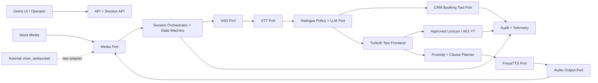
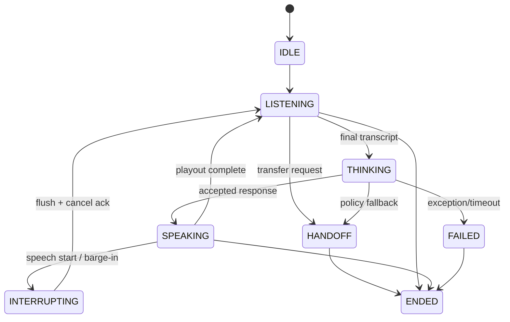

# Mimarî Master Planı — FreyaTTS Otomotiv Voice AI

## 0. Karar özeti ve doğrulama statüsü

Mimarî-önce, **ses-testleri-en-son** geliştirme ilkesi kabul edilmiştir. Bu doküman, 31.10.2026 tarihli kullanıcı klasör taslağı (12–15 ana klasör; src/audio/dialog/nlp/tts/telephony/voiceops/telemetry), önceki Freya araştırması ve A01-YT v0.5 ile 320-vaka test paketinden türetilmiş bir **önerilen sistem tasarımıdır**. Yapılmış gerçek GPU/TTS, gerçek çağrı, gerçek klip veya konuşmacı benzerliği testi ima etmez.

## 1. Kullanıcılar ve ürünün işlevsel kapsamı

- **Müşteri:** Arayan veya izinli süreçte aranan kişi; AI kimliği açıkça belirtilir; araç bilgisi sorabilir, fiyat kaynağını öğrenebilir, müsaitliği sorgulayabilir, randevu talebi oluşturabilir, temsilciye aktarım isteyebilir.
- **İşletme operatörü:** İşletme kataloğu, otomotiv sözlüğü, sözlü izin ve veri kaynağı politikalarını yönetir; çağrılara ve müdahale gerektiren taleplere bakar.
- **Telaffuz inceleyicisi:** Kaynak videosu + zaman aralığı + transkript + telaffuz önerisini görür; onay/red kararı verir; model sözlüğü yalnızca onaydan sonra güncellenir.
- **Teknik yönetici:** Sağlık, bağlantı, kuyruk, güvenlik, TTS/LLM model sürümleri ve gecikme bütçesini görür.

**İlk simüle senaryo:** Randevu müsaitliği sorgulama ve açık onaydan sonra randevu talebi. Doğrudan CRM'e yazma, gerçek müşteriyi arama ve gerçek kişisel veri nihai saha kabulünden önce YOK.

## 2. Mimari stil

**Modüler monolit + port-adapter (hexagonal) + async olay orkestrasyonu.** Başlangıçta ayrı Python mikroservisleri, dağıtık broker, Kubernetes veya sürekli çalışma gerektiren bulut altyapısı kurulmuyor. Sınırlar belli olduğundan ileride TTS/STT/telefon modülleri ayrı sürece taşınabilir.

### Bağımlılık yönü

`domain`/`core` (tipler, olaylar, konuşma durumu, policy) **hiçbir üçüncü taraf model veya telefon kütüphanesini import etmez**. Adaptörler bu portları uygular. API yalnızca uygulama servislerini çağırır. UI, model betiğinin içine yerleştirilmez. `voiceops` kalite ve gözlemleme alanıdır; canlı ses üretimini yönetmez.

## 3. Modül sözleşmeleri ve sahiplik

| Modül | Tek sorumluluk | Port girdi/çıktı | Yan etki |
|---|---|---|---|
| `core/session` | Oturum yaşam döngüsü, versiyonlama, kesme, yeniden bağlanma | `SessionEvent` → `SessionSnapshot` | Yok |
| `media` | PCM formatı, dönüşüm, outbound queue, frame clock | `AudioFrame`, `AudioFormat` | Kuyruk/codec |
| `transport` | Simülatör, WebSocket, Asterisk bağlantıları | `MediaInput/MediaOutput` | Ağ/telefon |
| `speech/vad` | Speech-start/stop kararları | Audio → `VoiceActivity` | Yok |
| `speech/stt` | Partial/final ASR, language tag | Audio → `Transcript` | Yalnız adaptör |
| `dialog` | Diyalog politikası, confirmation, handoff | Transcript + CRM → `AssistantAction` | İzinli tool portları |
| `text` | Sayı/para/tarih + context + sözlük + cümle sınırları | `SpeechText` → `NormalizedUtterance` | Audit trail |
| `speech/tts` | Freya modelinin çevrimdışı yüklemesi ve clause sentezi | `SpeechRequest` → `AudioChunk` | GPU |
| `voiceops` | Kaynak hakları, klip anotasyonları, gözden geçirme, sözlük promotion | `PronunciationEvidence` | SQLite/YAML |
| `telemetry` | PII temizlenmiş loglar ve ölçümler | `Event` → JSON metrik | Log |
| `api` | Dış çağrılar ve operatör arayüzü | JSON/WS | HTTP |
| `security` | Token, rol, izin, saklama, PII | PolicyDecision | Audit |

**Zorunlu tipler:**
- `AudioFormat(sample_rate:int, channels:int, sample_width_bits:int, encoding:Literal["pcm_s16le","float32","alaw","mulaw"]);` örtük resampling yok.
- `AudioFrame(session_id, stream_id, generation_id, seq, sample_count, timestamp_mono_ns, format, payload)`; uygulama seviyesinde 8 kHz ve 16 kHz birbirine karıştırılmaz.
- `Transcript(text, final, confidence, start_ms, end_ms, language, model_version)`; ASR taslağı doğru telaffuz kanıtı değildir.
- `NormalizedUtterance(raw_text, semantic_slots, spoken_text, warnings, applied_rules, lexicon_version)`; müşteriye ait veri değiştirilmez.
- `SpeechRequest(text, voice_profile, checkpoint_hash, inference_params, generation_id)`; `seed=9` yalnızca sabit bir profil parametresi, evrensel ses koruma garantisi değildir.
- `ToolOutcome(status, reference_id, details, idempotency_key)`; işletme eylemi LLM metninden değil gerçek tool sonucundan türetilir.

## 4. Sürüm ve olay modeli

`EventEnvelope`: `schema_version`, `event_id`, `event_type`, `session_id`, `turn_id`, `generation_id`, `sequence`, `occurred_at_utc`, `occurred_mono_ns`, `payload`. Olay şeması `contracts/event.schema.json`. Ölçüm için monotonic saat; audit için UTC kullanılır. Kararlı idempotency key olmadan randevu yazma yok.

### Çağrı durum makinesi

- Her yeni konuşma turu `generation_id` artırır. Eski neslin medya chunk'ları, model sonucu veya CRM cevabı **uygulanmaz**.
- Barge-in sırasında aktif TTS/LLM görevleri iptal edilir; çalma kuyruğu boşaltılır; telefon adaptöründe tampon temizleme komutu sonra uygulanır. Sadece VAD'nin kendi kendine konuşmayı tetiklemesini önlemek için echo/duplex stratejisi ayrı katmandır.
- Kapatma (`hangup`) ve temsilciye aktarım, tekrar çağrılsa bile yan etkileri çoğaltmaz.
- Her timeout ve backpressure için bounded queue / cancellation policy bulunur. Sonsuza dek bekleyen `await` yasak.

## 5. Türkçe ve otomotiv dil katmanı

Sıra: `semantic_span_detection → protected_token_span → domain_number_normalization → suffix_safe_lexicon → vocabulary_validation → clause_planning`. 

- `1250000 ₺` bağlama göre fiyat; `1.5 TSI` motor hacmi; `14:30'da` saat; `34 ABC 123` plaka. Aynı sayı dizisi tek bir genel `regex` ile seslendirilmez.
- Qashqai, Peugeot, Citroën, Škoda **sadece onaylı** `canonical → spoken_tr` kayıtlarından gelir. Belirsiz ek uyumunda hatalı türetmek yerine güvenli yeniden cümleleştirme / `needs_review`.
- FreyaTTS'in kendi normalizer'ı da var. İki kat normalizasyonun bozucu etkileri golden metin seti ile denetlenir. `raw_text` her zaman saklanabilir referans olarak korunur (PII politikası içinde).
- Sözlük kaydı `evidence_id`, `source_id`, `video_start_ms`, `video_end_ms`, `transcript`, `spoken_tr`, `reviewer`, `decision`, `license_scope`, `version`, `approved_at` taşır. YouTube kaynak URL'si kanıtın **kökenidir**, otomatik ses izni veya fonetik doğruluk değildir.
- Freya'nın IPA/fonem girişi native sözleşme olarak varsayılmaz. IPA/espeak yardımcı anotasyon katmanı olabilir.

## 6. Model ve telefon adaptör kararları

**FreyaTTS:** `freyavoiceai/FreyaTTS` kod commit'i ve HF model snapshot hash'i manifestte tutulur; float32 48 kHz mono çıkış kabul edilir. Model paketine doğrudan müdahale edilmez; adapter'da `synthesize_clause` ve gerekiyorsa future batching bulunur. Gerçek sürüm/VRAM/RTF ölçümü sadece en sondaki ses kabulünde yapılır.

**STT / LLM / VAD:** Sahte implementasyonlar ilk sürümde kullanılır; gerçek faster-whisper, Silero VAD, yerel/bulut LLM ancak nihai medya entegrasyonuna geçildiğinde çalıştırılır. Düşük VRAM için aynı GPU'da hepsinin aynı anda çalışacağı varsayılmaz.

**Asterisk:** Öncelik desteklenen sürümde `chan_websocket`, JSON kontrolleri (sürüm uygunluğu en son gerçek ortamda doğrulanır), `MEDIA_START` codec müzakeresi, `FLUSH_MEDIA` kesme davranışı. Alternatif `AudioSocket`. WebSocket protokolünü uygulama orkestrasyonuna gömmeyin. `chan_websocket` Asterisk tarafında yeniden çerçeveleme ve zamanlama yönetir; bu özellik tek başına uçtan uca düşük gecikmeyi kanıtlamaz.

## 7. Güvenli iş akışları

- `available` ≠ `booked`. Randevu kesinleşmiş denmesi için araç çağrısı sonucunda `status=confirmed` ve `reference_id` gerekir.
- Oturumun tamamı kapatılınca müşteri verisi, bellek içi buffer ve görevler temizlenir. Loglarda telefon/isim/fiyat gibi hassas alanların tam kopyası bulunmaz.
- Gerçek çağrılar açıldığında AI kimliği, KVKK aydınlatma, yasal arama yetkisi, veri saklama politikası, rıza yönetimi, yetkili insan devri ayrı kabul kalemidir.
- Harici CRM/tool whitelist, negatif yetki, ajan prompt injection ve çifte rezervasyon ihtimali için güvenli onay kapısı.
- İnternetten gelen transkriptler ve kaynak açıklamaları güvenilmez veri olarak yorumlanır; API anahtarı ve sistem talimatı olamaz.

## 8. UI/UX planı (ses çalışmadan önce)

Üç panelli operatör alanı: **sol** oturumlar / durum, **orta** canlı diyalog akışı ve ses olmadan simüle edilen tur olayları, **sağ** normalization (ham → işlenmiş) / sözlük incelemesi / gecikme olayları. Ayrı ekranlar: telaffuz review queue, kaynak/izin kaydı, ayarlar/health, senaryo ve regresyon sonuçları. Tüm bekleme/boş/hata durumları gerçekçi metinle gösterilir; sahte ses performansları gerçek ölçüm gibi sunulmaz.

## 9. Tek süreçten üretime doğru

- `Windows + Python 3.11` geliştirici ortamı, yerel SQLite ve json golden metinler.
- Uygulama çekirdeği CPU'da çalışır; GPU sadece Freya adaptörünün gerçekte açıldığı son aşamada devreye girer.
- Sonraki dağıtım: Asterisk Linux üzerinde (WSL2/Docker/ayrı sunucu); Windows uygulamasına taşıma protokolüyle bağlanır.
- Klasör sayısını metrik olarak optimize etmeyin; **arayüzlerin istikrarı**, bakım ve regresyon kapsamı başarı kriteridir.

## 10. Bu dokümanın sınırları

A00–A01'de daha önce raporlanan metin testleri, gerçek Freya WAV veya doğrulanmış telefon kalite sonucu olarak yorumlanmaz. A01-YT kaynak sahipleri için kullanıcı tarafından bildirilen sözlü izin meta veridir; ses kliplerinin gerçekten işlendiği anlamına gelmez. Mimari ve sahte testler ses kalitesini sertifikalandırmaz.
